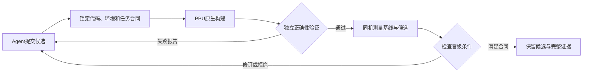

# Resume brief: 理解KDA设计并提炼PPU实现

- **Thread ID:** `01a18a74-7c7a-7660-aa08-04b02a0305f7`
- **Started / last event:** 2026-10-30 01:40 UTC → 2026-11-10 06:18 UTC
- **Working dir:** `/root`
- **Model:** gpt-6-astra  ·  **Source:** vscode  ·  **Codex CLI:** 0.166.0
- **Original rollout:** `/root/.codex/sessions/2026/10/30/rollout-2026-10-30T09-37-32-01a18a74-7c7a-7660-aa08-04b02a0305f7.jsonl`
- **Subagents spawned:** 0 (not exported)

Full transcript: [2026-10-30_01a18a74_理解KDA设计并提炼PPU实现.md](../transcripts/2026-10/2026-10-30_01a18a74_理解KDA设计并提炼PPU实现.md)

## How to continue this work in Devin

1. Open the original working directory (or its equivalent) shown above.
2. Start Devin there and say: `Read <path to this file> and continue the task from where it stopped. Verify the current state of the repo before changing anything.`
3. Devin cannot replay Codex's encrypted reasoning or compacted context; treat this brief + the transcript as the source of truth and re-check facts against the code.

## Original request

我希望你根据我本地的历史，以及memory和skills，编写kda，ignore我们之前的kda的提交，这个压根不合理。我需要你从我的历史的memory中的linear attention，flash attention，quactlize，sage attention，以及其他的算子中提取出来。注意我们是PPU，所以和nvidia有所不同。注意写法要按照kda的写法，不要自己随意写。之前的commit可以回退。先理解kda的设计

## Follow-up requests (chronological)

2. (2026-10-30 01:42 UTC) 需要acu和asys的mcp吗？你先看看kda需要不需要
3. (2026-10-30 01:43 UTC) 这是我们的ppu自有工具链
4. (2026-10-30 01:44 UTC) 对应的kda中的文档都要想想怎么适配到ppu，如果不需要适配也可以
5. (2026-10-30 01:59 UTC) 上传
6. (2026-10-30 02:00 UTC) main去掉我们的自己添加的commit，然后sync fork，然后我们的ppu rebuild rebase到sync的main
7. (2026-10-30 02:03 UTC) skill太多了，你这里dummy都添加了，另外这些skill我也是要放到repo中，这些skill放到repo的都需要仔细看一下。对比kda原始的写法。我们有很多是冗余的，跟kda无关的都要删掉。
8. (2026-10-30 02:03 UTC) 我说的是repo里面的删掉
9. (2026-10-30 02:05 UTC) 很多比较有效的，比如cute的精度debug，以及ppu的ptx硬件差别。这些我觉得比较有用，需要放过去，你需要按照类似的逻辑一个个判断，需要加进去的才放过去。按照你是一个使用kda的agent，需要写或者迁移nvidia的kernel的逻辑思考哪些知识需要。而不是全部放过去，尤其是很多只有我们这几个repcai用的，什么quactlize budget之类的。。。。
10. (2026-10-30 02:06 UTC) nvidia的skills有一些也是有效的。不要都删掉，我们是nvidai兼容的，架构也差不多。
11. (2026-10-30 02:07 UTC) 你要思考你需要哪些信息，以及kda中nvidai的卡都包含了哪些信息，然后你根据这些你需要的，去memory和skill中找，找不到的总结给我
12. (2026-10-30 02:07 UTC) 另外actlize和cutlass的区别也在memory中。
13. (2026-10-30 02:19 UTC) 1.0不需要了？
14. (2026-10-30 02:20 UTC) skills/ppu-kernel-knowledge/references/sources.md 我要在其他的机器呢？这个里面的很多就不存在了吧？
15. (2026-10-30 02:30 UTC) 缺了哪些材料？
16. (2026-10-30 02:33 UTC) 我希望的是直接在810上跑，直接能够kda优化某个kernel或者迁移某个nvidia的kernel到ppu
17. (2026-10-30 02:44 UTC) sources里面不要出现我的github repo，如果需要某些markdown，直接放到当前的kda repo
18. (2026-10-30 02:44 UTC) 另外有一些actlize之类的有开源的版本，不要用我的fork版本
19. (2026-10-30 03:52 UTC) 我上传了PPU架构与NVIDIA_SM对照的markdown，你可以参考
20. (2026-10-30 03:58 UTC) 你提出你的问题，我去问内网的agent，读取我们自己的perf model。然后回复你
21. (2026-10-30 06:18 UTC) https://developer.t-head.cn/docs_center/doc_list/index.html 这里有很多问题的答案。你可以阅读一下。
22. (2026-10-30 06:19 UTC) https://developer.t-head.cn/docs_center/doc_detail/index.html?projectId=39&chapterId=612
23. (2026-10-30 06:20 UTC) https://developer.t-head.cn/docs_center/doc_detail/index.html?projectId=48
24. (2026-10-30 06:20 UTC) https://developer.t-head.cn/docs_center/doc_detail/index.html?projectId=1
25. (2026-10-30 10:00 UTC) 现在已经可以直接到机器上实际让这个kda开发算子了吗
26. (2026-11-02 01:40 UTC) 提取一下kda的整个repo的结构，画一个图
27. (2026-11-02 09:21 UTC) 直接svg吧
28. (2026-11-02 09:28 UTC) 放到root目录
29. (2026-11-02 09:35 UTC) 从写一个新的kernel开始画一个流程图，最终会发生哪些事情？
30. (2026-11-02 09:39 UTC) KDA仓库结构我想要的是原始的非PPU的结构。这个也给我svg
31. (2026-11-02 09:51 UTC) 如果是提升一个已有kernel的性能呢？
32. (2026-11-02 09:54 UTC) 而且目标机器如果是zw890，你这边还适用吗？
33. (2026-11-02 09:58 UTC) inspect ppu吧，其他的命名也参考这个修改
34. (2026-11-02 10:19 UTC) 如果我想要用kda去优化某个算子，需要怎么跟local的agent说
35. (2026-11-02 10:22 UTC) 假设是优化890上的fa的dense shape下的tensor利用率。
36. (2026-11-02 11:01 UTC) 什么时候会去reference我们自己的优化的kernel的经验
37. (2026-11-02 11:56 UTC) 同样的，把ppu的挪到forgekernel这个repo
38. (2026-11-02 11:56 UTC) https://github.com/DrXuQian/ForgeKernel 推送
39. (2026-11-02 12:07 UTC) 可以适配到ppu 吗
40. (2026-11-02 12:53 UTC) 还有多久
41. (2026-11-02 12:57 UTC) =================================== FAILURES =================================== ______________________ test_public_ffn[10-separate-dense] ______________________ package = PosixPath('/workspace/kpack-ffn-accuracy.vA3esJ91/package') sdk = <quactlize.runtime.native.SDK object at 0x7fb1ddf41e80>, kind = 0 merged = False, q = 10 @pytest.mark.parametrize('kind', [0, 1], ids=['dense', 'moe']) @pytest.mark.parametrize('merged', [False, True], ids=['separate', 'canonical-2n']) def test_public_ffn(package, sdk, kind, merged, q): > run_ffn(package, sdk, kind, merged, q) tests/ppu/test_ffn_library.py:23: _ _ _ _ _ _ _ _ _ _ _ _ _ _ _ _ _ _ _ _ _ _ _ _ _ _ _ _ _ _ _ _ _ _ _ _ _ _ _ _ got = array([[ 1.19 …
42. (2026-11-02 12:58 UTC) 颤过了，不是给你的
43. (2026-11-02 13:08 UTC) 给我promtp
44. (2026-11-02 23:04 UTC) 同样的逻辑给forgekernel画图，三个图
45. (2026-11-04 01:18 UTC) KDA的代码过程画一个动图吧。希望尽可能多的cover到所有的设计模块。并且要准确。忽略ppu部分。
46. (2026-11-04 01:54 UTC) 感觉上还是不对，太抽象了，以一个具体的kernel作为例子呢？然后查询的内容有哪些
47. (2026-11-10 01:47 UTC) 帮我按照kda的要求申请平头哥AI算力资源申请汇报模板，修改这个ppt，注意最后一页不写，另外风险应该也不用谢，第一页就直接在上面改。
48. (2026-11-10 01:55 UTC) 申请主要是token，参考最新上传的几个图片，三张图
49. (2026-11-10 06:10 UTC) KDA如何设计CI
50. (2026-11-10 06:15 UTC) KDA仓库本身有哪些测试能做

## Files edited via apply_patch (most frequent first)

- `/root/marlin_ppu/kda/docs/ppu-adaptation.md` ×11
- `/root/marlin_ppu/kda/skills/ppu-kernel-knowledge/references/sources.md` ×7
- `/root/marlin_ppu/kda/skills/ppu-kernel-knowledge/SKILL.md` ×7
- `/root/marlin_ppu/kda/README.md` ×6
- `/root/marlin_ppu/kda/skills/ppu-kernel-knowledge/references/architecture.md` ×6
- `/root/marlin_ppu/ForgeKernel/src/forgekernel/loop/driver.py` ×6
- `/root/marlin_ppu/ForgeKernel/src/forgekernel/loop/agent_policy.py` ×6
- `/root/marlin_ppu/kda/skills/ppu-kernel-knowledge/references/cutlass-porting.md` ×5
- `/root/marlin_ppu/kda/AGENTS.md` ×5
- `/root/marlin_ppu/kda/docs/zw810.md` ×5
- `/root/marlin_ppu/ForgeKernel/src/forgekernel/ppu.py` ×5
- `/workspace/kda-animation-20261104/model.py` ×5
- `/root/marlin_ppu/kda/skills/ppu-kernel-knowledge/references/linear-attention.md` ×4
- `/root/marlin_ppu/kda/skills/ppu-kernel-knowledge/references/sage-attention.md` ×4
- `/root/marlin_ppu/kda/skills/ppu-kernel-knowledge/references/quantization.md` ×4
- `/root/marlin_ppu/kda/THIRD_PARTY_NOTICES.md` ×4
- `/root/marlin_ppu/kda/docs/ppu-tooling.md` ×4
- `/root/marlin_ppu/kda/docs/ppu.md` ×4
- `/root/marlin_ppu/ForgeKernel/src/forgekernel/card_template/eval/ppu_profile.py` ×4
- `/root/marlin_ppu/ForgeKernel/src/forgekernel/taskcard.py` ×4
- `/root/marlin_ppu/ForgeKernel/tests/test_ppu.py` ×4
- `/workspace/kda-animation-20261104/generate.py` ×4
- `/root/marlin_ppu/kda/skills/ppu-kernel-knowledge/references/numerics.md` ×3
- `/root/marlin_ppu/kda/docs/agent-flow.md` ×3
- `/root/marlin_ppu/kda/scripts/inspect_zw810.py` ×3
- `/root/marlin_ppu/kda/prompts/zw810.md` ×3
- `/root/marlin_ppu/kda/tests/test_inspect_zw810.py` ×3
- `/root/marlin_ppu/kda/skills/ppu-kernel-knowledge/references/memory-hierarchy.md` ×3
- `/root/marlin_ppu/kda/skills/ppu-kernel-knowledge/references/official-docs.md` ×3
- `/root/marlin_ppu/kda/scripts/inspect_ppu.py` ×3
- `/root/marlin_ppu/ForgeKernel/src/forgekernel/card_template/eval/leaderboard.py` ×3
- `/root/marlin_ppu/ForgeKernel/src/forgekernel/launch.py` ×3
- `/root/marlin_ppu/ForgeKernel/meta/ppu/distill_blackbox_prompt.md` ×3
- `/root/marlin_ppu/ForgeKernel/meta/ppu/distill_prompt.md` ×3
- `/root/marlin_ppu/ForgeKernel/docs/ppu.md` ×3
- `/workspace/forgekernel-diagrams-20261103/generate.py` ×3
- `/workspace/kda-fa-case-20261104/story.py` ×3
- `/workspace/kda-resource-request-20261110/edit_presentation.py` ×3
- `/workspace/kda-ppu-rebuild-20261030/source/prompts/basic-flow.md` ×2
- `/workspace/kda-ppu-rebuild-20261030/source/README.md` ×2
- `/workspace/kda-ppu-rebuild-20261030/source/CONTRIBUTING.md` ×2
- `/workspace/kda-ppu-rebuild-20261030/source/docs/ppu-tooling.md` ×2
- `/workspace/kda-ppu-rebuild-20261030/source/docs/ppu-adaptation.md` ×2
- `/workspace/kda-ppu-rebuild-20261030/source/.github/PULL_REQUEST_TEMPLATE/wishlist.md` ×2
- `/workspace/kda-ppu-rebuild-20261030/source/skills/asys-report-skill/references/timeline.md` ×2
- `/workspace/kda-ppu-rebuild-20261030/source/skills/acu-report-skill/SKILL.md` ×2
- `/workspace/kda-ppu-rebuild-20261030/source/skills/acu-report-skill/references/collection.md` ×2
- `/workspace/kda-ppu-rebuild-20261030/source/skills/ppu-kernel-knowledge/references/sources.md` ×2
- `/root/marlin_ppu/kda/docs/ppu-artifacts.md` ×2
- `/root/marlin_ppu/kda/skills/ppu-kernel-knowledge/references/integration.md` ×2
- `/root/marlin_ppu/kda/skills/ppu-profiling/SKILL.md` ×2
- `/root/marlin_ppu/kda/prompts/README.md` ×2
- `/root/marlin_ppu/kda/skills/ppu-profiling/references/metrics.md` ×2
- `/root/marlin_ppu/kda/skills/ppu-profiling/references/analysis.md` ×2
- `/root/marlin_ppu/kda/skills/ppu-kernel-knowledge/references/tix-porting.md` ×2
- `/workspace/kda-diagrams-20261102/generate_optimization.py` ×2
- `/root/marlin_ppu/ForgeKernel/skills/ppu-kernel-knowledge/references/forge-integration.md` ×2
- `/root/marlin_ppu/ForgeKernel/skills/README.md` ×2
- `/root/marlin_ppu/ForgeKernel/src/forgekernel/loop/lang_mode.py` ×2
- `/root/marlin_ppu/ForgeKernel/src/forgekernel/loop/cli.py` ×2

## Last assistant conclusions

### 2026-11-10 02:01 UTC

已修改原 PPT，并另存了 [KDA申请版](/root/平头哥AI算力资源申请汇报_KDA.pptx)｜[PDF预览](/root/平头哥AI算力资源申请汇报_KDA.pdf)。

按三张图写为 **500M Token/月（5亿）**，首期建议2个月，PPU复用现有环境。第一页直接修改，风险内容已替换，最后一页完全未动。

汇报人、团队仍待填写；0.5人月/月列为预期目标，ROI待核算。

### 2026-11-10 06:13 UTC

建议把 KDA 的 CI 分成三层：**框架自检、Agent 能力回归、kernel 验收**。

你本地这版还没有 CI workflow，已有测试主要覆盖设备探测和导出器。下面是建议设计，沿用 KDA“工作流与算子工作区分开”的原则。[现有流程](/root/marlin_ppu/kda/docs/agent-flow.md)

| 层次 | 验证什么 | 触发时机 | Token 消耗 |
|---|---|---|---|
| KDA 仓库 CI | Python 测试、文档链接、skill 格式、来源与版本引用 | 每个 PR | 无 |
| Agent 回归评测 | prompt、skill、模型变化后，是否仍能正确完成固定任务 | 相关变更、定时或手动 | 有，单独限额 |
| 算子 CI | 原生构建、数值正确性、性能回归、产物可复现 | 候选提交、合并前、夜间回归 | 构建与测试本身不消耗 Token |

**最关键的是第三层：Agent 提交候选，CI 独立验收，再把结果反馈给 Agent。**



以你关注的 **890 上 dense FA 优化**为例，具体这样运行：

1. **锁定任务。** 明确 shape、dtype、layout、mask、误差标准、计时范围和 cache 策略；记录基线 commit、候选 diff、实际设备及 SDK。测试和容差不能随着候选改动被悄悄放宽。
2. **构建并真正执行。** `inspect_ppu.py` 成功只证明环境查询成功；CI 还必须确认目标 kernel 编译、加载并运行，不能误用旧二进制。
3. **验证正确性。** 使用独立参考，覆盖目标 shape，以及这次改动影响的尾块、stride、状态或重复调用场景。数值失败直接阻止晋级。
4. **比较性能。** 同一张卡、同一环境、同一口径运行基线和候选，交错重复测量，保留原始样本。阈值根据任务目标和基线噪声设定。
5. **解释差异。** 需要定位原因时采 ACU/Asys；干净计时与 profiler 分开。tensor 利用率提高，但目标耗时变差，不能算优化成功。
6. **归档证据。** 保存源码和二进制摘要、环境、验证结果、`benchmark.csv`、`candidates.jsonl` 和原始报告。设备不可用或结果受干扰，应标为未完成，不能记作通过。

810、890应分别维护基线。性能 runner 需要统一的设备预约或锁，保证测试时没有其他作业干扰。

**第二层要测“Agent 是否还能完成任务”，不能只检查 SKILL.md 能否解析。** 可以先准备几个小而固定的回归题：

- 修复一个已知的 layout/精度错误，通过冻结的数值测试。
- 根据给定 ACU 报告，定位瓶颈并提出可验证的候选。
- 查询迁移知识，正确区分 NVIDIA 与对应代际 PPU 的适用条件。

记录任务通过率、错误修改、完成时间，以及**每个成功任务的 Token 消耗**。模型输出有波动，应在固定起点和预算下重复评测；候选是否正确仍由测试决定。

结合这次 Token 申请，建议常规 PR 跑确定性检查，把模型调用集中到 Agent 回归和实际开发任务。每次 Agent 评测设置最大轮次、时间及 Token 预算，额度耗尽就留下未完成状态和证据。

落地可以采用 **GitHub Actions 的可复用 workflow＋内网 PPU runner**：KDA 提供通用检查模板，各算子仓库提供自己的构建、验证和 benchmark 命令。[可复用工作流文档](https://docs.github.com/en/actions/how-tos/reuse-automations/reuse-workflows) 多个仓库共享设备时，还要有统一设备队列；仓库内的 `concurrency` 不能替代这一层。[并发控制文档](https://docs.github.com/en/actions/how-tos/write-workflows/choose-when-workflows-run/control-workflow-concurrency)

第一版优先跑通 **KDA 自身检查＋一个 dense FA 任务的 890 验收链**，再扩展算子、设备和 Agent 回归集。

### 2026-11-10 06:18 UTC

**KDA 仓库本身可以测工具可靠性、知识包完整性，以及 prompt/skill 的行为回归。大部分检查不需要 GPU，也不消耗 Token。**

我刚实际跑了你当前分支：**44 项通过，1 项跳过**。

| 现有测试 | 具体覆盖 | 本次结果 |
|---|---|---|
| [HF 导出器](/root/marlin_ppu/kda/tests/test_export_huggingface.py) | import 改写、嵌套入口、同名模块隔离、配置和路径校验、原文件保持不变、失败清理、元数据与文件摘要 | 32 通过，1 跳过 |
| [PPU 环境探测](/root/marlin_ppu/kda/tests/test_inspect_ppu.py) | 拒绝错误或歧义设备记录；构建失败不运行旧二进制；失败不误报成功；不覆盖已有证据；缺 profiler 不掩盖有效设备查询 | 12 通过 |

**原版 main 只有导出器测试，设备探测测试是 PPU 扩展。** 跳过项是真实 `kernel-builder` 的打包、加载和摘要检查，因为当前没有安装该工具。其余导出测试主要模拟构建，设备探测测试模拟工具输出，不能据此宣称真实硬件已验证。

在仓库根目录，使用 Python ≥3.11、安装 pytest 后运行：

```bash
python -m pytest -q -ra tests
```

除了现成测试，以下检查值得加入仓库 CI，**目前尚未实现为完整检查集**：

| 检查 | 应当发现的问题 |
|---|---|
| **文档链接和锚点** | 页面改名后链接失效；skill 指向不存在的 reference；目录索引与实际文件不一致 |
| **Skill 完整性** | frontmatter 缺字段、名称冲突、引用的脚本或资源没有随仓库提交 |
| **知识检索回归** | 固定查询找不到预期主题；page ID 失效；`sources` 无法回溯。先初始化锁定的子模块，再检查其接口 |
| **来源与版本检查** | 引用不存在的来源编号；源码版本无法追溯；更新知识时遗漏相应 provenance |
| **干净 checkout 可用性** | 必需资料依赖作者机器上的 `/root/...`、私有 memory 或全局 skill，换机器就缺失 |
| **工具异常路径** | 命令超时、可执行文件缺失、损坏的 JSON、非 UTF-8 日志、CLI 参数错误没有得到正确处理 |

这里尤其有价值的是**知识包可移植性**：你之前要求“资料随 repo 走”，就应该在没有你的本地 memory 和全局 skills 的环境里检查。当前 checkout 的两个 NVIDIA 知识子模块尚未初始化，因此这次 pytest 没有覆盖它们。

如果还要验证 **“改完 skill，Agent 是否真的会用”**，可以增加少量耗 Token 的行为评测，例如：

- 任务给的是 890，Agent 是否先核对设备，而不是直接套用另一代架构参数。
- 只得到“编译成功”，是否仍明确标注尚未执行 kernel。
- 数值测试失败，是否先修复，而非放宽容差或直接比较性能。
- 查询知识后，是否选用与目标架构、算子语义匹配的来源。

这些应按**工具调用轨迹和最终产物**判定，不要求回答逐字一致。算子专属任务夹具可以外置，由 KDA CI 调用；完整的 kernel 数值和性能回归仍留在算子仓库。
