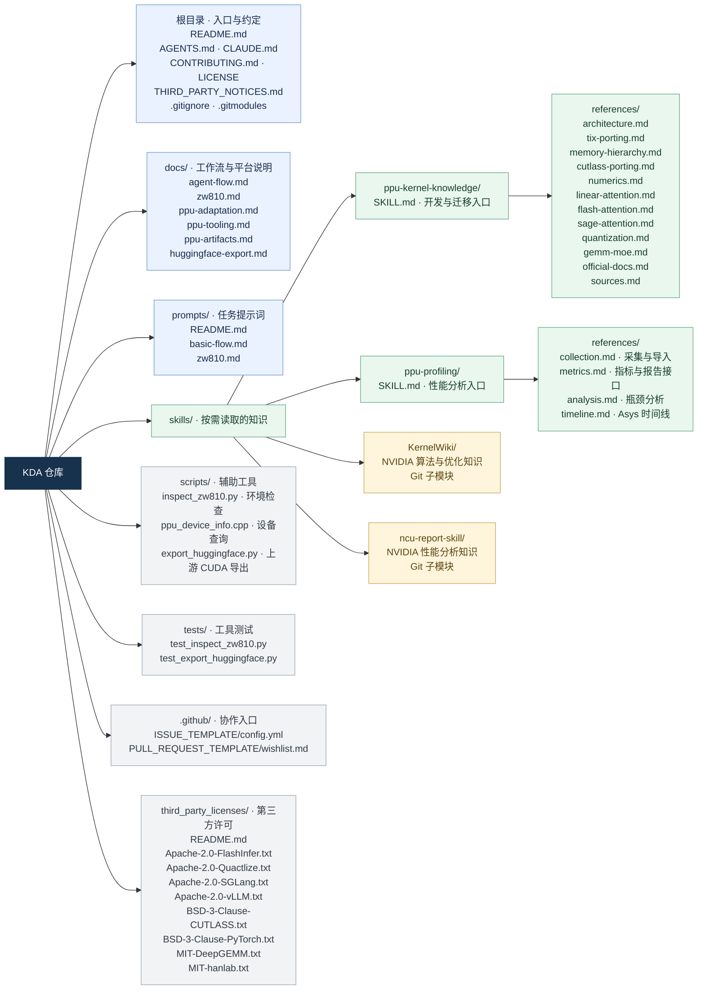
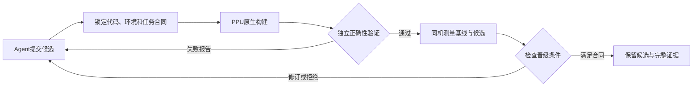

# 理解KDA设计并提炼PPU实现

- **Thread ID:** `01a18a74-7c7a-7660-aa08-04b02a0305f7`
- **Started / last event:** 2026-10-30 01:40 UTC → 2026-11-10 06:18 UTC
- **Working dir:** `/root`
- **Model:** gpt-6-astra  ·  **Source:** vscode  ·  **Codex CLI:** 0.166.0
- **Original rollout:** `/root/.codex/sessions/2026/10/30/rollout-2026-10-30T09-37-32-01a18a74-7c7a-7660-aa08-04b02a0305f7.jsonl`
- **Subagents spawned:** 0 (not exported)

---

## User · 2026-10-30 01:41 UTC

我希望你根据我本地的历史，以及memory和skills，编写kda，ignore我们之前的kda的提交，这个压根不合理。我需要你从我的历史的memory中的linear attention，flash attention，quactlize，sage attention，以及其他的算子中提取出来。注意我们是PPU，所以和nvidia有所不同。注意写法要按照kda的写法，不要自己随意写。之前的commit可以回退。先理解kda的设计

## Assistant · 2026-10-30 01:41 UTC

我会先读本地历史、memory 和相关 PPU skill，确认 KDA 的设计与现有实现规范，再决定如何重写；已有的 KDA 提交先作为待审查内容，不直接沿用。

<details><summary>1 tool call(s)</summary>

- `exec: text(ALL_TOOLS.filter(x=>/memory|history|search|terminal/i.test(x.name+" "+x.description)).map(x=>({name:x.name,description:x.description.slice(0,140)}))); const results = await Promise.allSettled([ tools.exec_command({cmd:"pwd && rg --file …`

</details>

## Assistant · 2026-10-30 01:41 UTC

这次会使用 `ppu17-hopper-porting` skill：保留 KDA 原有的 CUDA/C++、CuTe/CUTLASS 分层和算法，只在有历史证据支持的 PPU 差异处适配。我正在定位有效的历史记录和源码，避免把之前 KDA 的试验产物当成设计依据。

<details><summary>5 tool call(s)</summary>

- `exec: const results = await Promise.allSettled([ tools.exec_command({cmd:"ls -la /root",max_output_tokens:5000}), tools.exec_command({cmd:"ls -la /root/.codex && rg --files --hidden /root/.codex/memories /root/.codex/skills -g '*.md' -g '*.json'  …`
- `exec: const results = await Promise.allSettled([ tools.exec_command({cmd:"python - <<'PY'\nfrom pathlib import Path\nfor base in [Path('/root'),Path('/root/.codex'),Path('/root/.codex/memories')]:\n print('\\n'+str(base))\n if base.exists():\n fo …`
- `exec: const results = await Promise.allSettled([ tools.exec_command({cmd:"python - <<'PY'\nimport sqlite3\nfrom pathlib import Path\np=Path('/root/.codex/memories_1.sqlite')\nc=sqlite3.connect('file:'+str(p)+'?mode=ro',uri=True)\nfor name,sql in  …`
- `exec: const results = await Promise.allSettled([ tools.exec_command({cmd:"cat /root/marlin_ppu/kda/AGENTS.md && git -C /root/marlin_ppu/kda status --short --branch && git -C /root/marlin_ppu/kda log -12 --oneline && git -C /root/marlin_ppu/kda re …`
- `exec: const results = await Promise.allSettled([ tools.exec_command({cmd:"cat README.md docs/agent-flow.md prompts/README.md prompts/basic-flow.md CLAUDE.md","workdir":"/root/marlin_ppu/kda","max_output_tokens":14500}), tools.exec_command({cmd:"c …`

</details>

## Assistant · 2026-10-30 01:41 UTC

已确认这里的 KDA 是 **Kernel Design Agents 工作流框架**。上游的核心是“任务契约 → draft → 可执行计划 → candidate → 验证与测量 → 保留或淘汰”，实现和实验产物放在独立任务目录。之前那次提交把入口收窄成了 Quactlize GEMV 的 overnight 工具；我会按上游结构重新整理，把各算子的 PPU 经验作为可按需读取的知识，而不是让某一个算子的流程代表整个 KDA。

<details><summary>2 tool call(s)</summary>

- `exec: const results = await Promise.allSettled([ tools.exec_command({cmd:"git diff --name-status ef6ce61 e09dd9d && git submodule status && git show ef6ce61:CLAUDE.md && git show ef6ce61:README.md && cat skills/KernelWiki/SKILL.md skills/ncu-repo …`
- `exec: text(ALL_TOOLS.find(x=>x.name==="mcp__codex_apps__github_fetch")); const results = await Promise.allSettled([ tools.exec_command({cmd:"cat /root/.codex/skills/.system/skill-creator/SKILL.md && cat /root/marlin_ppu/kda/.gitmodules && cat /ro …`

</details>

## Assistant · 2026-10-30 01:42 UTC

历史里有几处已经被后续实验纠正的结论：早期 linear attention 的“AIU 接不上中间量”不能再当结构性限制；PPU1.0 的 fragment、swizzle 和 occupancy 经验也不能直接套到 1.7。新知识会写明适用代际、来源和验证范围，并按 KDA 的知识 skill／性能报告 skill 分工组织。我也会用 `skill-creator` 检查这些入口是否简洁、能正确引导后续任务。

<details><summary>3 tool call(s)</summary>

- `exec: const results = await Promise.allSettled([ tools.mcp__codex_apps__github_fetch({url:"https://raw.githubusercontent.com/mit-han-lab/KernelWiki/76d27b56f804e7e7295d4c570e1e5d7eef4b0a75/SKILL.md"}), tools.mcp__codex_apps__github_fetch({url:"ht …`
- `exec: const results = await Promise.allSettled([ tools.exec_command({cmd:"git status --short --branch && git log -4 --oneline && git worktree list && cat docs/PPU_INT8_PORT.md dev/ppu_int8/STATUS.md","workdir":"/root/marlin_ppu/SageAttention","ma …`
- `exec: const results = await Promise.allSettled([ tools.exec_command({cmd:"cat /root/marlin_ppu/quactlize/.codex/skills/ppu-kernel-iteration/SKILL.md && cat /root/marlin_ppu/quactlize/.codex/skills/ppu-kernel-iteration/references/native-lowering.m …`

</details>

## User · 2026-10-30 01:42 UTC

需要acu和asys的mcp吗？你先看看kda需要不需要

## User · 2026-10-30 01:43 UTC

这是我们的ppu自有工具链

## Assistant · 2026-10-30 01:43 UTC

明白，ACU 和 Asys 是 PPU 自有工具链。我先核对 KDA 如何调用 profiler，以及本地 ACU／Asys 已有的采集、报告解析能力，再判断是否需要 MCP 接口；这会直接决定 PPU 版的性能分析 skill 怎么写。

<details><summary>3 tool call(s)</summary>

- `exec: const results = await Promise.allSettled([ tools.exec_command({cmd:"git grep -n -i -E 'mcp|profil|ncu|nsys|tool|skill|humanize' ef6ce61 -- README.md docs prompts CLAUDE.md .gitmodules && rg -n -i 'acu|asys|mcp' docs scripts skills/ppu-* -g  …`
- `exec: const results = await Promise.allSettled([ tools.mcp__codex_apps__github_fetch({url:"https://raw.githubusercontent.com/NVlabs/kda/main/README.md"}), tools.exec_command({cmd:"sed -n '1,240p' tools/asys_kernel_time.py && sed -n '1,200p' tools …`
- `exec: const results = await Promise.allSettled([ tools.exec_command({cmd:"/root/ppu-sdk/2.1.1/asight/bin/acu --version","max_output_tokens":1200}), tools.exec_command({cmd:"/root/ppu-sdk/2.1.1/asight/bin/asys --help","max_output_tokens":2200}), t …`

</details>

## Assistant · 2026-10-30 01:43 UTC

结论已经清楚：**KDA 不依赖 MCP；PPU 版需要 ACU／Asys 的分析能力，MCP 可以作为接入方式。** 上游实际使用的是 `ncu-report-skill`，由 agent 调命令行和 Python 解析报告，没有要求 profiler MCP。

你的本地历史也已有完整入口：ACU 导出计数器 CSV，Asys 导出 SQLite 时间线。两者应分别承担 kernel 内部瓶颈分析和整段调用的时间线分析。下一步会把这层写成 PPU 自有 skill；若已有 MCP，就复用它，否则 CLI 足以支撑 KDA 的迭代闭环。

<details><summary>3 tool call(s)</summary>

- `exec: const results = await Promise.allSettled([ tools.exec_command({cmd:"rg --files /root/ppu-sdk-runtime/ubuntu2404 /root/ppu-sdk-cache/noble-runtime /root/noble-rt -g '*ld-linux*' -g '*libstdc++*' -g '*libc.so*' && sed -n '1,185p' /workspace/f …`
- `exec: const results = await Promise.allSettled([ tools.exec_command({cmd:"/root/ppu-sdk-runtime/ubuntu2404/usr/lib/x86_64-linux-gnu/ld-linux-x86-64.so.2 --library-path /root/ppu-sdk-runtime/ubuntu2404/usr/lib/x86_64-linux-gnu:/root/ppu-sdk/2.1.1/ …`
- `exec: text(await tools.exec_command({cmd:"mkdir -p /workspace/kda-ppu-rebuild-20261030/docs /workspace/kda-ppu-rebuild-20261030/outputs && git worktree add -b ppu-knowledge-rebuild /workspace/kda-ppu-rebuild-20261030/source ef6ce61","workdir":"/r …`

</details>

## Assistant · 2026-10-30 01:44 UTC

本地工具链也核实了：用已有的兼容运行库，ACU 可以正常启动；Asys 明确提供 `profile / export / stats / analyze / compare`。因此当前没有必须增加 MCP 的能力缺口。

我已从旧 KDA 提交之前的基线建立独立分支，按上游原有目录和写法重建。工具层会保留 ACU 与 Asys 的各自语义，知识层则覆盖你提到的几类 attention 和量化算子。

<details><summary>1 tool call(s)</summary>

- `exec: const results = await Promise.allSettled([ tools.exec_command({cmd:"/root/ppu-sdk-runtime/ubuntu2404/usr/lib/x86_64-linux-gnu/ld-linux-x86-64.so.2 --library-path /root/ppu-sdk-runtime/ubuntu2404/usr/lib/x86_64-linux-gnu:/root/ppu-sdk/2.1.1/ …`

</details>

## User · 2026-10-30 01:44 UTC

对应的kda中的文档都要想想怎么适配到ppu，如果不需要适配也可以

## Assistant · 2026-10-30 01:45 UTC

会逐份检查 KDA 的文档和 prompt，记录每份是“适配、保留还是另提供 PPU 对应内容”，并说明原因。流程、证据记录、计划机制可以保留；硬件知识、profiler 操作、指标解释和示例需要按 PPU 改写；许可证和上游贡献约定则保持原意。

<details><summary>6 tool call(s)</summary>

- `exec: const results = await Promise.allSettled([ tools.exec_command({cmd:"cat CONTRIBUTING.md .github/PULL_REQUEST_TEMPLATE/wishlist.md .github/ISSUE_TEMPLATE/config.yml .gitignore third_party_licenses/README.md && git ls-tree -r --name-only HEAD …`
- `exec: const result=await tools.mcp__codex_apps__github_fetch({url:"https://raw.githubusercontent.com/NVlabs/kda/acdd79343c5e9d0c7cb96289f26fd3f1051ce785/docs/huggingface-export.md"}); const s=result.structuredContent;store("kda_hf_export",s);text …`
- `exec: text(await tools.apply_patch("*** Begin Patch\n*** Update File: /workspace/kda-ppu-rebuild-20261030/source/README.md\n@@\n-# Kernel Design Agents\n+# Kernel Design Agents for PPU\n@@\n Kernel Design Agents (KDA) is an agent-centric workflow …`
- `exec: text(await tools.apply_patch("*** Begin Patch\n*** Add File: /workspace/kda-ppu-rebuild-20261030/source/docs/ppu-adaptation.md\n+# PPU adaptation of Kernel Design Agents\n+\n+KDA separates the agent workflow from the implementation workspac …`
- `exec: text(await tools.apply_patch("*** Begin Patch\n*** Add File: /workspace/kda-ppu-rebuild-20261030/source/skills/ppu-kernel-knowledge/SKILL.md\n+---\n+name: ppu-kernel-knowledge\n+description: Research, port and debug PPU kernels using scoped …`
- `exec: text(await tools.apply_patch("*** Begin Patch\n*** Add File: /workspace/kda-ppu-rebuild-20261030/source/skills/ppu-kernel-knowledge/references/quantization.md\n+# Quantization, offline formats and GEMV\n+\n+Sources: [S01, S08](sources.md).  …`

</details>

## Assistant · 2026-10-30 01:50 UTC

逐份适配时还发现，上游新增了 Hugging Face 导出文档，但它的 helper 只接受 Python/JSON 的 CuTe-DSL 源码，不支持我们这些 native PPU C++ 库。我把这项明确列为“保留导出前验证的流程，PPU 交付走各算子现有构建和 ABI 契约”，避免只改硬件名称就声称兼容。

知识页已覆盖 linear attention、FlashAttention、SageAttention、量化/GEMV、GEMM/MoE、数值调试和运行时集成；现在补齐 ACU／Asys 操作说明与来源核对。

<details><summary>11 tool call(s)</summary>

- `exec: text(await tools.apply_patch("*** Begin Patch\n*** Add File: /workspace/kda-ppu-rebuild-20261030/source/skills/acu-report-skill/SKILL.md\n+---\n+name: acu-report-skill\n+description: Analyze PPU ACU kernel reports and design evidence-based  …`
- `exec: text(await tools.exec_command({cmd:"sed -n '1,70p' /root/marlin_ppu/quactlize/LICENSE && sed -n '1,170p' /root/marlin_ppu/memory/quantize-budget-tool.md && sed -n '1,135p' /root/marlin_ppu/memory/quactlize-kpack-loader-contract.md && sed -n …`
- `exec: text(await tools.exec_command({cmd:"python - <<'PY'\nfrom pathlib import Path\nimport hashlib,json,subprocess,datetime\nout=Path('/workspace/kda-ppu-rebuild-20261030/source/skills/ppu-kernel-knowledge/references')\nplan=[\n('S01','Local ope …`
- `exec: const paths=["reference/02-harness-guide.md","reference/04-python-api.md","reference/05-analysis-dimensions.md","reference/06-diagnosis-playbook.md","reference/08-b200-metric-names.md","reference/09-common-issues.md"]; const results=await P …`
- `exec: for (const path of ["reference/05-analysis-dimensions.md","reference/06-diagnosis-playbook.md"]) { const c=load("ncu:"+path); text({path,content:c}); }`
- `exec: const results = await Promise.allSettled([ tools.exec_command({cmd:"python - <<'PY'\nimport csv,re\np='/workspace/kda-ppu-rebuild-20261030/outputs/acu-raw.csv'\nwith open(p) as f:\n r=csv.DictReader(f); row=next(r)\n for term in ['duration' …`
- `exec: const results=await Promise.allSettled([ tools.exec_command({cmd:"rg -n -A 5 -B 3 'time_duration|warps_active|kvd__bytes|l2__bytes|tsm__bank_conflicts|Tensor|tensor|inst_executed' /root/ppu-sdk/2.1.1/asight/sections/SpeedOfLight.section /ro …`
- `exec: const results=await Promise.allSettled([ tools.exec_command({cmd:"rg --files /root/ppu-sdk/2.1.1/asight -g '*.py' -g '*.so' -g '!**/PySide*/**' -g '!**/libQt*/**' | rg '(report|Rule|rules|stats|analy|_acu|_asys)' && rg -n -m 10 'Duration|Ex …`
- `exec: text(await tools.exec_command({cmd:"sed -n '1,110p' /root/ppu-sdk/2.1.1/asight/reports/compute_stats_rules/StatsSassByStall.py && sed -n '1,120p' /root/ppu-sdk/2.1.1/asight/reports/compute_stats_rules/ExportMetricsByKernel.py && sed -n '1,5 …`
- `exec: const results=await Promise.allSettled([ tools.exec_command({cmd:"sed -n '1,108p' /workspace/kda-ppu-rebuild-20261030/outputs/acu-help.txt && rg -n -A 4 -B 2 'output|export|get_identifier|def apply|instruction|sass' /root/ppu-sdk/2.1.1/asig …`
- `exec: text(await tools.exec_command({cmd:"cat /workspace/kda-ppu-rebuild-20261030/outputs/acu-sections.txt && sed -n '215,259p' /workspace/kda-ppu-rebuild-20261030/outputs/acu-help.txt && sed -n '205,250p' /root/ppu-sdk/2.1.1/asight/reports/compu …`

</details>

## Assistant · 2026-10-30 01:54 UTC

已经用一份现有 `.acurep` 实测了报告读取：成功导出 1 个 kernel、658 列数据。一个具体差异是，这份报告的耗时指标叫 `ppu__time_duration.sum`，上游 NCU 示例的 `gpu__time_duration.sum` 并不存在。SDK 还提供自己的 `HgRules` 报告规则接口，这些都会写进适配说明，不能直接照搬 NCU 的 Python API 和指标表。

<details><summary>9 tool call(s)</summary>

- `exec: const results=await Promise.allSettled([ tools.exec_command({cmd:"/root/ppu-sdk-runtime/ubuntu2404/usr/lib/x86_64-linux-gnu/ld-linux-x86-64.so.2 --library-path /root/ppu-sdk-runtime/ubuntu2404/usr/lib/x86_64-linux-gnu:/root/ppu-sdk/2.1.1/as …`
- `exec: text(await tools.apply_patch("*** Begin Patch\n*** Update File: /workspace/kda-ppu-rebuild-20261030/source/docs/ppu-adaptation.md\n@@\n ## Skill correspondence\n+\n+The bundled NCU reference documents were evaluated by responsibility as wel …`
- `exec: text(await tools.exec_command({cmd:"rg -n 'bundled NCU|metric guide|partial capture' docs/ppu-adaptation.md skills/acu-report-skill/SKILL.md skills/acu-report-skill/references/collection.md","workdir":"/workspace/kda-ppu-rebuild-20261030/so …`
- `exec: text(await tools.apply_patch("*** Begin Patch\n*** Update File: /workspace/kda-ppu-rebuild-20261030/source/docs/ppu-adaptation.md\n@@\n ## Skill correspondence\n+\n+The bundled NCU reference documents were evaluated by responsibility as wel …`
- `exec: const paths=["reference/00-directory-layout.md","reference/01-workflow.md","reference/03-collection.md","reference/07-report-template.md"]; const results=await Promise.allSettled(paths.map(async path=>{ const r=await tools.mcp__codex_apps__ …`
- `exec: text(await tools.exec_command({cmd:"python - <<'PY'\nfrom pathlib import Path\nimport hashlib,json\nroot=Path('/workspace/kda-ppu-rebuild-20261030/source')\np=root/'skills/ppu-kernel-knowledge/references/sources.json'\nd=json.loads(p.read_t …`
- `exec: text(await tools.exec_command({cmd:"python - <<'PY'\nfrom pathlib import Path\nimport csv,hashlib,json,re,subprocess\nfrom urllib.parse import unquote,urlsplit\nroot=Path('/workspace/kda-ppu-rebuild-20261030/source')\nfail=[];links=0\nfiles …`
- `exec: text(await tools.exec_command({cmd:"git add -- .github/ISSUE_TEMPLATE/config.yml .github/PULL_REQUEST_TEMPLATE/wishlist.md .gitignore AGENTS.md CLAUDE.md CONTRIBUTING.md README.md THIRD_PARTY_NOTICES.md docs/agent-flow.md docs/ppu-adaptatio …`
- `exec: text(await tools.apply_patch("*** Begin Patch\n*** Update File: /workspace/kda-ppu-rebuild-20261030/source/README.md\n@@\n-[Browse and upvote requests](https://github.com/NVlabs/kda/pulls?q=is%3Apr%20base%3Awishlist), [discuss an idea](http …`

</details>

## Assistant · 2026-10-30 01:57 UTC

文档适配和来源核对已完成：上游核心文档、prompt，以及 NCU skill 的各类参考文档都有对应处理说明。3 个新 skill 校验通过，55 份来源文件的摘要一致；ACU 的 CSV 导出和 `HgRules` 指标／stall 规则也已用现有报告验证。

我正在做最后的链接和差异检查，随后把重写结果放回本地 KDA 仓库的新分支。旧提交会保留在原分支，便于回看。

<details><summary>3 tool call(s)</summary>

- `exec: text(await tools.apply_patch("*** Begin Patch\n*** Update File: /workspace/kda-ppu-rebuild-20261030/source/prompts/basic-flow.md\n@@\n - Objective: '<fill in the user-facing goal>'\n+- Inputs and outputs: '<public entrypoint, logical operat …`
- `exec: text(await tools.exec_command({cmd:"git commit -s -m \"Rebuild PPU KDA around operator knowledge and native profiling\" && git status --porcelain && git show --stat --oneline HEAD","workdir":"/workspace/kda-ppu-rebuild-20261030/source","max …`
- `exec: text(await tools.exec_command({cmd:"python - <<'PY'\nfrom pathlib import Path\nimport datetime,json,subprocess\nroot=Path('/root/marlin_ppu/kda')\nsha=subprocess.check_output(['git','-C',str(root),'rev-parse','HEAD'],text=True).strip()\nass …`

</details>

## Assistant · 2026-10-30 01:58 UTC

已按 KDA 原有结构完成本地重写，分支 `ppu-knowledge-rebuild`，提交 `193942d`。旧提交保留在原 `main`。

- [逐份适配清单](/root/marlin_ppu/kda/docs/ppu-adaptation.md)：说明各文档为何适配或保留。
- [PPU 知识入口](/root/marlin_ppu/kda/skills/ppu-kernel-knowledge/SKILL.md)：涵盖各类 attention、量化、GEMM/MoE，区分 PPU 代际和历史纠正。
- [工具层设计](/root/marlin_ppu/kda/docs/ppu-tooling.md)：ACU 分析 kernel，Asys 分析时间线；**MCP 可选，不是 KDA 必需依赖**。

3 个 skill、81 个本地链接、55 份来源摘要检查通过。ACU 报告及规则解析已实测；Asys 本轮核对了接口，未进行设备采集。

## User · 2026-10-30 01:59 UTC

上传

## Assistant · 2026-10-30 01:59 UTC

我会把 `ppu-knowledge-rebuild` 分支推送到你的 KDA fork，保留现有 `main`，然后核对远端提交。

<details><summary>7 tool call(s)</summary>

- `exec: const results = await Promise.allSettled([ tools.exec_command({cmd:"git status --short --branch && git remote -v && git log -2 --oneline && git show -s --format='%H%n%B' HEAD && cat AGENTS.md","workdir":"/root/marlin_ppu/kda","max_output_to …`
- `exec: text(await tools.write_stdin({session_id:72582,chars:"","yield_time_ms":1000,"max_output_tokens":1500}));`
- `exec: text(await tools.exec_command({cmd:"git push -u origin ppu-knowledge-rebuild","workdir":"/root/marlin_ppu/kda","yield_time_ms":1000,"max_output_tokens":2000}));`
- `exec: text(await tools.write_stdin({session_id:32420,chars:"","yield_time_ms":1000,"max_output_tokens":2000}));`
- `exec: text(await tools.exec_command({cmd:"git ls-remote --heads origin refs/heads/ppu-knowledge-rebuild refs/heads/main && git status --short --branch","workdir":"/root/marlin_ppu/kda","yield_time_ms":1000,"max_output_tokens":1200}));`
- `exec: text(await tools.write_stdin({session_id:12662,chars:"","yield_time_ms":1000,"max_output_tokens":1200}));`
- `exec: text(await tools.exec_command({cmd:"python - <<'PY'\nfrom pathlib import Path\nfrom datetime import datetime, timezone\np=Path('/workspace/kda-ppu-rebuild-20261030/STATUS.md')\ns=p.read_text()\ns=s.replace('- Status: complete locally; no re …`

</details>

## Assistant · 2026-10-30 02:00 UTC

已上传到 [ppu-knowledge-rebuild 分支](https://github.com/DrXuQian/kda/tree/ppu-knowledge-rebuild)，提交 `193942d`，远端校验一致。原 `main` 保留。

## User · 2026-10-30 02:00 UTC

main去掉我们的自己添加的commit，然后sync fork，然后我们的ppu rebuild rebase到sync的main

## Assistant · 2026-10-30 02:00 UTC

我会先备份当前 `main` 和 PPU rebuild 分支，把 fork 的 `main` 同步到上游，再将 rebuild rebase 到新的 `main`，处理冲突并核对后推送。

<details><summary>6 tool call(s)</summary>

- `exec: const results=await Promise.allSettled([ tools.exec_command({cmd:"git status --short --branch && git remote -v && git worktree list && git branch -vv && cat AGENTS.md && cat docs/ppu-adaptation.md","workdir":"/root/marlin_ppu/kda","max_outp …`
- `exec: text(await tools.write_stdin({session_id:71152,chars:"","yield_time_ms":1000,"max_output_tokens":1600})); const r=await tools.mcp__codex_apps__github_get_repo({repository_full_name:"DrXuQian/kda"}); const s=r.structuredContent; if(s){ const …`
- `exec: text(await tools.exec_command({cmd:"python - <<'PY'\nimport datetime,json,subprocess\nfrom pathlib import Path\nrepo=Path('/root/marlin_ppu/kda')\ndef git(*args):return subprocess.check_output(['git','-C',str(repo),*args],text=True).strip() …`
- `exec: text(await tools.write_stdin({session_id:2290,chars:"","yield_time_ms":1000,"max_output_tokens":1600}));`
- `exec: text(await tools.exec_command({cmd:"git fetch --no-tags --no-recurse-submodules origin main ppu-knowledge-rebuild && git log --oneline --left-right main...upstream/main && git diff --stat ef6ce61..upstream/main && git diff ef6ce61..upstream …`
- `exec: const results=await Promise.allSettled([ tools.write_stdin({session_id:67865,chars:"","yield_time_ms":1000,"max_output_tokens":5500}), tools.exec_command({cmd:"python3 --version && git show upstream/main:scripts/export_huggingface.py && git …`

</details>

## Assistant · 2026-10-30 02:01 UTC

上游 `main` 当前是 `acdd793`，新增了 Hugging Face exporter 及测试。我会保留这些上游内容，将 PPU 原生库交付说明放到单独文档中，再完成 rebase。远端两个分支会使用带旧提交校验的推送更新，避免覆盖期间出现的新提交。

<details><summary>5 tool call(s)</summary>

- `exec: text(await tools.exec_command({cmd:"python - <<'PY'\nimport json,subprocess\nfrom pathlib import Path\nroot=Path('/root/marlin_ppu/kda')\ndef git(*a):return subprocess.check_output(['git','-C',str(root),*a],text=True).strip()\nstate=Path('/ …`
- `exec: const results=await Promise.allSettled([ tools.exec_command({cmd:"git status --short && cat docs/huggingface-export.md && sed -n '80,112p' README.md && sed -n '1,65p' skills/ppu-kernel-knowledge/references/sources.json && rg -n 'huggingface …`
- `exec: text(await tools.exec_command({cmd:"python - <<'PY'\nimport datetime,json,subprocess\nfrom pathlib import Path\nroot=Path('/root/marlin_ppu/kda')\nup=subprocess.check_output(['git','-C',str(root),'rev-parse','upstream/main'],text=True).stri …`
- `exec: text(await tools.exec_command({cmd:"git add -- README.md docs/huggingface-export.md docs/ppu-artifacts.md docs/ppu-adaptation.md skills/ppu-kernel-knowledge/references/integration.md skills/ppu-kernel-knowledge/references/sources.md skills/ …`
- `exec: const results=await Promise.allSettled([ tools.exec_command({cmd:"/workspace/kda-main-sync-20261030T020118Z/test-env/bin/python -m pip install --index-url https://pypi.org/simple pytest","workdir":"/root/marlin_ppu/kda","yield_time_ms":1000 …`

</details>

## User · 2026-10-30 02:03 UTC

skill太多了，你这里dummy都添加了，另外这些skill我也是要放到repo中，这些skill放到repo的都需要仔细看一下。对比kda原始的写法。我们有很多是冗余的，跟kda无关的都要删掉。

## User · 2026-10-30 02:03 UTC

我说的是repo里面的删掉

## Assistant · 2026-10-30 02:03 UTC

明白，只清理 KDA repo 内的 skills，不动全局 skills 或其他算子仓库。我会重新对照原始 KDA 的知识与性能分析分工，删掉无关内容、占位内容和重复入口；这轮清理完成后再推送 rebuild。

<details><summary>2 tool call(s)</summary>

- `exec: const results=await Promise.allSettled([ tools.exec_command({cmd:"git status --short --branch && git ls-tree -r --name-only HEAD skills && rg --files --hidden skills && rg -n -i 'dummy|placeholder|fake|stub|TODO|TBD|template|product|packag| …`
- `request_user_input_async: {"questions":[{"title":"你说的 dummy 是 KDA repo 里的哪个文件或目录？当前分支没有这个名称；我会先继续清理已确认的重复入口和无关内容。"}]}`

</details>

## Assistant · 2026-10-30 02:04 UTC

你说的 dummy 是 KDA repo 里的哪个文件或目录？当前分支没有这个名称；我会先继续清理已确认的重复入口和无关内容。

## Assistant · 2026-10-30 02:05 UTC

repo 当前有 3 个 PPU skill 入口和 2 个 NVIDIA skill 子模块。ACU／Asys 的流程说明重复，知识页里也混入了产品发布、运行时集成和量化预算规划内容。

我会按原始 KDA 的两个职责收敛：保留 PPU kernel 知识和 PPU profiling 两个入口，将 ACU／Asys 作为 profiling 下的参考文档；移除 repo 内不使用的 NVIDIA skill 副本，保留来源链接。

## User · 2026-10-30 02:05 UTC

很多比较有效的，比如cute的精度debug，以及ppu的ptx硬件差别。这些我觉得比较有用，需要放过去，你需要按照类似的逻辑一个个判断，需要加进去的才放过去。按照你是一个使用kda的agent，需要写或者迁移nvidia的kernel的逻辑思考哪些知识需要。而不是全部放过去，尤其是很多只有我们这几个repcai用的，什么quactlize budget之类的。。。。

## User · 2026-10-30 02:06 UTC

nvidia的skills有一些也是有效的。不要都删掉，我们是nvidai兼容的，架构也差不多。

## Assistant · 2026-10-30 02:06 UTC

收到，我不会按 NVIDIA／PPU 的名字整包删除。会以“写新 kernel 或迁移 NVIDIA kernel 时，agent 能否直接用上”为标准逐项判断：保留 CuTe 精度调试、PTX／硬件差异，以及 NVIDIA 中可复用的布局、流水线和 profiling 方法；具体指令、资源限制和指标名再标明 PPU 差异。

Quactlize budget、产品分支策略、发布运维和历史任务配置这类项目专用内容会从 repo skills 中去掉。

<details><summary>1 tool call(s)</summary>

- `exec: text(await tools.exec_command({cmd:"git branch backup/kda-before-skill-prune-20261030T020118Z HEAD && wc -l skills/*/SKILL.md skills/*/references/*.md && cat skills/ppu-kernel-knowledge/references/architecture.md skills/ppu-kernel-knowledge …`

</details>

## User · 2026-10-30 02:07 UTC

你要思考你需要哪些信息，以及kda中nvidai的卡都包含了哪些信息，然后你根据这些你需要的，去memory和skill中找，找不到的总结给我

## User · 2026-10-30 02:07 UTC

另外actlize和cutlass的区别也在memory中。

## Assistant · 2026-10-30 02:08 UTC

我会先列出 agent 写新 kernel、迁移 NVIDIA kernel 时需要的信息，再对照 KDA 的 NVIDIA 知识结构逐项查 memory 和 skills：硬件资源、指令与 fragment 布局、内存搬运、同步、CuTe/CUTLASS 接口、数值验证和性能分析。actlize 与 CUTLASS 的差异会单独核对；缺少依据的项会列出来，不用 NVIDIA 的参数代填。

<details><summary>2 tool call(s)</summary>

- `exec: const paths=["references/primer.md","references/schema.md","queries/by-hardware-feature.md"]; const results=await Promise.allSettled([ ...paths.map(async p=>{ const r=await tools.mcp__codex_apps__github_fetch({url:"https://raw.githubusercon …`
- `exec: const results = await Promise.allSettled([ tools.exec_command({cmd:"git status --short --branch",workdir:"/root/marlin_ppu/kda",max_output_tokens:1200}), tools.exec_command({cmd:"cat AGENTS.md",workdir:"/root/marlin_ppu/kda",max_output_toke …`

</details>

## Assistant · 2026-10-30 02:10 UTC

memory 中的 actlize 记录确实有关键差异：同名 CUTLASS schedule 在 PPU 上可能选中 AIU collective，SWZL 和 sub-byte converter 也会改变布局约定。这些会直接影响迁移正确性，我会保留；项目的预算、发布流程和旧性能目标会从 repo skills 中剔除。

<details><summary>4 tool call(s)</summary>

- `exec: text({primer:load("kw:references/primer.md")}); const idx=load("kw:queries/by-hardware-feature.md")||""; text({hardwarePages:[...new Set([...idx.matchAll(/\.\.\/wiki\/hardware\/[^)]+/g)].map(x=>x[0]))]}); const results=await Promise.allSett …`
- `exec: const results=await Promise.allSettled([ tools.exec_command({cmd:"cat .gitmodules skills/ppu-kernel-knowledge/references/architecture.md skills/ppu-kernel-knowledge/references/numerics.md skills/ppu-kernel-knowledge/references/sources.md",w …`
- `exec: const r=await Promise.allSettled([ tools.mcp__codex_apps__github_fetch({url:"https://raw.githubusercontent.com/mit-han-lab/ncu-report-skill/d1887948c7d53690cfe6605f59c1329b8a1c6bb5/blackwell-cuda-programming.md"}), tools.exec_command({cmd:" …`
- `exec: const results=await Promise.allSettled([ tools.exec_command({cmd:"rg --files /root/marlin_ppu/memory /root/.codex/skills /root/.claude/skills | rg -i 'ppu|cutlass|cute|attention|numer|profil|tma|occup|quant|kernel|gemm|hardware|arch|ptx'",m …`

</details>

## Assistant · 2026-10-30 02:11 UTC

对照 KDA 原始 NVIDIA 内容后，筛选范围已经清楚：保留算法、CuTe 布局推导、数值定位和性能诊断方法，再补 PPU 的指令、资源与工具差异。原有 KernelWiki 和 NCU skill 会保留；PPU 知识按需加载，重复的 ACU/Asys 入口会合并。硬件参数表目前只有 PPU0010 的部分依据，1.5/1.7 缺少完整实测表，我会明确列为缺口。

<details><summary>9 tool call(s)</summary>

- `exec: const results=await Promise.allSettled([ tools.exec_command({cmd:"cat /root/marlin_ppu/memory/ppu-swzl-cute-modelable.md /root/marlin_ppu/memory/ppu-marlin-cute-port.md /root/marlin_ppu/memory/ppu-aiu-source-and-asm.md /root/marlin_ppu/memo …`
- `exec: const results=await Promise.allSettled([ tools.exec_command({cmd:"cat /root/.codex/skills/ppu17-hopper-porting/references/hopper-mapping.md",max_output_tokens:3800}), tools.exec_command({cmd:"cat skills/acu-report-skill/references/analysis. …`
- `exec: const results=await Promise.allSettled([ tools.exec_command({cmd:"cat README.md CLAUDE.md docs/agent-flow.md prompts/README.md",workdir:"/root/marlin_ppu/kda",max_output_tokens:6000}), tools.exec_command({cmd:"cat prompts/basic-flow.md docs …`
- `exec: const results=await Promise.allSettled([ tools.exec_command({cmd:"git ls-files",workdir:"/root/marlin_ppu/kda",max_output_tokens:2700}), tools.exec_command({cmd:"sed -n '1,120p' /root/marlin_ppu/memory/ppu17-cutlass3-bf16-gemm.md",max_outpu …`
- `exec: text(await tools.apply_patch("*** Begin Patch\n*** Update File: /root/marlin_ppu/kda/skills/acu-report-skill/references/analysis.md\n*** Move to: /root/marlin_ppu/kda/skills/ppu-profiling/references/analysis.md\n@@\n-## Report in the task w …`
- `exec: const results=await Promise.allSettled([ tools.exec_command({cmd:"git -C /root/marlin_ppu/quactlize/third_party/actlize rev-parse HEAD",max_output_tokens:150}), tools.exec_command({cmd:"sed -n '1,150p' /root/marlin_ppu/quactlize/third_party …`
- `exec: text(await tools.exec_command({cmd:"rg --files /root/marlin_ppu/quactlize/third_party/actlize | rg 'mma_traits.*10000|ppu_mma_builder|mma_aiu_multistage_mixed_input|copy.*swzl|ppu_include|CMakeLists.txt$'","max_output_tokens":2200}));`
- `exec: const results=await Promise.allSettled([ tools.exec_command({cmd:"rg --files /root/marlin_ppu/quactlize/third_party/actlize/include/cute | rg '(mma|copy)_(traits_)?ppu'",max_output_tokens:1000}), tools.exec_command({cmd:"sed -n '415,495p' / …`
- `exec: text(await tools.apply_patch("*** Begin Patch\n*** Update File: /root/marlin_ppu/kda/skills/ppu-kernel-knowledge/references/architecture.md\n@@\n-Sources: [S01, S02, S03, S04, S05, S07, S08](sources.md). Scope: the inspected\n+Sources: [S01 …`

</details>

## Assistant · 2026-10-30 02:13 UTC

已补上几个会直接影响 kernel 迁移的点：n8→n16 MMA 的输出布局、plain ldmatrix 的寄存器顺序、AIU/SWZL 与 converter 的配对关系，以及 actlize builder 的实际派发路径。CuTe 精度 debug 也补充了 iterator 偏移、非连续 fragment、sub-byte 字节步长和异步时序检查。

<details><summary>8 tool call(s)</summary>

- `exec: text(await tools.apply_patch("*** Begin Patch\n*** Delete File: /root/marlin_ppu/kda/skills/ppu-kernel-knowledge/references/sources.md\n*** Add File: /root/marlin_ppu/kda/skills/ppu-kernel-knowledge/references/sources.md\n+# Sources and evi …`
- `exec: const p="/root/marlin_ppu/kda/skills/ppu-kernel-knowledge/references/sources.md"; const old=await tools.exec_command({cmd:"cat "+p,max_output_tokens:6000}); if(old.exit_code!==0)throw Error("source read failed"); const body="# Sources and e …`
- `exec: text(await tools.apply_patch("*** Begin Patch\n*** Update File: /root/marlin_ppu/kda/README.md\n@@\n-| 'skills/acu-report-skill/' | Kernel counters, native instructions and bottleneck analysis. |\n-| 'skills/asys-report-skill/' | Device tim …`
- `exec: text(await tools.apply_patch("*** Begin Patch\n*** Update File: /root/marlin_ppu/kda/docs/ppu-adaptation.md\n@@\n-| 'skills/KernelWiki' | Keep pinned upstream submodule; add 'ppu-kernel-knowledge' | NVIDIA knowledge is useful for a referenc …`
- `exec: text(await tools.exec_command({cmd:"cat docs/ppu-adaptation.md",workdir:"/root/marlin_ppu/kda",max_output_tokens:4200}));`
- `exec: text(await tools.apply_patch("*** Begin Patch\n*** Update File: /root/marlin_ppu/kda/docs/ppu-adaptation.md\n@@\n-| 'skills/KernelWiki' | Keep pinned upstream submodule; add 'ppu-kernel-knowledge' | NVIDIA knowledge is useful for a referenc …`
- `exec: const results=await Promise.allSettled([ tools.exec_command({cmd:"git diff --stat",workdir:"/root/marlin_ppu/kda",max_output_tokens:2500}), tools.exec_command({cmd:"git status --short",workdir:"/root/marlin_ppu/kda",max_output_tokens:1500}) …`
- `exec: const results=await Promise.allSettled([ tools.exec_command({cmd:"python3 - <<'PY'\nfrom pathlib import Path\nimport re, subprocess\nfrom urllib.parse import unquote\nroot=Path.cwd()\npaths=subprocess.check_output(['git','ls-files','--cache …`

</details>

## Assistant · 2026-10-30 02:16 UTC

repo 内已整理为两个 PPU skill 入口：知识和 profiling，两个原始 NVIDIA submodule 保留。测试 32 项通过，1 项因未安装 `kernel-builder` 跳过；本地链接和来源索引检查通过。接下来检查最终提交，并按你的要求更新 fork 的 main 和 rebase 后的 PPU 分支。

<details><summary>6 tool call(s)</summary>

- `exec: text(await tools.apply_patch("*** Begin Patch\n*** Update File: /root/marlin_ppu/kda/skills/ppu-kernel-knowledge/references/cutlass-porting.md\n@@\n-The reviewed PPU3.6 integration uses 'KernelHardwareInfo::sm_count', a\n+The reviewed PPU C …`
- `exec: const checks=await Promise.allSettled([ tools.exec_command({cmd:"git diff --cached --name-status",workdir:"/root/marlin_ppu/kda",max_output_tokens:2000}), tools.exec_command({cmd:"git diff --quiet",workdir:"/root/marlin_ppu/kda",max_output_ …`
- `exec: text(await tools.exec_command({cmd:"git push --atomic --force-with-lease=refs/heads/main:e09dd9d35b8cc99795d46efeacc32604aefedd15 --force-with-lease=refs/heads/ppu-knowledge-rebuild:193942d1cfde897725ee1b79bd6d06ae457513c1 origin refs/heads …`
- `exec: const results=await Promise.allSettled([ tools.write_stdin({session_id:56539,chars:"",max_output_tokens:2500,yield_time_ms:1000}), tools.exec_command({cmd:"cat /workspace/kda-main-sync-20261030T020118Z/state.json",max_output_tokens:2000}),  …`
- `exec: const results=await Promise.allSettled([ tools.exec_command({cmd:"git ls-remote origin refs/heads/main refs/heads/ppu-knowledge-rebuild",workdir:"/root/marlin_ppu/kda",max_output_tokens:600,yield_time_ms:1000}), tools.exec_command({cmd:"git …`
- `exec: const remote=await tools.write_stdin({session_id:87706,chars:"",max_output_tokens:600,yield_time_ms:1000}); text(remote); if(remote.exit_code!==0 || !remote.output.includes("55e3726130b4b70ae2a553cc6479298106c41146") || !remote.output.inclu …`

</details>

## Assistant · 2026-10-30 02:17 UTC

已完成并上传：

- fork `main` 已去掉自加提交，与 upstream `acdd793` 一致。
- [`ppu-knowledge-rebuild`](https://github.com/DrXuQian/kda/tree/ppu-knowledge-rebuild) 已 rebase，当前提交 `55e3726`。
- 清理仅限 repo：保留原有 NVIDIA skills，PPU 收敛为知识、profiling 两个入口，删除重复流程和项目产品化内容。
- 已补充 [actlize/CUTLASS 差异](/root/marlin_ppu/kda/skills/ppu-kernel-knowledge/references/cutlass-porting.md)，保留并加强 CuTe 精度 debug、PTX/fragment、AIU/SWZL 等迁移知识。ACU/Asys 可直接用 CLI，MCP 可选。

对照 NVIDIA 内容后，[仍缺的依据](/root/marlin_ppu/kda/docs/ppu-adaptation.md:69) 包括：

- PPU1.5/1.7 完整的型号资源、缓存、带宽和计算峰值表。
- 原生 PPU1.7 编译及执行证据，部分低精度、cluster、TMEM 等能力契约。
- 各代指令延迟、吞吐及舍入、subnormal、数学函数误差规范。
- PPU CuTe DSL/Triton 的明确版本支持和运行实例。

校验通过；上游测试 **32 passed、1 skipped**，跳过项依赖未安装的 `kernel-builder`。

## User · 2026-10-30 02:19 UTC

1.0不需要了？

## Assistant · 2026-10-30 02:19 UTC

需要，PPU1.0 仍然是当前知识里证据最完整的一代，并没有删掉。刚才只强调了 1.5/1.7 的缺口，容易让人误解。我会把 1.0 已有内容和仍缺的参数也明确列出来。

<details><summary>3 tool call(s)</summary>

- `exec: const results=await Promise.allSettled([ tools.exec_command({cmd:"git status --short --branch",workdir:"/root/marlin_ppu/kda",max_output_tokens:1200}), tools.exec_command({cmd:"cat AGENTS.md",workdir:"/root/marlin_ppu/kda",max_output_tokens …`
- `exec: const results=await Promise.allSettled([ tools.exec_command({cmd:"rg -n -i '72.{0,15}(CU|SM)|\\b(500|1000|2766|1792)\\b|L2.{0,30}(MB|MiB)|LLC.{0,30}(MB|MiB)|[0-9]+.{0,5}(GHz|MHz)' /root/marlin_ppu/memory/ppu-occupancy-limits.md /root/marlin …`
- `exec: text(await tools.apply_patch("*** Begin Patch\n*** Update File: /root/marlin_ppu/kda/docs/ppu-adaptation.md\n@@\n These define the questions to answer for PPU, not values to copy into a PPU card.\n \n+PPU1.0 is a primary target of this coll …`

</details>

## Assistant · 2026-10-30 02:20 UTC

1.0 也需要补齐硬件资料。目前已有 MMA、AIU/SWZL、CuTe 布局和多个算子的实测经验；仍缺统一绑定到具体卡型的缓存、频率、峰值、完整寄存器分配规则和指令数值规范。我已把这一区别写进文档，并保留 memory 中的 72 CU 等历史参数及其适用范围。

<details><summary>2 tool call(s)</summary>

- `exec: text(await tools.apply_patch("*** Begin Patch\n*** Update File: /root/marlin_ppu/kda/docs/ppu-adaptation.md\n@@\n-| Device resources and performance model | PPU0010 occupancy limits, historical card values and ACU resource counterexamples | …`
- `exec: text(await tools.write_stdin({session_id:load("ppu10_push_session"),chars:"",max_output_tokens:1000,yield_time_ms:1000})); text(await tools.exec_command({cmd:"git status --short --branch",workdir:"/root/marlin_ppu/kda",max_output_tokens:600 …`

</details>

## Assistant · 2026-10-30 02:20 UTC

需要，**PPU1.0 仍是重点**。上一条是我漏列了它的资料缺口。

- **已保留**：MMA、AIU/SWZL、actlize/CuTe 差异，以及 attention、GEMM/GEMV、MoE 的实测经验。
- **仍需补齐**：具体卡型的缓存、频率与峰值、完整寄存器分配规则、指令延迟和数值规范。

已修正文档并上传：[2f0e096](https://github.com/DrXuQian/kda/commit/2f0e096)。

## User · 2026-10-30 02:20 UTC

skills/ppu-kernel-knowledge/references/sources.md 我要在其他的机器呢？这个里面的很多就不存在了吧？

## Assistant · 2026-10-30 02:20 UTC

对，当前 `sources.md` 中的本地 memory/skill 路径只能在这台机器追溯，换机器会失效。我会改成：repo 内的知识足够直接使用，可公开追溯的来源链接到固定提交；无法随仓库取得的本地来源明确标注为历史依据，不作为使用前提。

<details><summary>3 tool call(s)</summary>

- `exec: const results=await Promise.allSettled([ tools.exec_command({cmd:"git status --short --branch",workdir:"/root/marlin_ppu/kda",max_output_tokens:1200}), tools.exec_command({cmd:"cat AGENTS.md docs/ppu-adaptation.md skills/ppu-kernel-knowledg …`
- `exec: const results=await Promise.allSettled([ tools.exec_command({cmd:"python3 - <<'PY'\nimport subprocess\nsources=[\n('S04','/root/marlin_ppu/actlizeLA','40776d7f5bc2cf51b7f7d730314f585a1a8fa322',['docs/PPU_RETAINED_PATH.md','docs/PPU_GDN_AIU_ …`
- `exec: const requests=[ ["S07","https://raw.githubusercontent.com/DrXuQian/SageAttention/ab334f8cef77556b3ff455aee0bbd3038de67816/dev/ppu_lowbit/docs/CUTLASS4_NVFP4_AUDIT.md"], ["S08-debug","https://raw.githubusercontent.com/DrXuQian/quactlize/4fb …`

</details>

## Assistant · 2026-10-30 02:22 UTC

已核对：算子仓库里的几份主要文档和 Quactlize skills 能通过固定提交访问，但本地 memory、全局 skills、SDK 检查记录不能这样获取。我会给每类来源指向仓库内已整理的内容，并把正文里“去看某条 memory”的写法改成直接说明结论和适用条件。

<details><summary>4 tool call(s)</summary>

- `exec: const more=[ ["S04-delivery","https://raw.githubusercontent.com/DrXuQian/actlizeLA/40776d7f5bc2cf51b7f7d730314f585a1a8fa322/docs/PPU_GDN_AIU_DELIVERY_AUDIT.md"], ["S04-split","https://raw.githubusercontent.com/DrXuQian/actlizeLA/40776d7f5bc …`
- `exec: const file="/root/marlin_ppu/kda/skills/ppu-kernel-knowledge/references/sources.md"; const old=await tools.exec_command({cmd:"cat "+file,max_output_tokens:7000}); if(old.exit_code!==0)throw Error("Cannot read source index"); const body="# S …`
- `exec: const results=await Promise.allSettled([ tools.exec_command({cmd:"git diff --check",workdir:"/root/marlin_ppu/kda",max_output_tokens:1000}), tools.exec_command({cmd:"python3 /root/.codex/skills/.system/skill-creator/scripts/quick_validate.p …`
- `exec: text(await tools.apply_patch("*** Begin Patch\n*** Update File: /root/marlin_ppu/kda/THIRD_PARTY_NOTICES.md\n@@\n-Their source revisions, included summaries and original-source availability are recorded in\n+Their source revisions, included …`

</details>

## Assistant · 2026-10-30 02:24 UTC

已移除来源索引中的本机文件清单。现在每项都有仓库内阅读入口，外部原文使用固定提交链接，无法取得的原始记录也已明确标注。我用仅含 Git 已跟踪文件的独立导出目录检查了 120 个本地链接和锚点，全部通过；接下来上传这次修正。

<details><summary>2 tool call(s)</summary>

- `exec: const checks=load("portable-final-checks"); if(checks.some(r=>r.status!=="fulfilled"||r.value.exit_code!==0))throw Error("Final checks failed"); for(const cmd of [ "git commit -s -m 'Make PPU knowledge references portable across machines'", …`
- `exec: text(await tools.write_stdin({session_id:load("portability-push-session"),chars:"",max_output_tokens:1200,yield_time_ms:1000})); text(await tools.exec_command({cmd:"git status --short --branch",workdir:"/root/marlin_ppu/kda",max_output_toke …`

</details>

## Assistant · 2026-10-30 02:24 UTC

对，之前那版本地路径换机器会失效。已修正并上传：[e14402f](https://github.com/DrXuQian/kda/commit/e14402f)。

- 使用所需的知识写在 repo 内，按相对链接读取。
- 外部原文改为固定 commit 链接，仅用于追溯。
- 未公开的原始 memory、日志等明确标注，不再要求读取。

换机器 clone `ppu-knowledge-rebuild` 即可使用这些指南，无需复制本机 memory 或全局 skills。运行 kernel 仍需目标机器的 SDK。

已用独立 Git 导出目录验证，120 个本地链接及锚点全部通过。

## User · 2026-10-30 02:30 UTC

缺了哪些材料？

## Assistant · 2026-10-30 02:30 UTC

我会把“知识本身还缺什么”和“已有结论但原始证据没有随仓库提供”分开列清楚，尤其把 PPU1.0 单独说明。

<details><summary>1 tool call(s)</summary>

- `exec: const results=await Promise.allSettled([ tools.exec_command({cmd:"sed -n '65,145p' docs/ppu-adaptation.md",workdir:"/root/marlin_ppu/kda",max_output_tokens:4000}), tools.exec_command({cmd:"cat skills/ppu-kernel-knowledge/references/sources. …`

</details>

## Assistant · 2026-10-30 02:31 UTC

目前缺两类材料。

**一类是还没查齐的技术资料：**

| 材料 | 具体缺什么 |
|---|---|
| **PPU1.0 完整卡型规格** | 已有 warp、shared、寄存器容量和 72 CU 历史配置；仍缺准确的缓存容量、频率、完整资源分配规则，以及不同带宽/峰值数字对应的卡型。 |
| **PPU1.5/1.7 硬件规格** | 各型号的 CU、寄存器、shared/cache、带宽、各 dtype 吞吐和 launch/cluster 限制。 |
| **各代 ISA 与数值规范** | 指令延迟/吞吐、舍入、subnormal/FTZ、累加语义、数学函数误差；现有资料主要覆盖具体算子的验证结果。 |
| **PPU1.7 原生开发与验证材料** | 能生成原生 1.7 代码的 SDK、明确编译目标、最小运行样例，以及相关低精度指令的执行证据。 |
| **可复现的诊断样例** | 关键布局问题的最小 probe、正确输出和错误对照，以及匹配版本的 ACU/Asys 样例报告。结论已有，部分原始实验材料未提供。 |
| **DSL 支持资料，可后补** | PPU CuTe DSL/Triton 的支持版本和运行实例；不影响当前 CUDA/C++ 主线。 |

**另一类是已用于整理知识，但没有随 KDA 提供的原件：**

- S01/S02：原始 memory 和 `ppu-ptx` skill。
- S03/S07：原始 Hopper-porting skill、对应的 PPU CUTLASS 3.6/4.3 厂商源码包。
- S10：SDK 工具本体及原始 profiler 报告。
- S11：本地 mixed-GEMM skill 和部分原始测量记录。

这些原件的**已选知识已写进 repo**；换机器可以阅读，但无法仅靠 KDA 重跑全部历史实验。范围见 [sources.md](/root/marlin_ppu/kda/skills/ppu-kernel-knowledge/references/sources.md)。

优先补 **PPU1.0 卡型规格、ISA/数值规范、关键布局 probe**，它们对当前写 kernel 最直接。

## User · 2026-10-30 02:33 UTC

我希望的是直接在810上跑，直接能够kda优化某个kernel或者迁移某个nvidia的kernel到ppu

## Assistant · 2026-10-30 02:33 UTC

明白，你要的是在 ZW810 上把 KDA 用起来：给一个现有 kernel 或 NVIDIA kernel，agent 能完成构建、正确性验证、profiling 和优化迭代。当前版本还缺经过验证的上机执行入口。我会以 PPU1.0/ZW810 为默认路径检查现有 SDK、构建和采集工具，补齐最小可运行流程；没有实际跑过的环节会明确标出。

<details><summary>2 tool call(s)</summary>

- `exec: const results=await Promise.allSettled([ tools.exec_command({cmd:"pwd",workdir:"/root/marlin_ppu/kda",max_output_tokens:500}), tools.exec_command({cmd:"git status --short --branch",workdir:"/root/marlin_ppu/kda",max_output_tokens:600}), too …`
- `request_user_input_async: {"questions":[{"title":"当前环境只检测到 NVIDIA 设备。你有本次可用的 ZW810 SSH 主机别名和任务目录吗？有的话我可以在 810 上验证流程；没有的话，我会先完成可直接带到 810 使用的仓库入口。"}]}`

</details>

## Assistant · 2026-10-30 02:34 UTC

当前环境只检测到 NVIDIA 设备。你有本次可用的 ZW810 SSH 主机别名和任务目录吗？有的话我可以在 810 上验证流程；没有的话，我会先完成可直接带到 810 使用的仓库入口。

<details><summary>2 tool call(s)</summary>

- `exec: const results=await Promise.allSettled([ tools.exec_command({cmd:"python3 - <<'PY'\nfrom pathlib import Path\nfor p in [Path('/root/AGENTS.md'),Path('/root/marlin_ppu/AGENTS.md')]:\n if p.exists(): print(str(p)+'\\n'+p.read_text())\np=Path( …`
- `exec: const results=await Promise.allSettled([ tools.exec_command({cmd:"cat /root/marlin_ppu/quactlize/tools/box_identity_probe.cpp",max_output_tokens:3800}), tools.exec_command({cmd:"sed -n '1,230p' /root/marlin_ppu/quactlize/tools/probe_box_ide …`

</details>

## Assistant · 2026-10-30 02:35 UTC

当前机器有 PPU SDK，但实际设备是 RTX 4080 SUPER，不能在这里声称完成 810 实测。810 路径可以先做实用化：从目标机查询资源，复用 kernel 项目自己的构建、校验和 benchmark，再用 ACU/Asys 定位问题；不需要等完整硬件手册齐备。KDA 仍保留原来的 agent 工作流，我会补一个轻量环境检查工具和两种直接可用的任务入口。

<details><summary>7 tool call(s)</summary>

- `exec: const results=await Promise.allSettled([ tools.exec_command({cmd:"rg -n 'typedef.*DeviceProp|struct.*DeviceProp|multiProcessorCount|regsPerBlock|regsPerMultiprocessor|sharedMemPerMultiprocessor|l2CacheSize|memoryClockRate|clockRate|maxThrea …`
- `exec: text(await tools.exec_command({cmd:"sed -n '1293,1365p' /root/ppu-sdk/2.1.1/targets/x86_64-linux/include/driver_types.h",max_output_tokens:2200})); text(await tools.exec_command({cmd:"rg -n -- '--version|version' /workspace/kda-ppu-rebuild- …`
- `exec: text(await tools.apply_patch("*** Begin Patch\n*** Add File: /root/marlin_ppu/kda/scripts/ppu_device_info.cpp\n+// SPDX-License-Identifier: Apache-2.0\n+// Query the selected PPU runtime device; this program launches no kernels.\n+#include  …`
- `exec: const results=await Promise.allSettled([ tools.write_stdin({session_id:70847,chars:"",max_output_tokens:1700,yield_time_ms:1000}), tools.exec_command({cmd:"rg --files /workspace/kda-zw810-entry-20261030/host-inspection",max_output_tokens:70 …`
- `exec: const results=await Promise.allSettled([ tools.exec_command({cmd:"cat /workspace/kda-zw810-entry-20261030/host-inspection/device-query-build.log /workspace/kda-zw810-entry-20261030/host-inspection/asys.log",max_output_tokens:2000}), tools.e …`
- `exec: text(await tools.apply_patch("*** Begin Patch\n*** Update File: /root/marlin_ppu/kda/scripts/inspect_zw810.py\n@@\n command = [str(sdk / \"bin/hgcc\"), \"-x\", \"hg\", \"-arch=ppu_10\",\n- \"-DSWITCH_TO_HGGCRT\", \"-std=c++17\", str(DEVICE_ …`
- `exec: text(await tools.apply_patch("*** Begin Patch\n*** Update File: /root/marlin_ppu/kda/README.md\n@@\n [document adaptation map](docs/ppu-adaptation.md) for the scope of this fork.\n \n+For work directly on **ZW810 / PPU1.0**, start with\n+[R …`

</details>

## Assistant · 2026-10-30 02:40 UTC

810 入口和环境检查工具已写好：用户给 kernel 路径与工作负载，agent 在任务仓库里建立 baseline、验证并迭代。检查工具会读取目标机资源，不把其他卡的参数写死。这里的实际检查已准确报出 native runtime 库缺失和 profiler 的 glibc 版本不匹配；这些环境失败不会被记成通过。

<details><summary>3 tool call(s)</summary>

- `exec: text(await tools.apply_patch("*** Begin Patch\n*** Update File: /root/marlin_ppu/kda/README.md\n@@\n [document adaptation map](docs/ppu-adaptation.md) for the scope of this fork.\n \n+For work directly on **ZW810 / PPU1.0**, start with\n+[R …`
- `exec: const results=await Promise.allSettled([ tools.write_stdin({session_id:49208,chars:"",max_output_tokens:2200,yield_time_ms:1000}), tools.exec_command({cmd:"python3 scripts/inspect_zw810.py --sdk /root/ppu-sdk/2.1.1 --out /workspace/kda-zw81 …`
- `exec: const results=await Promise.allSettled([ tools.write_stdin({session_id:89551,chars:"",max_output_tokens:1800,yield_time_ms:1000}), tools.exec_command({cmd:"cat /workspace/kda-zw810-entry-20261030/host-inspection-with-libpath/device-query-bu …`

</details>

## Assistant · 2026-10-30 02:42 UTC

本地检查已完成：40 项测试通过，1 项因缺少 `kernel-builder` 跳过；设备查询源码也通过了 SDK 编译。新增入口没有增加 skill，也没有另造优化调度器，仍由 agent 按 KDA 的 draft → plan → candidate → 验证 → 测量流程工作。尚未验证的是完整链接和真实 ZW810 执行，这台机器缺运行库，也没有 810 设备。

<details><summary>3 tool call(s)</summary>

- `exec: text(await tools.apply_patch("*** Begin Patch\n*** Update File: /root/marlin_ppu/kda/tests/test_inspect_zw810.py\n@@\n-import importlib.util\n+# SPDX-License-Identifier: Apache-2.0\n+import importlib.util\n*** End Patch")); text(await tools …`
- `exec: const results=load("zw810-final-checks"); if(results.some(r=>r.status!=="fulfilled"||r.value.exit_code!==0))throw Error("Final checks failed"); for(const cmd of [ "git commit -s -m 'Add a ZW810 entry for kernel optimization and porting'", " …`
- `exec: text(await tools.write_stdin({session_id:load("zw810-push-session"),chars:"",max_output_tokens:1200,yield_time_ms:1000})); text(await tools.exec_command({cmd:"git status --short --branch",workdir:"/root/marlin_ppu/kda",max_output_tokens:700 …`

</details>

## Assistant · 2026-10-30 02:43 UTC

明白，我之前过于强调补材料了。**目标应是：在 810 上给 agent 一个 kernel，它能按 KDA 流程完成迁移或优化。**

已按这个目标更新并上传：[0d27c8b](https://github.com/DrXuQian/kda/commit/0d27c8b)。

现在从 [810 使用入口](/root/marlin_ppu/kda/docs/zw810.md) 和 [任务 prompt](/root/marlin_ppu/kda/prompts/zw810.md) 开始，提供：

- kernel 路径或入口函数；
- 代表性 shape、dtype；
- 优化现有 PPU kernel，或迁移 NVIDIA kernel。

agent 负责查环境、确定构建和校验命令、建立 baseline，再进行 ACU/Asys 分析和迭代。完整硬件手册不是前置条件。

**尚未完成 810 实机验收。** 本地 40 项测试通过、1 项跳过，查询源码编译通过；当前机器没有 810，不能据此宣称上机流程已经跑通。

## User · 2026-10-30 02:44 UTC

sources里面不要出现我的github repo，如果需要某些markdown，直接放到当前的kda repo

## Assistant · 2026-10-30 02:44 UTC

我会移除 `sources.md` 中指向你其他 GitHub 仓库的链接，把使用这些知识所需的 Markdown 内容精炼后放进当前 KDA，保留必要的来源说明和许可证，不再要求 agent 跳到你的其他仓库读取。

<details><summary>1 tool call(s)</summary>

- `exec: const results=await Promise.allSettled([ tools.exec_command({cmd:"git status --short --branch",workdir:"/root/marlin_ppu/kda",max_output_tokens:800}), tools.exec_command({cmd:"cat AGENTS.md skills/ppu-kernel-knowledge/references/sources.md  …`

</details>

## User · 2026-10-30 02:44 UTC

另外有一些actlize之类的有开源的版本，不要用我的fork版本

## Assistant · 2026-10-30 02:45 UTC

明白，公开依赖优先使用项目官方仓库。actlize 我会核对官方版本的实际接口；你 fork 中才有的修复会整理成本仓库的迁移说明，明确适用条件，不再把 fork 当作默认依赖，也不会把那些改动写成官方已有能力。

<details><summary>4 tool call(s)</summary>

- `exec: text(ALL_TOOLS.filter(t=>/github_fetch$|github_fetch_file$|github_get_repo$|github_search_repositories$/.test(t.name)).map(t=>({name:t.name,description:t.description.slice(0,160)}))); const results=await Promise.allSettled([ tools.mcp__code …`
- `exec: const requests=[ ["actlize-readme","https://raw.githubusercontent.com/t-head/actlize/v1.0.0/README.md"], ["flash-attention","https://github.com/Dao-AILab/flash-attention"], ["sageattention","https://github.com/thu-ml/SageAttention"], ["line …`
- `exec: const rev="cace89de8cb1cfc9345535bdbc1fb5f403bfb01f"; const files=["cmake/PPUToolchain.cmake","include/cutlass/gemm/collective/builders/ppu_mma_builder.inl","include/cutlass/gemm/collective/ppu_mma_aiu_multistage_mixed_input.hpp","include/c …`
- `exec: for(const [p,a,b] of [ ["include/cute/arch/mma_ppu0010.hpp",115,180], ["include/cutlass/gemm/collective/ppu_mma_aiu_multistage_mixed_input.hpp",625,652], ["include/cutlass/gemm/collective/ppu_mma_aiu_multistage_mixed_input.hpp",834,886], [" …`

</details>

## Assistant · 2026-10-30 02:47 UTC

官方 actlize 已确认可用，核对的是 `v1.0.0` 分支上的固定提交。也查到几处必须区分的差异：该版本的 FP16 输出 MMA atom 尚未实现，interleaved mixed-input 路径的 L 步长为零，gs=32 也不能直接套用已有 scale-copy 逻辑。我会把这些写成本仓库内的迁移注意事项，避免仅替换链接后让 agent 误以为官方版本具备你 fork 的全部功能。

<details><summary>3 tool call(s)</summary>

- `exec: const q=load("official-actlize:media/docs/quickstart.md"); text(q?.split("\n").slice(85,140).join("\n")); const p="examples/15_ppu_cute_gemm/CMakeLists.txt"; const r=await tools.mcp__codex_apps__github_fetch({url:"https://raw.githubusercont …`
- `exec: const path="/root/marlin_ppu/kda/skills/ppu-kernel-knowledge/references/sources.md"; const previous=await tools.exec_command({cmd:"cat "+path,max_output_tokens:6500}); if(previous.exit_code!==0)throw Error("source index read failed"); const …`
- `exec: text(await tools.apply_patch("*** Begin Patch\n*** Update File: /root/marlin_ppu/kda/AGENTS.md\n@@\n-Keep required guidance in tracked files with relative links. Use fixed external\n-links for optional provenance; label unavailable original …`

</details>

## Assistant · 2026-10-30 02:51 UTC

已把需要的 GDN 数据契约与搬运分析、SageAttention bridge 校验和低精度格式审计补进现有 references，没有新增 skill。`sources.md` 现在只指向本仓库的 PPU 文档和官方上游；810 入口也改为使用官方 actlize 的固定提交，并说明哪些功能仍需在任务中实现、验证。

<details><summary>3 tool call(s)</summary>

- `exec: text(await tools.apply_patch("*** Begin Patch\n*** Update File: /root/marlin_ppu/kda/skills/ppu-kernel-knowledge/references/sage-attention.md\n@@\n-The reviewed PPU implementation uses INT8 QK, FP16 PV and FP32 accumulation. BF16 input and\ …`
- `exec: text(await tools.apply_patch("*** Begin Patch\n*** Update File: /root/marlin_ppu/kda/skills/ppu-kernel-knowledge/references/linear-attention.md\n@@\n-Gate/beta were '[B,T,Hv]', with gates in natural-log units. Inputs/output were\n-BF16, C64 …`
- `exec: text(await tools.write_stdin({session_id:47928,chars:"",max_output_tokens:1200,yield_time_ms:1000})); const results=await Promise.allSettled([ tools.exec_command({cmd:"git status --short --branch",workdir:"/root/marlin_ppu/kda",max_output_t …`

</details>

## Assistant · 2026-10-30 02:52 UTC

已修改并上传：[260f173](https://github.com/DrXuQian/kda/commit/260f173)。

- `sources.md` 已移除你的个人仓库链接。
- 所需 Markdown 内容已整理进当前 KDA 的 references。
- actlize 改用官方 [`t-head/actlize`](https://github.com/t-head/actlize/tree/cace89de8cb1cfc9345535bdbc1fb5f403bfb01f)，固定到已核对的提交。
- 历史扩展与官方已有能力已明确区分，避免依赖 fork 中才有的修复。

138 个本地链接及锚点、两个 PPU skill 格式检查通过。

## User · 2026-10-30 03:52 UTC

我上传了PPU架构与NVIDIA_SM对照的markdown，你可以参考

## Assistant · 2026-10-30 03:52 UTC

我先找到这份对照 Markdown，核对它与现有 PPU1.0/ZW810、PTX 和 actlize 说明的差异，再把会影响 kernel 迁移或优化的内容补进 KDA。

<details><summary>4 tool call(s)</summary>

- `exec: text(ALL_TOOLS.filter(t=>/upload|attachment|file.*search|search.*file|list.*files|recent.*files/.test(t.name+" "+t.description)).map(t=>({name:t.name,description:t.description.slice(0,200)})).slice(0,80)); const results=await Promise.allSet …`
- `exec: const results=await Promise.allSettled([ tools.exec_command({cmd:"wc -lc '/root/PPU架构与NVIDIA_SM对照.md'",max_output_tokens:600}), tools.exec_command({cmd:"cat '/root/PPU架构与NVIDIA_SM对照.md'",max_output_tokens:16000}), tools.exec_command({cmd:"c …`
- `exec: const r = await tools.exec_command({cmd:"pwd; git status --short --branch; wc -lc /root/PPU架构与NVIDIA_SM对照.md; rg -n '^#{1,4} |^\\|.*(PPU|SM|CU|CUDA|[0-9])' /root/PPU架构与NVIDIA_SM对照.md",workdir:"/root/marlin_ppu/kda",max_output_tokens:6000}); …`
- `exec: const results = await Promise.allSettled([ tools.exec_command({cmd:"sed -n '1,60p' /root/PPU架构与NVIDIA_SM对照.md",max_output_tokens:6000}), tools.exec_command({cmd:"sed -n '61,100p' /root/PPU架构与NVIDIA_SM对照.md",max_output_tokens:4500}), tools.e …`

</details>

## Assistant · 2026-10-30 03:55 UTC

这份对照补上了一个关键区别：图中的 PPU L2 由四个 CU 共享，LLC 才接近 NVIDIA 芯片级 L2 的作用。这会影响 tile 调度、缓存复用和 ACU 流量分析。我会把相关内容整理进仓库；文档没有注明芯片型号，其中的容量和带宽暂时不能当作 810 的规格。

<details><summary>1 tool call(s)</summary>

- `request_user_input_async: {"questions":[{"title":"这份对照中“288GB HBM3、64MB LLC、四个 CU 共享 512KB L2”对应哪个 PPU 型号或代际？文档未标型号，我会先作为型号待确认的架构参考纳入，继续保留 ZW810 的独立验证路径。"}]}`

</details>

## Assistant · 2026-10-30 03:55 UTC

这份对照中“288GB HBM3、64MB LLC、四个 CU 共享 512KB L2”对应哪个 PPU 型号或代际？文档未标型号，我会先作为型号待确认的架构参考纳入，继续保留 ZW810 的独立验证路径。

<details><summary>4 tool call(s)</summary>

- `exec: const results = await Promise.allSettled([ tools.exec_command({cmd:"for p in /AGENTS.md /root/AGENTS.md /root/marlin_ppu/AGENTS.md; do if [ -f \"$p\" ]; then echo \"$p\"; cat \"$p\"; fi; done; rg --files -g AGENTS.md -g SKILL.md -g '*adapta …`
- `exec: const results = await Promise.allSettled([ tools.exec_command({cmd:"sed -n '1,220p' skills/ppu-profiling/references/metrics.md; sed -n '1,200p' skills/ppu-profiling/references/analysis.md",workdir:"/root/marlin_ppu/kda",max_output_tokens:42 …`
- `exec: const results = await Promise.allSettled([ tools.exec_command({cmd:"sed -n '1,180p' docs/agent-flow.md; sed -n '1,160p' skills/ppu-kernel-knowledge/references/quantization.md; sed -n '1,140p' skills/ppu-kernel-knowledge/references/gemm-moe. …`
- `exec: const r=await tools.exec_command({cmd:"rg -n -i 'l1|l2|llc|cache|bandwidth|bank|smsp|warp.scheduler' README.md docs prompts scripts/ppu_device_info.cpp skills/ppu-kernel-knowledge skills/ppu-profiling","workdir":"/root/marlin_ppu/kda","max_ …`

</details>

## Assistant · 2026-10-30 03:56 UTC

现有说明里有两处需要随之修正：不能把 KVD 直接理解成 NVIDIA L1，也不能只按名为“L2”的容量设计冷缓存测试。我会新增一份按需读取的架构参考，并更新 ACU 分析、冷 GEMV 和资源缺口说明，保持现有两个 PPU skill 的结构。

<details><summary>1 tool call(s)</summary>

- `exec: text(await tools.apply_patch("*** Begin Patch\n*** Add File: /workspace/kda-memory-hierarchy-20261030/docs/draft.md\n+# Integrate the uploaded PPU/Hopper comparison\n+\n+Task: bring the decision-changing hardware information from the user-s …`

</details>

## User · 2026-10-30 03:58 UTC

你提出你的问题，我去问内网的agent，读取我们自己的perf model。然后回复你

## Assistant · 2026-10-30 03:58 UTC

我会整理一份可直接转发给内网 agent 的问题清单，优先确认 810 的资源分配、访存层级、指令吞吐和计数器含义，并请它给出 perf model 中的参数位置及适用型号。这样拿到回复后，就能明确补齐 KDA 的设计依据。

<details><summary>4 tool call(s)</summary>

- `exec: text(await tools.apply_patch("*** Begin Patch\n*** Add File: /root/marlin_ppu/kda/skills/ppu-kernel-knowledge/references/memory-hierarchy.md\n+# PPU memory hierarchy and the Hopper comparison\n+\n+Source: [S12](sources.md), adapted from the …`
- `exec: const results = await Promise.allSettled([ tools.exec_command({cmd:"git diff --check; git diff --stat; git diff -- skills/ppu-kernel-knowledge/references/architecture.md skills/ppu-kernel-knowledge/references/quantization.md skills/ppu-prof …`
- `exec: const results = await Promise.allSettled([ tools.exec_command({cmd:"git status --short; sed -n '1,160p' skills/ppu-kernel-knowledge/references/memory-hierarchy.md",workdir:"/root/marlin_ppu/kda",max_output_tokens:4600}), tools.exec_command( …`
- `exec: text(await tools.exec_command({cmd:"git add docs/ppu-adaptation.md docs/zw810.md skills/ppu-kernel-knowledge/SKILL.md skills/ppu-kernel-knowledge/references/architecture.md skills/ppu-kernel-knowledge/references/memory-hierarchy.md skills/p …`

</details>

## Assistant · 2026-10-30 04:01 UTC

图里的可用信息已整理进本地参考。问题清单还会请内网 agent 核实两个容易影响实验结论的点：SDK 的 `l2CacheSize` 究竟指哪一级缓存，以及每线程 186 个寄存器为何曾按接近 256 的占用计费。回复中需要区分模型默认值、硬件规格和实测结果。

<details><summary>6 tool call(s)</summary>

- `exec: text(await tools.exec_command({cmd:"/root/.local/bin/python3.12 - <<'PY'\nfrom pathlib import Path\nimport io, json, re, subprocess, tarfile, tempfile\nfrom urllib.parse import unquote, urlsplit\nrepo=Path.cwd()\ntree=subprocess.check_outpu …`
- `exec: text(await tools.apply_patch("*** Begin Patch\n*** Add File: /workspace/kda-memory-hierarchy-20261030/questions-for-perf-model-agent.zh.md\n+# 给内网 perf model agent 的问题\n+\n+目标：让 KDA agent 在 ZW810（PPU1.0 / PPU0010）上优化 kernel，或将\n+NVIDIA CUDA …`
- `exec: text(await tools.exec_command({cmd:"git diff --cached --stat",workdir:"/root/marlin_ppu/kda",max_output_tokens:1500})); text(await tools.exec_command({cmd:"git commit -s -m \"Document PPU memory hierarchy with scoped hardware evidence\"",wo …`
- `exec: text(await tools.exec_command({cmd:"git push origin ppu-knowledge-rebuild",workdir:"/root/marlin_ppu/kda",yield_time_ms:1000,max_output_tokens:2000}));`
- `exec: text(await tools.write_stdin({session_id:47232,chars:"",yield_time_ms:1000,max_output_tokens:2000}));`
- `exec: text(await tools.exec_command({cmd:"python3 - <<'PY'\nfrom pathlib import Path\nimport json, subprocess\nrepo=Path.cwd()\ndef git(*args):\n return subprocess.check_output(['git',*args],text=True).strip()\nhead=git('rev-parse','HEAD')\nremot …`

</details>

## Assistant · 2026-10-30 04:03 UTC

请让内网 agent **优先针对 ZW810 / PPU1.0 读取实际 perf model**。我整理了[完整可转发问题单](/workspace/kda-memory-hierarchy-20261030/questions-for-perf-model-agent.zh.md)，核心是下面七组问题，前四组优先。

1. **架构图对应哪个型号？**  
   “四 CU 共享 512KB L2、64MB LLC、288GB HBM3”对应哪个芯片、代际和模型配置？哪些结构适用于 810？请给模型版本、配置名和相关参数位置。

2. **occupancy 应当如何准确计算？**  
   CU、PU、WS、WE 的数量和调度关系是什么？CTA、warp、寄存器和 shared 在哪一级分配？请核实历史记录中的 64 warps/CU、131072 个寄存器/CU、256KiB shared/CU，并给出分配取整规则。尤其解释 **186 registers/thread 为什么曾表现出接近按 256 计费的限制**。

3. **KVD、L2、LLC、TSM 的实际结构是什么？**  
   KVD 是否包含缓存，是否另有 L1？各级缓存的容量、共享范围、line/sector、写入和 bypass 策略是什么？SDK 的 **`l2CacheSize` 到底指哪一级、哪个范围**？TSM 的 bank 数、宽度、地址映射，以及普通 load、ldmatrix、ld.swzl 的冲突规则是什么？

4. **带宽和延迟的统计口径是什么？**  
   请分别给 CU↔L2、L2↔Fabric、Fabric↔LLC、LLC↔HBM、执行侧↔TSM 的读写能力、时钟域和延迟。明确单方向还是读写合计、单端口还是全卡。特别核对图中的 **256/64 B/cycle、12TB/s R+W、6TiB/s、20 cycles**，区分传输周期和 load-to-use 延迟。

5. **关键指令的支持、吞吐和精度如何？**  
   FP16/BF16/TF32/INT8 MMA、FMA、convert、exp2/rcp，以及各类搬运指令，分别有什么依赖延迟、发射间隔和流水线争用？官方 actlize 中仍为占位实现的 **FP16 累加 m16n16k16**，硬件和模型实际是否支持？累加、舍入、subnormal/FTZ 等语义是否准确建模？

6. **异步搬运和同步保证是什么？**  
   cp.async、AIU/SWZL 的完成、可见性、wait/barrier 和 stage 复用分别由什么保证？在途请求、异步 group 和 barrier 有哪些限制？模型在哪些地方进行了简化？

7. **计数器与冷缓存实验怎样对应真实硬件？**  
   `kvd__bytes_load_pipe_l2.sum`、`dram__bytes_read.sum` 等统计哪个接口，如何聚合，哪些不能相加？有哪些 LLC 指标？ACU 重放和模型 flush 实际清理哪些缓存？如何确认冷 GEMV 的权重访问确实到达 HBM？模型有哪些已有校准结果？

请它按 **“值或规则｜单位与范围｜适用型号｜配置键/源码位置｜证据类型”** 回复，区分硬件规格、模型参数和实测。必要定义、公式直接写进 Markdown；未建模或未知的项明确标注，方便之后直接纳入 KDA。

你上传的对照已整理进仓库并推送到 `ppu-knowledge-rebuild`，提交 `65d1cf2`；文档链接和 skill 检查通过，型号未明确的数值保留了适用范围说明。

## User · 2026-10-30 06:18 UTC

https://developer.t-head.cn/docs_center/doc_list/index.html 这里有很多问题的答案。你可以阅读一下。

## Assistant · 2026-10-30 06:18 UTC

我会先查看文档中心，优先找能回答 ZW810 的架构、资源分配、指令和 ACU 指标问题的资料，再把确认的内容补进 KDA，并缩小需要问内网 agent 的问题清单。

<details><summary>5 tool call(s)</summary>

- `exec: const found = ALL_TOOLS.filter(x=>/browse|browser|fetch|web|search/i.test(x.name+" "+x.description)); text(found.map(x=>({name:x.name,description:x.description.slice(0,130)})).slice(0,80)); text(await tools.web__run({open:[{ref_id:"https:// …`
- `exec: const results = await Promise.allSettled([ tools.exec_command({cmd:"python3 - <<'PY'\nfrom pathlib import Path\nimport requests\nurl='https://developer.t-head.cn/docs_center/doc_list/index.html'\nr=requests.get(url,timeout=30)\nroot=Path('/ …`
- `exec: const results = await Promise.allSettled([ tools.exec_command({cmd:"python3 - <<'PY'\nfrom pathlib import Path\nimport re,requests\nroot=Path('/workspace/kda-official-docs-20261030')\nu='https://g.alicdn.com/thead-platform-frontend/t-head-d …`
- `exec: text(await tools.exec_command({cmd:"python3 - <<'PY'\nfrom pathlib import Path\nimport re,requests\ns=Path('/workspace/kda-official-docs-20261030/site.js').read_text()\nfor pattern in [r'function Jn\\(',r'Jn=async',r'baseURL',r'api/develope …`
- `exec: const r = await tools.exec_command({cmd:"python3 - <<'PY'\nfrom pathlib import Path\nfrom concurrent.futures import ThreadPoolExecutor\nimport requests,json\nroot=Path('/workspace/kda-official-docs-20261030')\ndef fetch(pid):\n r=requests.g …`

</details>

## Assistant · 2026-10-30 06:19 UTC

已经找到 HGGC 编程指南、TIX 指令指南、算子优化指南和 Asight 文档，网站也保留了 2.1.1 版本。公开资料还提供了官方 FlashAttention、线性注意力和 Triton 适配说明，之前这些部分的缺口需要重新核对；我会区分它们对 810 和 M890 的支持范围。

<details><summary>2 tool call(s)</summary>

- `exec: const r=await tools.exec_command({cmd:"python3 - <<'PY'\nfrom pathlib import Path\nfrom concurrent.futures import ThreadPoolExecutor\nimport json,requests\nroot=Path('/workspace/kda-official-docs-20261030')\ndef fetch(args):\n pid,vid=args\ …`
- `exec: text(await tools.exec_command({cmd:"python3 - <<'PY'\nfrom pathlib import Path\nfrom concurrent.futures import ThreadPoolExecutor\nimport json,requests,hashlib\nroot=Path('/workspace/kda-official-docs-20261030')\nids=['644','645','658','650 …`

</details>

## User · 2026-10-30 06:19 UTC

https://developer.t-head.cn/docs_center/doc_detail/index.html?projectId=39&chapterId=612

## Assistant · 2026-10-30 06:19 UTC

这个链接是 TIX 指令指南，我会优先核对。也找到了对应的 2.1.1 版本，可以对照指令的目标限制、MMA fragment 布局，以及异步搬运和同步语义，避免把新版功能直接套到 810 上。

<details><summary>2 tool call(s)</summary>

- `exec: const results=await Promise.allSettled([ tools.exec_command({cmd:"python3 - <<'PY'\nfrom pathlib import Path\nimport requests,json,hashlib\nroot=Path('/workspace/kda-official-docs-20261030')\nr=requests.get('https://developer.t-head.cn/api/ …`
- `exec: const results=await Promise.allSettled([ tools.exec_command({cmd:"rg -n '^#{1,4} ' chapter-644.md chapter-832.md chapter-734.md","workdir":"/workspace/kda-official-docs-20261030","max_output_tokens":5300}), tools.exec_command({cmd:"rg -n '^ …`

</details>

## User · 2026-10-30 06:20 UTC

https://developer.t-head.cn/docs_center/doc_detail/index.html?projectId=48

<details><summary>2 tool call(s)</summary>

- `exec: const results=await Promise.allSettled([ tools.exec_command({cmd:"sed -n '85,290p' chapter-768.md; sed -n '68,146p' chapter-832.md","workdir":"/workspace/kda-official-docs-20261030","max_output_tokens":4300}), tools.exec_command({cmd:"sed - …`
- `exec: const results=await Promise.allSettled([ tools.exec_command({cmd:"sed -n '8700,8847p' chapter-612.md; sed -n '35,145p' chapter-644.md","workdir":"/workspace/kda-official-docs-20261030","max_output_tokens":3800}), tools.exec_command({cmd:"se …`

</details>

## User · 2026-10-30 06:20 UTC

https://developer.t-head.cn/docs_center/doc_detail/index.html?projectId=1

<details><summary>2 tool call(s)</summary>

- `wait: {"cell_id":"g2:168","max_tokens":8500,"yield_time_ms":1000}`
- `exec: const results=await Promise.allSettled([ tools.exec_command({cmd:"sed -n '1,150p' chapter-612.md; sed -n '6350,6426p' chapter-612.md; sed -n '6784,6883p' chapter-612.md","workdir":"/workspace/kda-official-docs-20261030","max_output_tokens": …`

</details>

## Assistant · 2026-10-30 06:21 UTC

这几份文档已经回答了不少问题：TIX 明确将 810/810E 归为 `ppu001`、M890 归为 `ppu0015`，并给出了两代矩阵指令和 shared memory 分组差异。还有两处需要保留核实：公开指南的寄存器总量写法有冲突，ACU 对 `cache-control none` 的表格和正文也不一致。我会把问题清单收敛到这些具体分歧。

<details><summary>7 tool call(s)</summary>

- `exec: const results=await Promise.allSettled([ tools.exec_command({cmd:"sed -n '1,250p' chapter-721.md; sed -n '1,130p' chapter-709.md","workdir":"/workspace/kda-official-docs-20261030","max_output_tokens":3700}), tools.exec_command({cmd:"sed -n  …`
- `exec: const results=await Promise.allSettled([ tools.exec_command({cmd:"python3 - <<'PY'\nfrom pathlib import Path\nfrom concurrent.futures import ThreadPoolExecutor\nimport requests,json\nroot=Path('/workspace/kda-official-docs-20261030')\ndef f …`
- `exec: const results=await Promise.allSettled([ tools.exec_command({cmd:"sed -n '1051,1091p' chapter-612.md; sed -n '2150,2208p' chapter-612.md; sed -n '3745,3801p' chapter-612.md; sed -n '4165,4210p' chapter-612.md; sed -n '899,923p' chapter-832. …`
- `exec: text(await tools.apply_patch("*** Begin Patch\n*** Add File: /workspace/kda-official-docs-20261030/docs/draft.md\n+# Reconcile KDA knowledge with official T-Head documentation\n+\n+Task: read the public documentation center, especially TIX, …`
- `exec: const results=await Promise.allSettled([ tools.exec_command({cmd:"/root/ppu-sdk/2.1.1/bin/hgcc -x hg -arch=ppu_10 -DSWITCH_TO_HGGCRT -std=c++17 -c tix_f16_mma.cpp -o tix_f16_mma.o","workdir":"/workspace/kda-official-docs-20261030","yield_ti …`
- `exec: text(ALL_TOOLS.filter(x=>/github_(fetch|search_repositories)$/.test(x.name))); text(await tools.write_stdin({session_id:88807,chars:"",yield_time_ms:1000,max_output_tokens:1800})); text(await tools.write_stdin({session_id:34477,chars:"",yie …`
- `exec: const results=await Promise.allSettled([ tools.mcp__codex_apps__github_fetch({url:"https://github.com/t-head/flash-attention-for-sail/blob/v2.8.2/README.md"}), tools.mcp__codex_apps__github_fetch({url:"https://github.com/t-head/pla/blob/v1. …`

</details>

## Assistant · 2026-10-30 06:23 UTC

还有一个关键结果：TIX 文档明确列出了 FP16 累加的 `m16n16k16`。我用本机 SDK 2.1.1 编译了最小探针，反汇编中确实生成了 `v.mma.f16.f16.m16n16k16`。因此，这部分可以从“能力待确认”收敛为 actlize 包装实现的问题；设备数值正确性仍需在 810 上验证。

<details><summary>11 tool call(s)</summary>

- `exec: for(const [i,name] of [[0,"flash"],[1,"pla"]]){ const r=load("official-extra-"+i), s=r?.structuredContent?.content; if(!s){text({name,error:"no content"});continue;} const lines=s.split("\n"); text(name); for(let j=0;j<lines.length;j++)if(/ …`
- `exec: const results=await Promise.allSettled([ tools.exec_command({cmd:"cat skills/ppu-kernel-knowledge/references/cutlass-porting.md; cat skills/ppu-kernel-knowledge/references/numerics.md","workdir":"/root/marlin_ppu/kda","max_output_tokens":54 …`
- `exec: const results=await Promise.allSettled([ tools.mcp__codex_apps__github_fetch({url:"https://api.github.com/repos/t-head/triton-for-sail/commits/main"}), tools.exec_command({cmd:"sed -n '10268,10388p' chapter-612.md; sed -n '1101,1130p' chapt …`
- `exec: text(await tools.apply_patch("*** Begin Patch\n*** Add File: /root/marlin_ppu/kda/skills/ppu-kernel-knowledge/references/official-docs.md\n+# Official PPU documentation and remaining questions\n+\n+Sources: [S13, S14, S15](sources.md). Revi …`
- `exec: text(await tools.exec_command({cmd:"python3 - <<'PY'\nfrom pathlib import Path\nimport re,requests\nroot=Path('/workspace/kda-official-docs-20261030')\ns=(root/'chapter-768.md').read_text()\nu=next(u for u in re.findall(r'!\\[[^\\]]*\\]\\(( …`
- `exec: image((await tools.view_image({path:"/workspace/kda-official-docs-20261030/m890-chip-arch.png"})).image_url);`
- `exec: text(await tools.apply_patch("*** Begin Patch\n*** Update File: /root/marlin_ppu/kda/skills/ppu-kernel-knowledge/references/architecture.md\n@@\n-Sources: [S01, S02, S03, S04, S05, S07, S08, S11, S12](sources.md). Scope: the\n-inspected PPU …`
- `exec: text(await tools.exec_command({cmd:"git diff --stat; sed -n '1,6p' skills/ppu-kernel-knowledge/references/architecture.md; sed -n '1,8p' skills/ppu-kernel-knowledge/references/sage-attention.md","workdir":"/root/marlin_ppu/kda","max_output_ …`
- `exec: text(await tools.apply_patch("*** Begin Patch\n*** Update File: /root/marlin_ppu/kda/skills/ppu-kernel-knowledge/references/architecture.md\n@@\n-Sources: [S01, S02, S03, S04, S05, S07, S08, S11, S12](sources.md). Scope: the\n-inspected PPU …`
- `exec: text(await tools.apply_patch("*** Begin Patch\n*** Update File: /root/marlin_ppu/kda/skills/ppu-kernel-knowledge/references/sources.md\n@@\n | S12 | [PPU memory hierarchy and Hopper comparison](memory-hierarchy.md), [ACU interpretation](../ …`
- `exec: text(await tools.apply_patch("*** Begin Patch\n*** Update File: /root/marlin_ppu/kda/skills/ppu-kernel-knowledge/references/sources.md\n@@\n | S12 | [PPU memory hierarchy and Hopper comparison](memory-hierarchy.md), [ACU interpretation](../ …`

</details>

## Assistant · 2026-10-30 06:30 UTC

我正在把确认的内容放回各主题参考：TIX 指令与同步规则、内存层级、数值语义和 ACU 分析分别归到原有位置。官方 FlashAttention、PLA、Triton 和 CMake 入口也会补上。原先“基本资料缺失”的清单会改成剩余的参数缺口和三处文档冲突。

<details><summary>5 tool call(s)</summary>

- `exec: text(await tools.apply_patch("*** Begin Patch\n*** Update File: /root/marlin_ppu/kda/docs/ppu-tooling.md\n@@\n bundled NCU skill.\n \n+Asight2.2.0 supplies an official Asys MCP through its GUI and the\n+'asys_mcp_server' program. The docume …`
- `exec: const results=await Promise.allSettled([ tools.exec_command({cmd:"git diff --check; git status --short; rg -n 'not established|unestablished|missing|unresolved|unknown|PPU1.7 Hopper path|KVD.*(unknown|not established)|Triton|floating-point| …`
- `exec: text(await tools.apply_patch("*** Begin Patch\n*** Update File: /root/marlin_ppu/kda/skills/ppu-kernel-knowledge/references/architecture.md\n@@\n-Sources: [S01, S02, S03, S04, S05, S07, S08, S11, S12, S13](sources.md). Scope: the\n+Sources: …`
- `exec: text(await tools.exec_command({cmd:"python3 - <<'PY'\nfrom pathlib import Path\np=Path('/workspace/kda-memory-hierarchy-20261030/questions-for-perf-model-agent.zh.md')\np.write_text('''# 阅读公开文档后，仍需内网 perf model 核实的问题\n\n更新时间：2026-10-30。目标仍是 …`
- `exec: const results=await Promise.allSettled([ tools.exec_command({cmd:"git diff --check; git diff --stat; git diff -- docs/zw810.md docs/ppu-adaptation.md skills/ppu-kernel-knowledge/references/architecture.md skills/ppu-kernel-knowledge/referen …`

</details>

## Assistant · 2026-10-30 06:34 UTC

内容已更新，正在做链接、来源和版本范围检查。现在知识库会区分 810 的 `tc01`、M890 的 `tc02` 和历史 1.7 路径；官方后端入口已补齐。内网问题单也已缩短，重点是寄存器容量与计费、awbar 对齐、缓存刷新行为，以及仍缺的型号性能参数。

<details><summary>5 tool call(s)</summary>

- `exec: text(await tools.exec_command({cmd:"git add docs/ppu-adaptation.md docs/ppu-tooling.md docs/zw810.md skills/ppu-kernel-knowledge/SKILL.md skills/ppu-kernel-knowledge/references/architecture.md skills/ppu-kernel-knowledge/references/cutlass- …`
- `exec: text(await tools.exec_command({cmd:"/root/.local/bin/python3.12 - <<'PY'\nfrom pathlib import Path\nimport io,json,re,subprocess,tarfile,tempfile\nfrom urllib.parse import unquote,urlsplit\nrepo=Path.cwd()\ntree=subprocess.check_output(['gi …`
- `exec: text(await tools.exec_command({cmd:"git diff --cached --stat","workdir":"/root/marlin_ppu/kda","max_output_tokens":1600})); text(await tools.exec_command({cmd:"git commit -s -m \"Reconcile PPU guidance with official T-Head manuals\"","workd …`
- `exec: text(await tools.exec_command({cmd:"git push origin ppu-knowledge-rebuild","workdir":"/root/marlin_ppu/kda","yield_time_ms":1000,"max_output_tokens":1500}));`
- `exec: text(await tools.write_stdin({session_id:80519,chars:"",yield_time_ms:1000,max_output_tokens:1500})); text(await tools.exec_command({cmd:"python3 - <<'PY'\nfrom pathlib import Path\nimport subprocess,json,hashlib\nrepo=Path.cwd();work=Path( …`

</details>

## Assistant · 2026-10-30 06:37 UTC

已核对这些入口的关键章节，更新并推送到 `ppu-knowledge-rebuild`，提交 `192ee4d`。

这次补齐了：

- **810/810E 属于 `ppu001`，M890 属于 `ppu0015`**；两代的矩阵指令、AIU、shared 分组规则分别记录。[TIX 指南](https://developer.t-head.cn/docs_center/doc_detail/index.html?projectId=39&chapterId=612)
- 明确了 L1／CE 共享 L2／LLC 层级，以及 KVD、KSD 的缓存角色，修正了此前资料不足的表述。[M890 架构](https://developer.t-head.cn/docs_center/doc_detail/index.html?projectId=48)
- 补入官方 FlashAttention、PLA、Triton、cmake-hgcc 入口，以及 ACU Python 接口和可选的官方 Asys MCP。[仓库文档索引](/root/marlin_ppu/kda/skills/ppu-kernel-knowledge/references/official-docs.md)

另外，FP16 累加 MMA 已用 SDK2.1.1 编译并确认生成原生指令；尚未做设备数值验证。196 个本地链接及两个 skill 检查通过。

内网问题已收敛到 **VREG 64K/128K、awbar 8/64 字节对齐、`cache-control none` 刷新范围**这三处文档冲突，以及型号性能参数、MMA 数值细节。[更新后的问题单](/workspace/kda-memory-hierarchy-20261030/questions-for-perf-model-agent.zh.md)

## User · 2026-10-30 10:00 UTC

现在已经可以直接到机器上实际让这个kda开发算子了吗

## Assistant · 2026-10-30 10:00 UTC

我再核对一下仓库里的启动入口和依赖要求，明确区分“可以开始开发”和“已经在 810 上完整验证过”。

<details><summary>1 tool call(s)</summary>

- `exec: const results=await Promise.allSettled([ tools.exec_command({cmd:"git status --short --branch; cat prompts/zw810.md; sed -n '1,82p' docs/zw810.md","workdir":"/root/marlin_ppu/kda","max_output_tokens":4600}), tools.exec_command({cmd:"sed -n  …`

</details>

## Assistant · 2026-10-30 10:01 UTC

**可以，已经可以放到 810 上，让编程 agent 按 KDA 流程开发、迁移和优化算子。** 使用 `ppu-knowledge-rebuild` 分支：

```bash
git clone --branch ppu-knowledge-rebuild https://github.com/DrXuQian/kda.git
```

机器上需要可用的 PPU SDK、驱动/runtime，以及能执行 shell 的编程 agent。让 agent 读取 [启动指南](/root/marlin_ppu/kda/docs/zw810.md) 和 [任务提示词](/root/marlin_ppu/kda/prompts/zw810.md)，提供算子源码或参考实现、代表性 shape/dtype、精度与性能目标即可。它会在算子仓库里检查环境、建立基线、制定计划、实现、验证并迭代。**MCP 和原机器上的 memory/global skills 都不是前提。**

目前已完成文档、工具入口和部分原生编译验证，**还没有在真实 810 上完整跑过一个算子的开发闭环**。现在适合开始第一个实机任务；剩余 perf model 问题按实际遇到的优化点核实即可。

## User · 2026-11-02 01:40 UTC

提取一下kda的整个repo的结构，画一个图

## Assistant · 2026-11-02 01:41 UTC

我会读取当前 KDA 仓库的目录和文件，画出完整结构图，并标明工作流、PPU 知识、性能分析工具和保留的 NVIDIA 子模块之间的关系。

<details><summary>2 tool call(s)</summary>

- `exec: const results=await Promise.allSettled([ tools.exec_command({cmd:"git status --short --branch; git ls-files; git submodule status; cat .gitmodules","workdir":"/root/marlin_ppu/kda","max_output_tokens":7200}), tools.exec_command({cmd:"cat AG …`
- `exec: text(await tools.exec_command({cmd:"python3 - <<'PY'\nfrom pathlib import Path\nfrom collections import Counter\nimport shutil,subprocess\nrepo=Path.cwd()\nentries=[line.split('\\t',1) for line in subprocess.check_output(['git','ls-files',' …`

</details>

## Assistant · 2026-11-02 01:42 UTC

当前版本有 51 个文件和 2 个 NVIDIA 子模块入口。结构主要分为文档、任务提示词、两类 PPU skill、辅助脚本和测试；算子实现与运行报告放在独立任务仓库中。我会保留完整文件树，并用图展示这些目录的用途。

<details><summary>1 tool call(s)</summary>

- `exec: text(await tools.exec_command({cmd:"python3 - <<'PY'\nfrom pathlib import Path\nimport json,subprocess\nrepo=Path('/root/marlin_ppu/kda')\nout=Path('/workspace/kda-repo-map-20261102');out.mkdir(exist_ok=True)\nrows=subprocess.check_output([ …`

</details>

## Assistant · 2026-11-02 01:43 UTC

按当前 `ppu-knowledge-rebuild @ 192ee4d` 提取，共 **51 个文件、2 个 Git 子模块**。



使用关系是：**prompts 定义任务 → agent 按 docs 执行流程 → 按需读取 skills、调用 scripts → 在独立算子仓库中实现、验证和测量。**

两个 NVIDIA 子模块目前在本地未初始化，因此图中只展示入口。算子源码、benchmark 和运行报告属于任务工作区。

[完整目录树](/workspace/kda-repo-map-20261102/repo-tree.txt) · [可编辑 Mermaid 图源](/workspace/kda-repo-map-20261102/repo-structure.mmd)

## User · 2026-11-02 09:21 UTC

直接svg吧

## Assistant · 2026-11-02 09:21 UTC

我把这份结构图生成 SVG，保留完整文件名，并按目录职责分组。

<details><summary>2 tool call(s)</summary>

- `exec: const results=await Promise.allSettled([ tools.exec_command({cmd:"python3 - <<'PY'\nfrom pathlib import Path\nimport shutil, importlib.util, subprocess\nprint('commands', {k:shutil.which(k) for k in ['node','npm','npx','rsvg-convert','inksc …`
- `exec: text(await tools.exec_command({cmd:"python3 - <<'PY'\nfrom pathlib import Path\nimport json, html, xml.etree.ElementTree as ET\nroot=Path('/workspace/kda-repo-map-20261102')\nsnapshot=json.loads((root/'snapshot.json').read_text())\nW,H=1696 …`

</details>

## Assistant · 2026-11-02 09:25 UTC

[查看 / 下载 KDA 仓库结构图（SVG）](/workspace/kda-repo-map-20261102/kda-repo-structure.svg)

## User · 2026-11-02 09:28 UTC

放到root目录

## Assistant · 2026-11-02 09:29 UTC

我把 SVG 放到 `/root/kda-repo-structure.svg`。

<details><summary>1 tool call(s)</summary>

- `exec: text(await tools.exec_command({cmd:"python3 - <<'PY'\nfrom pathlib import Path\nimport shutil\nsrc=Path('/workspace/kda-repo-map-20261102/kda-repo-structure.svg')\ndst=Path('/root/kda-repo-structure.svg')\nif dst.exists() and dst.read_bytes …`

</details>

## Assistant · 2026-11-02 09:29 UTC

已放到 [ /root/kda-repo-structure.svg ](/root/kda-repo-structure.svg)。

## User · 2026-11-02 09:35 UTC

从写一个新的kernel开始画一个流程图，最终会发生哪些事情？

## Assistant · 2026-11-02 09:35 UTC

我会按“从零写一个 kernel”画出完整流程：任务定义、环境检查、实现、正确性验证、性能分析、迭代和交付，并把失败后的处理路径也标出来。SVG 会放到 `/root`。

<details><summary>1 tool call(s)</summary>

- `exec: const results=await Promise.allSettled([ tools.exec_command({cmd:"cat docs/agent-flow.md prompts/basic-flow.md prompts/zw810.md; cat docs/ppu-artifacts.md","workdir":"/root/marlin_ppu/kda","max_output_tokens":6500}), tools.exec_command({cmd …`

</details>

## User · 2026-11-02 09:39 UTC

KDA仓库结构我想要的是原始的非PPU的结构。这个也给我svg

## Assistant · 2026-11-02 09:39 UTC

明白，仓库结构图改按未加入 PPU 改动的上游 `main` 来画。新的 kernel 流程图也会以 KDA 原始流程为主，把具体硬件和工具作为任务配置。两张 SVG 都放到 `/root`。

<details><summary>1 tool call(s)</summary>

- `exec: const results=await Promise.allSettled([ tools.exec_command({cmd:"git ls-tree -r main; git log -1 --format='%H%n%s%n%cs' main; git remote -v; git show main:.gitmodules","workdir":"/root/marlin_ppu/kda","max_output_tokens":5000}), tools.exec …`

</details>

## Assistant · 2026-11-02 09:43 UTC

原版 `main` 的结构已核对：23 个文件、2 个子模块，没有 PPU 定制目录。流程图会突出两点：新 kernel 先建立正确、可复现的基线，再优化；每个候选都要经过验证和测量，最后决定保留、修改或拒绝。

<details><summary>4 tool call(s)</summary>

- `exec: text(await tools.exec_command({cmd:"python3 - <<'PY'\nfrom pathlib import Path\nimport json,subprocess\nrepo=Path('/root/marlin_ppu/kda')\nout=Path('/workspace/kda-diagrams-20261102');out.mkdir(exist_ok=True)\nrows=subprocess.check_output([ …`
- `exec: text(await tools.apply_patch("*** Begin Patch\n*** Add File: /workspace/kda-diagrams-20261102/generate.py\n+from pathlib import Path\n+import html\n+import json\n+import shutil\n+import xml.etree.ElementTree as ET\n+\n+BASE = Path(__file__) …`
- `exec: text(await tools.exec_command({cmd:"python3 /workspace/kda-diagrams-20261102/generate.py","max_output_tokens":1600}));`
- `exec: text(await tools.exec_command({cmd:"python3 - <<'PY'\nfrom pathlib import Path\nimport json,xml.etree.ElementTree as ET,subprocess\nsnap=json.loads(Path('/workspace/kda-diagrams-20261102/original-snapshot.json').read_text())\nfor name in [' …`

</details>

## Assistant · 2026-11-02 09:48 UTC

两张 SVG 都已放到 `/root`：

- [原始 KDA 仓库结构（非 PPU，main @ acdd793）](/root/kda-original-repo-structure.svg)
- [新 kernel 开发流程：实现、验证、优化与最终交付](/root/kda-new-kernel-flow.svg)

流程图包含失败返修、Keep / Revise / Reject、性能迭代，以及达标交付和受限时的未完成交接。

原来的 `/root/kda-repo-structure.svg` 也已替换为原版结构图。

## User · 2026-11-02 09:51 UTC

如果是提升一个已有kernel的性能呢？

## Assistant · 2026-11-02 09:51 UTC

我会再画一张“优化已有 kernel”的流程图，重点标出原版基线、瓶颈诊断、候选对比，以及优化失败时如何保留原版。SVG 放到 `/root`。

<details><summary>3 tool call(s)</summary>

- `exec: const results=await Promise.allSettled([ tools.exec_command({cmd:"sed -n '1,160p' /workspace/kda-diagrams-20261102/generate.py","max_output_tokens":5200}), tools.exec_command({cmd:"git show main:docs/agent-flow.md; git show main:prompts/bas …`
- `exec: const results = await Promise.allSettled([ tools.exec_command({cmd:"sed -n '1,165p' /workspace/kda-diagrams-20261102/generate.py",max_output_tokens:6500}), tools.exec_command({cmd:"git -C /root/marlin_ppu/kda show main:docs/agent-flow.md",m …`
- `exec: const results = await Promise.allSettled([ tools.exec_command({cmd:"python - <<'PY'\nfrom pathlib import Path\npaths = ['/AGENTS.md', '/root/AGENTS.md', '/workspace/AGENTS.md', '/workspace/kda-diagrams-20261102/AGENTS.md']\nfor name in path …`

</details>

## Assistant · 2026-11-02 09:54 UTC

已对照原版 KDA 的流程：优化已有 kernel 时，要先验证并测量原版，再分析瓶颈、制定计划。图里会区分“原始基线”和“当前最佳版本”，把正确性失败、性能退步、测量不稳定的处理路径都画出来。

## User · 2026-11-02 09:54 UTC

而且目标机器如果是zw890，你这边还适用吗？

## Assistant · 2026-11-02 09:55 UTC

优化流程本身适用于 ZW890；能否直接运行，还要看仓库里的设备识别、编译目标和性能工具是否支持它。我会核对现有的 890 材料，区分通用流程和需要调整的机器配置，同时继续完成 SVG。

<details><summary>4 tool call(s)</summary>

- `exec: const results=await Promise.allSettled([ tools.exec_command({cmd:"rg -n -i 'zw.?890|m.?890|ppu.?1[.]5|ppu15|ppu0015|zw810' /root/marlin_ppu/kda/docs /root/marlin_ppu/kda/prompts /root/marlin_ppu/kda/scripts /root/marlin_ppu/kda/skills/ppu-k …`
- `exec: const results=await Promise.allSettled([ tools.exec_command({cmd:"sed -n '1,180p' /root/marlin_ppu/kda/scripts/inspect_zw810.py",max_output_tokens:4200}), tools.exec_command({cmd:"sed -n '1,120p' /root/marlin_ppu/kda/docs/zw810.md",max_outp …`
- `exec: text(await tools.exec_command({cmd:"python - <<'PY'\nimport json\nfrom urllib.request import urlopen\nfrom pathlib import Path\nfor chapter in (768,612):\n url=f'https://developer.t-head.cn/api/developer/document/chapter/content?chapterId={ …`
- `exec: text(await tools.write_stdin({session_id:27929,chars:"",yield_time_ms:1000,max_output_tokens:2500}));`

</details>

## Assistant · 2026-11-02 09:57 UTC

找到了具体限制：现有 `inspect_zw810.py` 把目标写成了 ZW810，并固定使用 `-arch=ppu_10`，所以目前的执行入口不能直接当作 890 入口。官方文档把真武 M890 列为 `ppu0015`；如果你说的 ZW890 对应它，就需要选用这一代的编译和指令路径，并在实机重新建立基线。SVG 会保留通用闭环，并标明更换机器时必须重新确认这些条件。

## User · 2026-11-02 09:58 UTC

inspect ppu吧，其他的命名也参考这个修改

## Assistant · 2026-11-02 09:58 UTC

我会统一改成 `inspect_ppu.py`，并同步调整任务模板、执行文档、测试和引用。也会去掉入口里固定的 ZW810/PPU1.0 假设，让 agent 根据实际设备和 SDK 选择编译目标；已有的 810、M890 专属知识仍保留明确的适用范围。优化流程 SVG 也会一起完成。

<details><summary>9 tool call(s)</summary>

- `exec: const results=await Promise.allSettled([ tools.exec_command({cmd:"cat /root/marlin_ppu/kda/AGENTS.md /root/marlin_ppu/kda/CLAUDE.md",max_output_tokens:5500}), tools.exec_command({cmd:"cat /root/marlin_ppu/kda/scripts/ppu_device_info.cpp /ro …`
- `exec: const results=await Promise.allSettled([ tools.exec_command({cmd:"cat /root/marlin_ppu/kda/docs/ppu-adaptation.md /root/marlin_ppu/kda/prompts/zw810.md",max_output_tokens:6500}), tools.exec_command({cmd:"rg -n 'hgcc|sdk|host.only' /workspac …`
- `exec: const results=await Promise.allSettled([ tools.exec_command({cmd:"rg --files --hidden --no-ignore /root /usr -g hgcc -g '!node_modules' -g '!site-packages' -g '!proc' -g '!sys' 2>/dev/null",max_output_tokens:1500}), tools.exec_command({cmd: …`
- `exec: text(await tools.exec_command({cmd:"python - <<'PY'\nfrom pathlib import Path\nimport subprocess\nsdk=Path('/root/autodl-tmp/root-relocated/ppu-sdk/2.1.1')\nresult=subprocess.run([str(sdk/'bin/hgcc'),'--help'],capture_output=True,text=True) …`
- `exec: const results=await Promise.allSettled([ tools.exec_command({cmd:"python /workspace/kda-diagrams-20261102/generate_optimization.py",max_output_tokens:1000}), tools.exec_command({cmd:"python - <<'PY'\nfrom pathlib import Path\nimport subproc …`
- `exec: text(await tools.exec_command({cmd:"python - <<'PY'\nfrom pathlib import Path\nimport subprocess\nsdk=Path('/root/autodl-tmp/root-relocated/ppu-sdk/2.1.1')\nout=Path('/workspace/kda-ppu-entry-20261102')\ncommand=[str(sdk/'bin/hgcc'),'-x','c …`
- `exec: const results=await Promise.allSettled([ tools.exec_command({cmd:"python - <<'PY'\nfrom pathlib import Path\nsdk=Path('/root/autodl-tmp/root-relocated/ppu-sdk/2.1.1')\nfor name in ['lib','lib/libhggcrt1.so','lib/libhggc.so','include/hggc_ru …`
- `exec: text(await tools.apply_patch("*** Begin Patch\n*** Update File: /root/marlin_ppu/kda/scripts/inspect_zw810.py\n*** Move to: /root/marlin_ppu/kda/scripts/inspect_ppu.py\n@@\n- \"requested_target\": \"ZW810 / PPU0010\",\n+ \"requested_target\ …`
- `exec: text(await tools.apply_patch("*** Begin Patch\n*** Update File: /root/marlin_ppu/kda/AGENTS.md\n@@\n-For a ZW810 task, start with 'docs/zw810.md' and 'prompts/zw810.md'. Inspect the\n-task repo and resolve its native build, independent orac …`

</details>

## Assistant · 2026-11-02 10:03 UTC

命名和文档引用已统一到 PPU，SVG 也已生成。验证时发现 HGCC 即使编译纯 C++，链接阶段仍会默认走 `ppu001`；我正在去掉环境查询对这条设备链接路径的依赖，确保查询阶段不会暗中固定到 810。

<details><summary>6 tool call(s)</summary>

- `exec: text(await tools.exec_command({cmd:"python - <<'PY'\nimport subprocess\nsdk='/root/autodl-tmp/root-relocated/ppu-sdk/2.1.1'\nr=subprocess.run([sdk+'/bin/hgcc','--help'],capture_output=True,text=True)\nlines=r.stdout.splitlines()\nfor i,line …`
- `exec: text(await tools.apply_patch("*** Begin Patch\n*** Update File: /root/marlin_ppu/kda/scripts/inspect_ppu.py\n@@\n- command = [str(sdk / \"bin/hgcc\"), \"-x\", \"c++\",\n+ command = [str(sdk / \"bin/hgcc\"), \"-x\", \"c++\", \"--no-device-li …`
- `exec: const results=await Promise.allSettled([ tools.exec_command({cmd:"rg --files --hidden --no-ignore /workspace /root/.cache /root/autodl-tmp /opt -g pytest -g '!node_modules' 2>/dev/null",max_output_tokens:1800}), tools.exec_command({cmd:"cat …`
- `exec: const results=await Promise.allSettled([ tools.exec_command({cmd:"/workspace/kda-main-sync-20261030T020118Z/test-env/bin/python -m pytest -q",workdir:"/root/marlin_ppu/kda",max_output_tokens:2500,yield_time_ms:1000}), tools.exec_command({cm …`
- `exec: text(await tools.apply_patch("*** Begin Patch\n*** Update File: /root/marlin_ppu/kda/scripts/inspect_ppu.py\n@@\n-def inspect(sdk: Path, device: int, out: Path, timeout: float) -> dict:\n+def inspect(sdk: Path, device: int, out: Path, timeo …`
- `exec: const results=await Promise.allSettled([ tools.exec_command({cmd:"python - <<'PY'\nfrom pathlib import Path\nimport json, subprocess\nout=Path('/workspace/kda-ppu-entry-20261102')\nr=json.loads((out/'host-query-smoke/environment.json').read …`

</details>

## Assistant · 2026-11-02 10:07 UTC

现在环境查询使用主机 C++ 编译器和 PPU SDK 的运行时接口，不再选择设备 ISA。44 项测试通过，198 个本地文档链接有效；810、M890 的差异仍保留在各自知识条目中。接下来检查最终差异并推送到现有 PPU 分支；本机没有 PPU，890 实机运行仍未验证。

<details><summary>6 tool call(s)</summary>

- `exec: text(await tools.apply_patch("*** Begin Patch\n*** Update File: /root/marlin_ppu/kda/AGENTS.md\n@@\n actual device/generation, then resolve the task's native build, oracle and benchmark. Run\n-the KDA loop on the requested device; general h …`
- `exec: const results=await Promise.allSettled([ tools.exec_command({cmd:"git diff --cached --find-renames -- docs/ppu.md docs/zw810.md prompts/ppu.md prompts/zw810.md scripts/inspect_ppu.py scripts/inspect_zw810.py tests/test_inspect_ppu.py tests/ …`
- `exec: text(await tools.exec_command({cmd:"git commit -s -m \"Generalize the PPU execution entry beyond ZW810\"",workdir:"/root/marlin_ppu/kda",max_output_tokens:2200,yield_time_ms:1000}));`
- `exec: text(await tools.exec_command({cmd:"git push origin ppu-knowledge-rebuild",workdir:"/root/marlin_ppu/kda",max_output_tokens:2200,yield_time_ms:1000}));`
- `exec: text(await tools.write_stdin({session_id:9363,chars:"",yield_time_ms:1000,max_output_tokens:2200}));`
- `exec: const results=await Promise.allSettled([ tools.exec_command({cmd:"git status --short --branch",workdir:"/root/marlin_ppu/kda",max_output_tokens:1000}), tools.exec_command({cmd:"python - <<'PY'\nfrom pathlib import Path\nimport xml.etree.Ele …`

</details>

## Assistant · 2026-11-02 10:09 UTC

已统一为 PPU 命名并推送到 `ppu-knowledge-rebuild`，提交 `5445567`：

- [scripts/inspect_ppu.py](/root/marlin_ppu/kda/scripts/inspect_ppu.py)
- [docs/ppu.md](/root/marlin_ppu/kda/docs/ppu.md)
- [prompts/ppu.md](/root/marlin_ppu/kda/prompts/ppu.md)

测试、README 和 skills 引用已同步更新。环境查询去掉了固定的 `ppu_10`，由 agent 根据实际设备选择 kernel 编译目标，各代架构知识仍保留适用范围。

验证：44 项测试通过、1 项跳过；主机查询源码编译通过。890 实机运行尚未验证。

[已有 kernel 性能优化流程 SVG](/root/kda-existing-kernel-optimization-flow.svg) 也已放到 `/root`。

## User · 2026-11-02 10:19 UTC

如果我想要用kda去优化某个算子，需要怎么跟local的agent说

## Assistant · 2026-11-02 10:19 UTC

我先核对仓库里的 PPU 任务模板，给你一段可以直接发给本地 agent 的指令。

<details><summary>1 tool call(s)</summary>

- `exec: const results=await Promise.allSettled([ tools.exec_command({cmd:"cat /root/marlin_ppu/kda/prompts/ppu.md",max_output_tokens:3500}), tools.exec_command({cmd:"sed -n '1,110p' /root/marlin_ppu/kda/docs/ppu.md",max_output_tokens:4500}), tools. …`

</details>

## Assistant · 2026-11-02 10:21 UTC

在**算子仓库目录**启动本地 agent，让它读取 KDA 的 `ppu-knowledge-rebuild` 分支。可以直接复制下面这段，替换 `<…>`：

```text
请使用 <KDA 仓库绝对路径> 中的 KDA 流程，优化当前仓库里的已有算子，并实际完成优化迭代。

先阅读 KDA 的 docs/ppu.md 和 prompts/ppu.md，遵循当前算子仓库的开发要求。

任务：
- 算子入口：<源码路径、函数名或调用示例>
- 重点 workload：<shape、dtype、layout；也可以指定现有 benchmark/test 文件>
- 目标：降低这些 workload 的完整算子调用延迟。
- 设备：当前机器上分配给我的 PPU，设备编号 <编号>。
- 正确性：保持现有接口、数学语义和精度要求。

按 KDA 流程执行：
1. 检查实现、测试和构建配置，自行找到实际构建、验证及 benchmark 命令。确认设备型号、SDK 和对应编译目标。
2. 保存原版，先验证正确性，再测量原版基线。
3. 按需读取 KDA 中与该算子及目标架构相关的知识，分析瓶颈，写 docs/draft.md 和可执行的 docs/plan.md。
4. 实现候选，先通过独立正确性验证，再与基线做同条件性能比较；需要时使用 ACU/Asys。
5. 根据证据 Keep / Revise / Reject，持续迭代并保留最佳已验证版本。

代码、计划和实验记录都保存在当前算子仓库。
请执行到实现、验证和测量阶段；只有无法从代码和现有资料确定的关键语义或验收条件才询问我。

最终交付代码改动、复现命令、正确性结果、优化前后性能，以及适用范围和未解决的问题。
```

如果只关注某个 kernel 的耗时，把“完整算子调用延迟”改为“指定 kernel 的设备执行延迟”。有明确目标时，可以再写上“重点 workload 至少提升 20%，其他约定 workload 不回退”。

构建命令、SDK 路径和具体使用哪些 skills，可以让 agent 自行检查；你主要提供**算子入口、重点 workload 和优化目标**。

## User · 2026-11-02 10:22 UTC

假设是优化890上的fa的dense shape下的tensor利用率。

## Assistant · 2026-11-02 10:22 UTC

我先核对 FA 和 ACU 的相关知识，把这个目标写成能直接执行、也能衡量收益的任务指令。

<details><summary>1 tool call(s)</summary>

- `exec: const results=await Promise.allSettled([ tools.exec_command({cmd:"cat skills/ppu-kernel-knowledge/references/flash-attention.md",workdir:"/root/marlin_ppu/kda",max_output_tokens:4000}), tools.exec_command({cmd:"cat skills/ppu-profiling/refe …`

</details>

## Assistant · 2026-11-02 10:23 UTC

可以把 **Tensor 利用率作为主目标，正确性和实际延迟作为晋级约束**。直接给本地 agent 这段：

```text
请使用 <KDA 仓库路径> 中的 KDA，优化当前 890 机器上 FlashAttention 在 dense shapes 下的 Tensor 利用率，并实际完成实验迭代。

入口：
- FA 仓库：<路径>
- 重点 workload：<benchmark/test 文件或 shape 列表>
- 使用设备：<分配的设备编号>

先阅读 KDA 的 docs/ppu.md、prompts/ppu.md，按需使用
ppu-kernel-knowledge 和 ppu-profiling，重点阅读 FlashAttention、
目标架构、TIX、数值验证和性能诊断相关知识。

任务合同：
1. 从源码和测试确认 dense 的具体含义、forward/backward、实际 FA 实现和 dispatch。
   记录 B、Sq、Sk、Hq/Hkv、head dimension、dtype、layout、causal/mask 等条件。
2. 确认实际 890 型号、SDK、原生编译目标和执行的 kernel。
3. 保持数学语义、接口和原有精度要求。
4. 提高重点 workload 的有效 Tensor 利用率，同时要求 FA kernel 和完整算子
   的延迟没有超出测量噪声的回退。

执行流程：
1. 保存原版，完成独立正确性验证，并建立逐个 shape 的性能基线。
2. 用目标机的 ACU 查询并采集实际可用的 Tensor 相关指标。
   写清指标名称、定义、统计范围和分母，区分活跃周期利用率、
   整段执行期间的利用率，以及按有效计算量估算的吞吐。
3. 围绕 QK、softmax/归约、概率转换与搬运、PV 的依赖关系诊断：
   - Tensor 工作供给是否充足；
   - 数据搬运、布局转换、同步或指令依赖是否限制发射；
   - 寄存器、shared memory、驻留 CTA 和 grid 是否限制并行；
   - padding、尾块或负载不均衡造成了多少无效计算。
   用实际计数器、原生指令和受控实验支撑判断。
4. 写 docs/draft.md 和可执行 docs/plan.md，按收益和风险排序候选。
   每轮围绕一个可验证的假设修改，再检查正确性和性能。
5. 将干净 benchmark 与 profiler 采集分开。
   对原版和候选使用相同输入、缓存策略、预热及计时范围。
6. 根据证据 Keep / Revise / Reject，保留最佳已验证版本并继续迭代。

最终交付：
- 代码改动、构建及复现命令；
- 每个 shape 的 Tensor 指标、有效计算吞吐、kernel/完整算子延迟和正确性结果；
- 瓶颈判断、各候选的决定及依据；
- 剩余限制，以及继续提高利用率需要解决的问题。

计划和实验产物放在 FA 仓库中。请执行到代码修改和实测比较阶段。
```

这里最关键的是让 agent **先确认“Tensor 利用率”具体指哪个指标**。晋级时结合有效工作量和延迟判断，才能确认利用率上升对应了实际收益。

## User · 2026-11-02 11:01 UTC

什么时候会去reference我们自己的优化的kernel的经验

## Assistant · 2026-11-02 11:01 UTC

我核对一下当前模板里经验检索的位置，确认它是在设计候选前就会发生，还是只留作可选参考。

<details><summary>1 tool call(s)</summary>

- `exec: const results=await Promise.allSettled([ tools.exec_command({cmd:"nl -ba prompts/ppu.md | sed -n '1,95p'\nnl -ba skills/ppu-kernel-knowledge/SKILL.md | sed -n '1,100p'",workdir:"/root/marlin_ppu/kda",max_output_tokens:4500}), tools.exec_com …`

</details>

## Assistant · 2026-11-02 11:02 UTC

**第一次就应该在确认目标设备和 FA 实现之后、写 `docs/draft.md` 之前发生。** 按当前 [skill 的要求](/root/marlin_ppu/kda/skills/ppu-kernel-knowledge/SKILL.md:8)，agent 要先读相关架构和算子经验，再设计候选。

具体有三个时机：

1. **设计第一轮方案前**：读取我们沉淀的 FA 经验，形成初始假设。比如 [FA 历史经验](/root/marlin_ppu/kda/skills/ppu-kernel-knowledge/references/flash-attention.md:32) 已包含 Q 驻留、K/V staging、QK→PV 的概率布局转换，以及增加 shared memory 导致驻留 CTA 下降的案例。
2. **拿到 ACU 结果后**：按瓶颈检索跨算子经验。例如概率转换限制 MMA 供给，就查 SageAttention 的 C-to-A bridge；资源限制并行度，就查 FA/GEMM 的布局、流水线和资源经验。
3. **候选失败或收益不符合预期时**：查数值调试、同步、布局及历史反例，更新下一轮假设。

对于 890，历史经验需要逐条判断：**原来在哪一代 PPU 上验证、哪些机制适用、哪些布局和参数需要重新验证。**

这些经验已经放进 KDA 的 `references/`，换机器后 agent 读取这些随仓库分发的文件即可。

我前面的提示词只写了“按需读取”，这一步确实不够明确。可以补上：

```text
在编写 docs/draft.md 前，检索 KDA 中与本任务相关的历史算子优化经验。

对选用的经验，在 draft 中写明：
来源文件/章节 → 原始目标与证据范围 → 对当前 890 的适用性
→ 对应候选方案 → 验证或推翻该假设的实验。

每轮根据 profile、正确性和性能结果，重新选择相关经验并更新计划。
```

这样你检查 `draft` 和候选记录，就能看到**自己的经验具体影响了哪个优化决策**。

## User · 2026-11-02 11:56 UTC

同样的，把ppu的挪到forgekernel这个repo

## Assistant · 2026-11-02 11:56 UTC

我先找到 `forgekernel`，对照它的结构，把 KDA 中的 PPU 知识、工具和任务入口迁入，并按目标仓库的写法调整引用。

<details><summary>3 tool call(s)</summary>

- `exec: const results=await Promise.allSettled([ tools.exec_command({cmd:"pwd\nrg --files --hidden /root /workspace -g AGENTS.md -g README.md -g SKILL.md -g config -g '!node_modules' -g '!site-packages' -g '!miniconda3' -g '!autodl-tmp' 2>/dev/null …`
- `exec: for (const name of ["mcp__codex_apps__github_get_repo","mcp__codex_apps__github_search_repositories","mcp__codex_apps__github_list_repositories","mcp__codex_apps__github_fetch_file","mcp__codex_apps__github_fetch"]) { const t=ALL_TOOLS.find …`
- `exec: const results=await Promise.allSettled([ tools.mcp__codex_apps__github_get_repo({repository_full_name:"DrXuQian/forgekernel"}), tools.mcp__codex_apps__github_search_repositories({query:"forgekernel",per_page:6}) ]);for(let i=0;i<results.len …`

</details>

## User · 2026-11-02 11:56 UTC

https://github.com/DrXuQian/ForgeKernel 推送

## Assistant · 2026-11-02 11:57 UTC

已确认目标是你的 `DrXuQian/ForgeKernel`，我会迁入并推送。先对齐 ForgeKernel 的知识组织和优化流程，把“写方案前检索历史经验、拿到性能结果后再次检索”接到它自己的入口中。

<details><summary>3 tool call(s)</summary>

- `exec: const results=await Promise.allSettled([ tools.exec_command({cmd:"git clone git@github.com:DrXuQian/ForgeKernel.git /root/marlin_ppu/ForgeKernel","max_output_tokens":2000,"yield_time_ms":1000}), tools.mcp__codex_apps__github_fetch_file({rep …`
- `exec: text(await tools.write_stdin({session_id:33253,chars:"",yield_time_ms:1000,max_output_tokens:1500})); text(await tools.exec_command({cmd:"rg --files -g AGENTS.md -g CLAUDE.md -g SKILL.md -g pyproject.toml -g '*.py' -g '*.toml' -g '*.md' src …`
- `exec: const results=await Promise.allSettled([ tools.exec_command({cmd:"rg --files -g AGENTS.md -g CLAUDE.md\ncat skills/README.md hw_kb/README.md src/forgekernel/loop/lang_mode.py src/forgekernel/skills/__init__.py","workdir":"/root/marlin_ppu/F …`

</details>

## Assistant · 2026-11-02 11:58 UTC

ForgeKernel 有一处重要区别：它会把知识交给 teacher/student，并把经过硬件实验验证的结论存入 `hw_kb`。我会按它的结构迁移 PPU 经验，区分历史线索和实机验证结论；同时使用 `skill-creator` 检查迁入 skill 的范围和引用。

<details><summary>4 tool call(s)</summary>

- `exec: const results=await Promise.allSettled([ tools.exec_command({cmd:"sed -n '235,295p' src/forgekernel/task.py\ncat tasks/_template/task.toml\ncat src/forgekernel/paths.py\nsed -n '1,125p' tests/test_skills.py\nsed -n '1,100p' tests/test_repo_ …`
- `exec: const results=await Promise.allSettled([ tools.exec_command({cmd:"sed -n '1,190p' src/forgekernel/localenv.py\nsed -n '285,380p' src/forgekernel/taskcard.py\nsed -n '415,470p' src/forgekernel/taskcard.py\nrg -n 'mode_of|is_cuda|kb_arch|ncu_ …`
- `exec: const results=await Promise.allSettled([ tools.exec_command({cmd:"sed -n '2080,2118p' src/forgekernel/loop/cli.py\nsed -n '2150,2245p' src/forgekernel/loop/cli.py\nsed -n '300,355p' src/forgekernel/loop/agent_policy.py\nsed -n '650,705p' sr …`
- `request_user_input_async: {"questions":[{"title":"ForgeKernel 的自动运行器目前只支持 NVIDIA 架构。这次迁移的范围是？我会先继续迁入 PPU 知识、经验检索入口和工具。","options":["同时适配 forge new/run 的 PPU 优化流程","先迁移知识、skills 和工具"]}]}`

</details>

## Assistant · 2026-11-02 12:01 UTC

ForgeKernel 的自动运行器目前只支持 NVIDIA 架构。这次迁移的范围是？我会先继续迁入 PPU 知识、经验检索入口和工具。
- 同时适配 forge new/run 的 PPU 优化流程
- 先迁移知识、skills 和工具

<details><summary>4 tool call(s)</summary>

- `exec: const results=await Promise.allSettled([ tools.exec_command({cmd:"rg -n 'KDA|KernelWiki|ncu-report|docs/draft|docs/plan|benchmark.csv|candidates.jsonl|\\.\\./\\.\\./' skills/ppu-kernel-knowledge skills/ppu-profiling","workdir":"/root/marlin …`
- `exec: text(await tools.exec_command({cmd:"git switch -c ppu-support","workdir":"/root/marlin_ppu/ForgeKernel","max_output_tokens":1000})); text(await tools.exec_command({cmd:"python - <<'PY'\nfrom pathlib import Path\nimport shutil,json\nsrc=Path …`
- `exec: const results=await Promise.allSettled([ tools.exec_command({cmd:"sed -n '140,165p' skills/ppu-kernel-knowledge/references/architecture.md\nsed -n '1,75p' skills/ppu-kernel-knowledge/references/official-docs.md\nsed -n '1,30p' skills/ppu-ke …`
- `exec: text(await tools.apply_patch("*** Begin Patch\n*** Update File: /root/marlin_ppu/ForgeKernel/skills/ppu-kernel-knowledge/SKILL.md\n@@\n-Use this knowledge in KDA's task-contract, draft and candidate loop. Establish\n-the target generation a …`

</details>

## User · 2026-11-02 12:07 UTC

可以适配到ppu 吗

## Assistant · 2026-11-02 12:08 UTC

可以。我会把适配做到 ForgeKernel 的执行链：增加 PPU 任务配置和原生构建入口，接入 ACU 数据，并让 teacher 在设计和修订 milestone 时检索已有 PPU 经验。源码、配置和流程测试可以在这里完成；890 上的编译、正确性和性能验证仍需要实机。

<details><summary>10 tool call(s)</summary>

- `exec: const results=await Promise.allSettled([ tools.exec_command({cmd:"sed -n '375,415p' src/forgekernel/taskcard.py\nsed -n '510,540p' src/forgekernel/launch.py\nsed -n '1750,1775p' src/forgekernel/loop/driver.py\nsed -n '1875,1905p' src/forgek …`
- `exec: text(await tools.apply_patch("*** Begin Patch\n*** Update File: /root/marlin_ppu/ForgeKernel/skills/ppu-kernel-knowledge/references/sources.md\n@@\n-The PPU knowledge needed by this skill is stored in this KDA checkout. The\n+The PPU knowle …`
- `exec: text(await tools.exec_command({cmd:"sed -n '37,46p' skills/ppu-kernel-knowledge/references/official-docs.md\nhead -5 skills/ppu-kernel-knowledge/references/sources.md\nsed -n '3,8p' skills/README.md","workdir":"/root/marlin_ppu/ForgeKernel" …`
- `exec: text(await tools.apply_patch("*** Begin Patch\n*** Update File: /root/marlin_ppu/ForgeKernel/skills/ppu-kernel-knowledge/references/sources.md\n@@\n-The PPU knowledge needed by this skill is stored in this KDA checkout. The\n+The PPU knowle …`
- `exec: text(await tools.exec_command({cmd:"sed -n '162,188p' src/forgekernel/loop/agent_policy.py\nsed -n '450,468p' src/forgekernel/task.py\nsed -n '140,180p' src/forgekernel/runs.py\nsed -n '1,85p' src/forgekernel/loop/dsl_source.py","workdir":" …`
- `exec: text(await tools.apply_patch("*** Begin Patch\n*** Update File: /root/marlin_ppu/ForgeKernel/src/forgekernel/loop/lang_mode.py\n@@\n MODE_CUDA = \"cuda\"\n+MODE_PPU = \"ppu\"\n@@\n-KB_ROOT = {MODE_CUTEDSL: \"hw_kb/cutedsl\", MODE_CUDA: \"hw …`
- `exec: text(await tools.exec_command({cmd:"rg -n 'FK_LB_TIMER|TIMER_MODES|SUPPORTED.*TIMER|choices=.*event|def summarize_metrics|job_env_preflight' src/forgekernel/card_template/eval/leaderboard.py src/forgekernel/card_template/eval/timing.py src/ …`
- `exec: text(await tools.apply_patch(String.raw'*** Begin Patch *** Add File: /root/marlin_ppu/ForgeKernel/src/forgekernel/card_template/eval/ppu_build.py +"""Trusted build adapter for a single PPU C++ PyTorch extension. + +A task may replace this  …`
- `exec: text(await tools.exec_command({cmd:"sed -n '1470,1510p' src/forgekernel/card_template/eval/leaderboard.py\nsed -n '540,585p' src/forgekernel/inner/ncu.py\nsed -n '215,240p' src/forgekernel/sealref.py\nsed -n '288,307p' src/forgekernel/sealr …`
- `exec: const results=await Promise.allSettled([ tools.exec_command({cmd:"rg -n 'BASIS_|_flush|cold_l2|cache_size|SUITE_TASK|time_task' src/forgekernel/card_template/eval/leaderboard.py | tail -60\nsed -n '1155,1185p' src/forgekernel/card_template/ …`

</details>

## Assistant · 2026-11-02 12:19 UTC

PPU 已有独立的任务类型和知识库路径。接下来接通原生 kernel 的构建与加载，并把计时、性能采集切到 PPU 路径；这里会保留 ACU 的原始指标名称和单位，避免误用 NVIDIA 指标的含义。

<details><summary>12 tool call(s)</summary>

- `exec: text(await tools.apply_patch(String.raw'*** Begin Patch *** Update File: /root/marlin_ppu/ForgeKernel/src/forgekernel/taskcard.py @@ -KERNEL_FILE = {"cutedsl": "kernel.py", "cuda": "kernel.cu"} +KERNEL_FILE = {"cutedsl": "kernel.py", "cuda" …`
- `exec: text(await tools.apply_patch(String.raw'*** Begin Patch *** Add File: /root/marlin_ppu/ForgeKernel/src/forgekernel/inner/acu.py +"""Native ACU CSV evidence; preserve PPU metric identities and units. + +Only duration is normalized to the dri …`
- `exec: text(await tools.exec_command({cmd:"python - <<'PY'\nfrom pathlib import Path\nimport re\nroot=Path('meta')\nfor name in ['student_prompt.md','recon_prompt.md','distill_prompt.md','distill_blackbox_prompt.md','patch_prompt.md','diagnose_pro …`
- `exec: text(await tools.exec_command({cmd:"rg -n 'ncu-direct|ncu-derived|sass-derived|VERIFY_KINDS|VERIFY_TYPES' src/forgekernel/loop src/forgekernel/milestone.py | head -60\nrg -n 'Gate|gate.*metric|metric.*gate|profiler\\[' src/forgekernel/miles …`
- `exec: text(await tools.exec_command({cmd:"python - <<'PY'\nfrom pathlib import Path\nfor name in ('diagnose_prompt.md','patch_prompt.md','m0_audit_prompt.md','kb_recipe_prompt.md','kb_harvest_prompt.md'):\n text=(Path('meta')/name).read_text()\n  …`
- `exec: text(await tools.exec_command({cmd:"df -h /workspace\n/workspace/kda-main-sync-20261030T020118Z/test-env/bin/python -m venv /workspace/forgekernel-ppu-migration-20261102/venv","max_output_tokens":1200,"yield_time_ms":1000}));`
- `exec: text(await tools.write_stdin({session_id:49439,chars:"",yield_time_ms:1000,max_output_tokens:1000})); text(await tools.exec_command({cmd:"/workspace/forgekernel-ppu-migration-20261102/venv/bin/python -m pip install -q pytest pyyaml safetens …`
- `exec: text(await tools.exec_command({cmd:"sed -n '525,557p' src/forgekernel/card_template/eval/leaderboard.py\nsed -n '565,580p' src/forgekernel/milestone.py\nsed -n '795,830p' src/forgekernel/milestone.py\nsed -n '3073,3083p' src/forgekernel/loo …`
- `exec: text(await tools.exec_command({cmd:"sed -n '70,125p' meta/cuda/student_prompt.md\nsed -n '180,235p' src/forgekernel/loop/driver.py\nsed -n '628,677p' src/forgekernel/milestone.py\nrg -n 'JOB_ENV_PREFLIGHT_POLICIES' src/forgekernel/loop/driv …`
- `exec: text(await tools.apply_patch(String.raw'*** Begin Patch *** Add File: /root/marlin_ppu/ForgeKernel/meta/ppu/student_prompt.md +# PPU coding agent + +## Inputs + +- Milestone: {MILESTONE_PATH} +- Certified recipes for this target: {KB_READ_D …`
- `exec: text(await tools.exec_command({cmd:"/workspace/forgekernel-ppu-migration-20261102/venv/bin/python -m compileall -q src/forgekernel\nsed -n '55,120p' tests/test_loop_driver.py\nsed -n '20,65p' tests/test_task.py\nsed -n '90,120p' src/forgeke …`
- `exec: const r = await tools.exec_command({cmd:"git status --short\nrg -n 'lever_pricing|_recon_missing_tools|_sass_evidence|job_env_preflight|probing NCU|degrades' src/forgekernel/loop/driver.py src/forgekernel/taskcard.py src/forgekernel/launch. …`

</details>

## Assistant · 2026-11-02 12:41 UTC

PPU 的构建、加载和 ACU 采集入口已经接上。我正在检查完整流程，重点排除仍会自动调用 NVIDIA 专用工具的环节，并验证已有 NVIDIA 路径没有受到影响。这里没有 PPU 实机，890 上的运行结果还不能确认。

<details><summary>8 tool call(s)</summary>

- `exec: const results = await Promise.allSettled([ tools.exec_command({cmd:"sed -n '220,385p' src/forgekernel/taskcard.py\nsed -n '420,485p' src/forgekernel/launch.py\nsed -n '9675,9805p' src/forgekernel/loop/driver.py\nsed -n '11085,11190p' src/fo …`
- `exec: text(await tools.exec_command({cmd:"sed -n '1,210p' src/forgekernel/loop/lang_mode.py\nsed -n '9675,9758p' src/forgekernel/loop/driver.py\nsed -n '394,445p' src/forgekernel/taskcard.py\nrg -n '_is_cuda|mode_of|_ncu_mode|_struct_recon|sass_t …`
- `exec: text(await tools.exec_command({cmd:"sed -n '5360,5455p' src/forgekernel/loop/driver.py\nsed -n '5850,5905p' src/forgekernel/loop/driver.py\nsed -n '8660,8810p' src/forgekernel/loop/driver.py\nsed -n '9940,10025p' src/forgekernel/loop/driver …`
- `exec: const rs = await Promise.allSettled([ tools.exec_command({cmd:"rg -n 'ref_from_goal|language|cutedsl|cuda' src/forgekernel/loop/ref_from_goal.py | head -70\nsed -n '8690,8745p' src/forgekernel/loop/driver.py\nsed -n '10040,10110p' src/forge …`
- `exec: text(await tools.exec_command({cmd:"/workspace/forgekernel-ppu-migration-20261102/venv/bin/python -m pytest -q --disable-warnings --maxfail=6","workdir":"/root/marlin_ppu/ForgeKernel","yield_time_ms":1000,"max_output_tokens":1200}));text(aw …`
- `exec: const rs = await Promise.allSettled([ tools.exec_command({cmd:"cat src/forgekernel/card_template/eval/ncu_run.py\ncat src/forgekernel/card_template/eval/ncu_probe.py\ncat src/forgekernel/card_template/eval/ppu_profile.py\nsed -n '1,160p' sr …`
- `exec: text(await tools.exec_command({cmd:"sed -n '976,1060p' src/forgekernel/loop/goal_ref.py\nrg -n 'NCU_RUN|render_ncu|profilerStart|_cudaProfiler|cudart|cudaProfiler' src/forgekernel/taskcard.py src/forgekernel/card_template/eval/leaderboard.p …`
- `exec: text(await tools.exec_command({cmd:"rg -n '__post_init__|_seed_pricing_toolkits\\(|_timeline_on\\(|ctx.orch_census|ctx.stall_pricing' src/forgekernel/loop/driver.py | head -75\nsed -n '445,500p' src/forgekernel/loop/driver.py\ncat meta/ppu/ …`

</details>

## Assistant · 2026-11-02 12:42 UTC

检查发现，ForgeKernel 默认会要求 SASS、NCU stall 和 timeline 证据，这些检查不能直接套到 PPU。我会让 PPU 使用 ACU 与原生 ISA 的证据记录，并明确标出未测项；历史优化经验则在 teacher 选择方案前检索，不当作当前设备上的实测结论。

<details><summary>13 tool call(s)</summary>

- `exec: text(await tools.exec_command({cmd:"sed -n '580,615p' src/forgekernel/loop/driver.py\nsed -n '1645,1687p' src/forgekernel/loop/driver.py\nrg -n 'def _.*gate_msg|def .*evidence.*msg|_SASS_GATE_MSG' src/forgekernel/loop/driver.py\nsed -n '270 …`
- `exec: text(await tools.apply_patch(String.raw'*** Begin Patch *** Update File: /root/marlin_ppu/ForgeKernel/src/forgekernel/taskcard.py @@ - "[env]", 'PYTHONUNBUFFERED = "1"', - f'CUTE_DSL_ARCH = "{CUTE_ARCH.get(task.arch, task.arch + "a")}"', +  …`
- `exec: text(await tools.apply_patch(String.raw'*** Begin Patch *** Update File: /root/marlin_ppu/ForgeKernel/src/forgekernel/taskcard.py @@ - "[env]", 'PYTHONUNBUFFERED = "1"', - f'CUTE_DSL_ARCH = "{CUTE_ARCH.get(task.arch, task.arch + "a")}"', +  …`
- `exec: text(await tools.exec_command({cmd:"sed -n '9895,9940p' src/forgekernel/loop/driver.py\nrg -n 'lang_mode|_ablation.*probe|def .*ablation' src/forgekernel/loop/driver.py | head -20\nsed -n '35,85p' src/forgekernel/loop/agent_policy.py\nrg -n …`
- `exec: text(await tools.apply_patch(String.raw'*** Begin Patch *** Update File: /root/marlin_ppu/ForgeKernel/src/forgekernel/loop/driver.py @@ - spec_path = Path(ctx.workspace) / path + if lang_mode.is_ppu(ctx.language): + return [], ("native PPU  …`
- `exec: text(await tools.apply_patch(String.raw'*** Begin Patch *** Update File: /root/marlin_ppu/ForgeKernel/src/forgekernel/loop/driver.py @@ - spec_path = Path(ctx.workspace) / path + if lang_mode.is_ppu(ctx.language): + return [], ("native PPU  …`
- `exec: const rs = await Promise.allSettled([ tools.exec_command({cmd:"sed -n '527,546p' src/forgekernel/loop/agent_policy.py\nrg -n 'lang_mode.is_ppu\\(language\\)|Native PPU evidence|if lacking' src/forgekernel/loop/driver.py src/forgekernel/loop …`
- `exec: text(await tools.exec_command({cmd:"rg -n 'def test.*card|write_card|write_loop_toml|seal_reference|def _check' tests/test_launch.py\nrg -n '^def _ctx|^def test.*ncu|^def test.*profile|^def test.*recon' tests/test_loop_driver.py | head -25\ …`
- `exec: text(await tools.exec_command({cmd:"sed -n '445,515p' src/forgekernel/inner/ncu.py\nsed -n '150,190p' tests/test_launch.py\nsed -n '134,166p' tests/test_loop_driver.py\nsed -n '165,192p' src/forgekernel/loop/agent_policy.py\nsed -n '285,335 …`
- `exec: text(await tools.exec_command({cmd:"sed -n '1880,1918p' src/forgekernel/loop/cli.py\nsed -n '168,190p' tests/test_launch.py\nsed -n '134,159p' tests/test_loop_driver.py\nsed -n '1,70p' tests/test_agent_policy.py\nrg -n '^def test_' tests/te …`
- `exec: const rs = await Promise.allSettled([ tools.exec_command({cmd:"/root/autodl-tmp/root-relocated/ppu-sdk/2.1.1/asight/bin/acu --help","max_output_tokens":1600,"yield_time_ms":1000}), tools.write_stdin({session_id:94687,chars:"",yield_time_ms: …`
- `exec: text(await tools.apply_patch(String.raw'*** Begin Patch *** Update File: /root/marlin_ppu/ForgeKernel/src/forgekernel/loop/driver.py @@ - return not lang_mode.is_ppu(ctx.language) and ( + return not lang_mode.is_ppu(getattr(ctx, "language", …`
- `exec: text(await tools.apply_patch(String.raw'*** Begin Patch *** Add File: /root/marlin_ppu/ForgeKernel/tests/test_ppu.py +"""Native PPU routing and portable knowledge, without a PPU device. + +The extension test executes a real host CPython mod …`

</details>

## Assistant · 2026-11-02 12:46 UTC

现在可以创建原生 PPU 任务，并生成独立的 HGCC 构建与运行脚本。测试正在覆盖任务生成、reference 封装、动态模块加载和 ACU 解析；也在修复回归测试发现的兼容问题。实机验证前，我会把这些入口和限制写进仓库文档。

<details><summary>16 tool call(s)</summary>

- `exec: text(await tools.exec_command({cmd:"/workspace/forgekernel-ppu-migration-20261102/venv/bin/python -m pytest -q tests/test_ppu.py tests/test_acu.py tests/test_agent_policy.py tests/test_job_env.py tests/test_kb_axis_harvest.py --tb=short --d …`
- `exec: text(await tools.exec_command({cmd:"tail -55 scripts/inspect_ppu.py\nsed -n '1,70p' skills/ppu-kernel-knowledge/references/sources.md\nrg -n 'git@|https.*git|actlize' skills/ppu-kernel-knowledge/references/dependencies.md | head -20\nsed -n …`
- `exec: text(await tools.apply_patch(String.raw'*** Begin Patch *** Update File: /root/marlin_ppu/ForgeKernel/src/forgekernel/ppu.py @@ -set -eo pipefail +set -euo pipefail @@ -export PYTHONPATH="$WORKSPACE:$WORKSPACE/eval:$PYTHONPATH" +export PYTH …`
- `exec: text(await tools.exec_command({cmd:"sed -n '82,115p' src/forgekernel/sealref.py\nsed -n '165,223p' src/forgekernel/sealref.py\nrg -n '\\$W\\b|\\$WORKSPACE|SCRIPT_DIR|ROOT_DIR' src/forgekernel/binref.py src/forgekernel/sealref.py\nsed -n '1, …`
- `exec: text(await tools.exec_command({cmd:"sed -n '2572,2608p' src/forgekernel/card_template/eval/leaderboard.py\nrg -n 'endswith\\(\"\\.cu\"\\)|suffix.*\\.cu|CUDA_KERNEL_SUFFIXES|language_for_kernel' src/forgekernel/loop/goal_ref.py src/forgekern …`
- `exec: text(await tools.exec_command({cmd:"rg -n '^def clock_state|nvidia-smi|cublas|libcuda' src/forgekernel/card_template/eval/leaderboard.py src/forgekernel/card_template/eval/timing.py\nsed -n '122,155p' src/forgekernel/binref.py\nrg -n '^def  …`
- `exec: text(await tools.apply_patch(String.raw'*** Begin Patch *** Update File: /root/marlin_ppu/ForgeKernel/src/forgekernel/loop/agent_policy.py @@ student_online: bool = False + # Only reference generation may opt in: it has no accepted oracle y …`
- `exec: text(await tools.apply_patch(String.raw'*** Begin Patch *** Add File: /root/marlin_ppu/ForgeKernel/docs/ppu.md +# 在 PPU 上运行 ForgeKernel + +PPU 适配沿用 ForgeKernel 的 task → judge → reference 校准 → recon/candidates → +M0 → student → 正确性/计时 → teac …`
- `exec: const rs = await Promise.allSettled([ tools.exec_command({cmd:"/workspace/forgekernel-ppu-migration-20261102/venv/bin/python -m pytest -q tests/test_ppu.py tests/test_acu.py tests/test_agent_policy.py tests/test_job_env.py tests/test_kb_axi …`
- `exec: text(await tools.exec_command({cmd:"rg --files skills/ppu-kernel-knowledge/references\nrg -n 'CLOCK_ENV|case|language =|language.*ppu|kernel_file.*suffix' src/forgekernel/card_template/eval/leaderboard.py src/forgekernel/task.py\nsed -n '56 …`
- `exec: text(await tools.exec_command({cmd:"/workspace/forgekernel-ppu-migration-20261102/venv/bin/python -m pytest -q --disable-warnings --tb=short --maxfail=10 > /workspace/forgekernel-ppu-migration-20261102/pytest.log 2>&1","workdir":"/root/marl …`
- `exec: text(await tools.exec_command({cmd:"sed -n '686,755p' src/forgekernel/loop/driver.py\nsed -n '1,100p' meta/ppu/diagnose_prompt.md\ncat meta/ppu/patch_prompt.md\ncat meta/ppu/kb_recipe_prompt.md\ncat meta/ppu/kb_harvest_prompt.md","workdir": …`
- `exec: text(await tools.exec_command({cmd:"tail -40 meta/cuda/kb_recipe_prompt.md\ntail -35 meta/cuda/kb_harvest_prompt.md\ncat meta/ppu/m0_audit_prompt.md\ncat meta/ppu/verdict_probe_brief.md\nsed -n '1885,1915p' src/forgekernel/loop/driver.py\ns …`
- `exec: text(await tools.exec_command({cmd:"python - <<'PY'\nfrom pathlib import Path\nimport subprocess\nout=Path('/workspace/forgekernel-ppu-migration-20261102/native-smoke')\nout.mkdir(exist_ok=True)\nsource=out/'smoke.cpp'\nsource.write_text('# …`
- `exec: text(await tools.exec_command({cmd:"sed -n '1058,1098p' /workspace/kda-official-docs-20261030/chapter-718.md\nrg -n 'CSV|csv|Metric Value|Metric Name|Kernel Name' skills/ppu-profiling/references/*.md\nrg -n 'ready|sampl|platform|SM90|MHz' m …`
- `exec: const rs = await Promise.allSettled([ tools.exec_command({cmd:"rg --files /root/marlin_ppu /workspace -g '*.csv' -g '!site-packages/**' -g '!**/venv/**' | head -25\nrg --files /workspace /root/autodl-tmp/root-relocated -g 'ld-linux-x86-64.s …`

</details>

## Assistant · 2026-11-02 12:51 UTC

两种原生 target（`ppu_10`、`ppu_15`）的最小 kernel 都已用本地 HGCC 编译成目标文件。新增适配及相关回归测试已有 127 项通过，完整测试仍在运行。890 使用文档也已补上，包含 dense FA 任务、经验检索和 ACU 指标选择方法。

<details><summary>8 tool call(s)</summary>

- `exec: text(await tools.exec_command({cmd:"git diff --stat\ngit diff -- src/forgekernel/loop/lang_mode.py src/forgekernel/task.py src/forgekernel/loop/goal_ref.py src/forgekernel/loop/agent_policy.py","workdir":"/root/marlin_ppu/ForgeKernel","max_ …`
- `exec: text(await tools.exec_command({cmd:"rg --files src/forgekernel | rg 'gate|mechanism'\nrg -n 'VERIFY|ncu-direct|ncu-derived|correctness|gate_metric' src/forgekernel/inner src/forgekernel/loop | head -35\nrg -n 'bind.*metric|ncu-direct|ncu-de …`
- `exec: text(await tools.exec_command({cmd:"rg -n 'metric.*gate|gate.*metric|_MECHANISM|verification_tag|decision_verify|verify_classes|mechanism' src/forgekernel/loop/driver.py | tail -35\nrg -n 'ncu-direct|tensor_pct|bankconf|gate.*prof|VERIFY:'  …`
- `exec: text(await tools.exec_command({cmd:"sed -n '95,163p' src/forgekernel/milestone.py\nsed -n '255,320p' src/forgekernel/milestone.py\nsed -n '335,388p' src/forgekernel/milestone.py\nrg -n 'validate_milestone|violations\\(|authoring=True|lint.* …`
- `exec: text(await tools.exec_command({cmd:"sed -n '248,410p' src/forgekernel/milestone.py","workdir":"/root/marlin_ppu/ForgeKernel","max_output_tokens":4100}));`
- `exec: text(await tools.exec_command({cmd:"sed -n '410,468p' src/forgekernel/milestone.py\nsed -n '6951,6978p' src/forgekernel/loop/driver.py\nrg -n 'validate_milestone\\(' src/forgekernel --glob '*.py'\nsed -n '207,245p' src/forgekernel/milestone …`
- `exec: text(await tools.exec_command({cmd:"sed -n '1165,1198p' src/forgekernel/loop/cli.py\nsed -n '1830,1852p' src/forgekernel/loop/cli.py\nrg -n '_milestone.*\\(|_valid.*milestone|_fresh.*milestone' src/forgekernel/loop/cli.py | head -35\nsed -n …`
- `exec: text(await tools.exec_command({cmd:"rg -n '_will_distill\\(|_validate_milestone_file\\(' src/forgekernel/loop/cli.py src/forgekernel/loop/driver.py\nsed -n '2340,2390p' src/forgekernel/loop/cli.py\nrg -n 'is_valid\\(' src/forgekernel --glob …`

</details>

## User · 2026-11-02 12:53 UTC

还有多久

## Assistant · 2026-11-02 12:53 UTC

预计还需要 **10–15 分钟**。主要适配已完成，127 项相关测试已通过，两个 PPU target 的最小编译也通过了。现在在做完整回归，并收尾 milestone 中残留的 NVIDIA 专用检查；完成后就推送到 ForgeKernel 的 `ppu-support` 分支。

<details><summary>13 tool call(s)</summary>

- `exec: text(await tools.exec_command({cmd:"sed -n '1996,2015p' src/forgekernel/loop/cli.py\nsed -n '1525,1562p' src/forgekernel/loop/cli.py\nrg -n 'language =' src/forgekernel/loop/cli.py | tail -6\ntail -15 /workspace/forgekernel-ppu-migration-20 …`
- `exec: text(await tools.exec_command({cmd:"python - <<'PY'\nfrom pathlib import Path\ns=Path('/workspace/forgekernel-ppu-migration-20261102/pytest.log').read_text()\nfor title in ['test_recon_seeds_sass_tools','test_recon_finish_without_sass','tes …`
- `exec: const rs = await Promise.allSettled([ tools.exec_command({cmd:"sed -n '2071,2130p' tests/test_loop_driver.py\nrg -n '^def _recon_artifacts_written|^def _write_recon_done|lint_exam_surfaces|def exam_surfaces' src/forgekernel/loop/driver.py t …`
- `exec: text(await tools.exec_command({cmd:"sed -n '374,411p' src/forgekernel/loop/kb_lint.py\nsed -n '8888,8920p' src/forgekernel/loop/driver.py\nrg -n '_SYNC_VOCAB' src/forgekernel/milestone.py\n/workspace/forgekernel-ppu-migration-20261102/venv/ …`
- `exec: text(await tools.apply_patch(String.raw'*** Begin Patch *** Update File: /root/marlin_ppu/ForgeKernel/src/forgekernel/milestone.py @@ def validate_milestone(text: str, *, authoring: bool = False, - baseline: str | None = None) -> list[str]: …`
- `exec: text(await tools.exec_command({cmd:"rg -n '_native_verify_line|language: str \\| None = None.*bool|--page' src/forgekernel/milestone.py src/forgekernel/loop/cli.py src/forgekernel/card_template/eval/ppu_profile.py\nhead -6 meta/ppu/distill_ …`
- `exec: text(await tools.apply_patch(String.raw'*** Begin Patch *** Update File: /root/marlin_ppu/ForgeKernel/src/forgekernel/milestone.py @@ def validate_milestone(text: str, *, authoring: bool = False, - baseline: str | None = None) -> list[str]: …`
- `exec: text(await tools.exec_command({cmd:"rg -n '_native_verify|native =|^def validate' src/forgekernel/milestone.py\ncat meta/ppu/distill_blackbox_prompt.md\nsed -n '8878,8920p' src/forgekernel/loop/driver.py\nsed -n '50,80p' skills/ppu-kernel-k …`
- `exec: text(await tools.exec_command({cmd:"rg -n '^import hashlib|_recon.*sha|sha256' src/forgekernel/loop/driver.py | head -10\nsed -n '1992,2045p' tests/test_loop_driver.py\nsed -n '178,210p' tests/test_kb_lint.py\nsed -n '244,260p' src/forgeker …`
- `exec: text(await tools.apply_patch(String.raw'*** Begin Patch *** Update File: /root/marlin_ppu/ForgeKernel/src/forgekernel/loop/driver.py @@ session_start = time.time() + # Filesystem timestamps may lag wall time by a clock tick. Compare the + # …`
- `exec: text(await tools.exec_command({cmd:"rg -n '_recon_freshness|session_start = time.time' src/forgekernel/loop/driver.py\n/workspace/forgekernel-ppu-migration-20261102/venv/bin/python -m pytest -q tests/test_ppu.py tests/test_acu.py tests/test …`
- `exec: text(await tools.exec_command({cmd:"head -4 /root/marlin_ppu/quactlize/dev/acu/q4k_pdf_5090_144_aadeac8.csv\nhead -3 /root/marlin_ppu/quactlize/dev/acu/vllm_marlin_dense_axis_5090_144_9e9814e.csv\nrg --files /workspace /root/marlin_ppu -g ' …`
- `exec: text(await tools.apply_patch(String.raw'*** Begin Patch *** Update File: /root/marlin_ppu/ForgeKernel/tests/test_ppu.py @@ import json +import os @@ def test_generated_card_and_sealed_reference_use_native_entry(repo, profile_available): @@  …`

</details>

## Assistant · 2026-11-02 12:57 UTC

完整回归发现一个原仓库也能复现的问题：文件系统时间戳略落后时，新写的 recon 报告会被误判为旧文件。我已改为比较报告在本轮前后的版本，同时仍拒绝沿用未更新的旧报告。PPU 的 milestone 检查也已改用原生证据，正在做最后一轮回归。

<details><summary>4 tool call(s)</summary>

- `exec: text(await tools.write_stdin({session_id:64332,chars:"",yield_time_ms:1000,max_output_tokens:500}));text(await tools.exec_command({cmd:"tail -18 /workspace/forgekernel-ppu-migration-20261102/targeted.log\n/workspace/forgekernel-ppu-migratio …`
- `exec: text(await tools.exec_command({cmd:"/workspace/forgekernel-ppu-migration-20261102/venv/bin/python -m pytest -q --disable-warnings --tb=short > /workspace/forgekernel-ppu-migration-20261102/pytest-final.log 2>&1","workdir":"/root/marlin_ppu/ …`
- `exec: text(await tools.exec_command({cmd:"sed -n '41,103p' src/forgekernel/taskcard.py\nsed -n '523,549p' src/forgekernel/launch.py\nrg -n 'sm90|sm100|H100|B200|peak_tflops|peak_flops|clock_mhz' src/forgekernel/loop/cli.py src/forgekernel/launch. …`
- `exec: text(await tools.exec_command({cmd:"rg -n 'parse_ncu_csv|key_metrics\\(' src/forgekernel --glob '*.py' | head -45\nrg -n 'profiler_from_ncu|kernels_from_ncu' src/forgekernel --glob '*.py' | head -30\nrg -n 'native.*protocol|kernel.cpp|task. …`

</details>

## User · 2026-11-02 12:57 UTC

=================================== FAILURES ===================================
______________________ test_public_ffn[10-separate-dense] ______________________

package = PosixPath('/workspace/kpack-ffn-accuracy.vA3esJ91/package')
sdk = <quactlize.runtime.native.SDK object at 0x7fb1ddf41e80>, kind = 0
merged = False, q = 10

    @pytest.mark.parametrize('kind', [0, 1], ids=['dense', 'moe'])
    @pytest.mark.parametrize('merged', [False, True], ids=['separate', 'canonical-2n'])
    def test_public_ffn(package, sdk, kind, merged, q):
>       run_ffn(package, sdk, kind, merged, q)

tests/ppu/test_ffn_library.py:23:
_ _ _ _ _ _ _ _ _ _ _ _ _ _ _ _ _ _ _ _ _ _ _ _ _ _ _ _ _ _ _ _ _ _ _ _ _ _ _ _
got = array([[ 1.19209290e-07,  2.38418579e-07,  3.57627869e-07, ...,
         2.98023224e-07,  4.76837158e-07,  1.78813934e...  [-0.00000000e+00,  1.19209290e-07, -5.96046448e-08, ...,
         5.96046448e-08, -5.96046448e-08,  0.00000000e+00]])
gold = array([[ 1.44791557e-07,  2.59547960e-07,  3.74886440e-07, ...,
         3.11003532e-07,  4.88973456e-07,  1.61366188e...  [-6.54836185e-09,  9.84291546e-08, -3.58413672e-08, ...,
         5.18630259e-08, -7.49278115e-08,  2.43016984e-09]])
denom = array([[8.92294338e-07, 1.68295810e-06, 1.34110451e-06, ...,
        1.78656774e-06, 1.33158755e-06, 4.62416210e-07],
...
      [7.24656275e-07, 1.48994150e-06, 1.09478424e-06, ...,
        1.49075640e-06, 1.12042471e-06, 3.84097802e-07]])
tolerance = 0.005

## Assistant · 2026-11-02 12:57 UTC

这段输出显示 `got` 很像经过了 FP16 的最终舍入：相邻值约相差 `5.96e-8`，而当前允许误差 `0.005 × denom` 约为 `5e-9`，可能小于一次正常舍入误差。我先核对测试的输出 dtype 和判据，不能仅凭这段日志判定 kernel 算错；ForgeKernel 的回归和推送继续收尾。

<details><summary>6 tool call(s)</summary>

- `exec: const rs=await Promise.allSettled([ tools.exec_command({cmd:"git status --short\nsed -n '1,100p' tests/ppu/test_ffn_library.py\nrg -n 'def run_ffn|denom|tolerance|def .*error|float16|assert.*close' tests/ppu --glob '*.py' | head -42","workd …`
- `exec: text(await tools.exec_command({cmd:"rg --files /root /workspace -g 'test_ffn_library.py' -g '*ffn*accuracy*' -g '!**/site-packages/**' -g '!**/.git/**' | head -25","max_output_tokens":900,"yield_time_ms":1000})); text(await tools.exec_comma …`
- `exec: text(await tools.exec_command({cmd:"sed -n '1,70p' tests/ppu/test_ffn_library.py\nrg -n 'def run_ffn|denom|tolerance|assert.*close' tests/ppu --glob '*.py' | head -38\nrg -n '^def |float16' tests/ppu/ffn*.py","workdir":"/root/autodl-tmp/qua …`
- `exec: text(await tools.exec_command({cmd:"sed -n '115,190p' tests/ppu/test_ffn_library.py\nrg -n '^def compare|^def round_compute' ci/support/fixture.py\nsed -n '205,253p' ci/support/fixture.py\nrg -n 'def check_output|round_compute' tests/ppu/su …`
- `exec: text(await tools.exec_command({cmd:"sed -n '1,102p' ci/support/fixture.py\nsed -n '70,115p' tests/ppu/test_ffn_library.py\nrg -n 'half|f16|output|float\\*|compute_type|down' src/ffn* src/*ffn* include/*ffn* --glob '*.*' | head -40","workdir …`
- `exec: text(await tools.exec_command({cmd:"rg --files | rg '(ffn|postop|kpack).*\\.(cu|cpp|hpp|h)$' | head -25\nrg -n 'def compare|def run_ffn' /root/autodl-tmp/quactlize-concat-admit.RUYuLuVL/source/ci/support/fixture.py /root/autodl-tmp/llama-ff …`

</details>

## User · 2026-11-02 12:58 UTC

颤过了，不是给你的

## Assistant · 2026-11-02 12:58 UTC

收到，忽略这段报错。我继续完成 ForgeKernel 的 PPU 适配和推送。

<details><summary>7 tool call(s)</summary>

- `exec: text(await tools.exec_command({cmd:"ps -eo pid,ppid,etime,args | rg 'pytest|test_goal|claude-goal|sleep' | head -18\ntail -5 /workspace/forgekernel-ppu-migration-20261102/pytest-final.log\nsed -n '1,45p' src/forgekernel/loop/lang_mode.py\ng …`
- `exec: text(await tools.exec_command({cmd:"tail -30 meta/cuda/m0_audit_prompt.md\ntail -20 meta/cuda/patch_prompt.md\ntail -18 meta/cuda/kb_harvest_prompt.md\nrg -n 'parse.*diagnos|required.*diagnos|cause_class' src/forgekernel/loop/parse.py | hea …`
- `exec: text(await tools.exec_command({cmd:"tail -34 meta/m0_audit_prompt.md\nsed -n '1,35p' hw_kb/ppu/ppu15/index.md\nsed -n '1,30p' hw_kb/ppu/README.md\nrg -n '^def _.*repair|^def _.*diagnos|cause_class.*required' src/forgekernel/loop/driver.py | …`
- `exec: text(await tools.apply_patch(String.raw'*** Begin Patch *** Update File: /root/marlin_ppu/ForgeKernel/src/forgekernel/card_template/eval/ppu_profile.py @@ - p.add_argument("--launch-count", type=int, default=24) + p.add_argument("--launch-c …`
- `exec: text(await tools.exec_command({cmd:"sed -n '152,165p' src/forgekernel/taskcard.py\ntail -4 /workspace/forgekernel-ppu-migration-20261102/pytest-final.log","workdir":"/root/marlin_ppu/ForgeKernel","max_output_tokens":650}));`
- `exec: text(await tools.apply_patch(String.raw'*** Begin Patch *** Update File: /root/marlin_ppu/ForgeKernel/src/forgekernel/card_template/eval/ppu_profile.py @@ - p.add_argument("--launch-count", type=int, default=24) + p.add_argument("--launch-c …`
- `exec: text(await tools.write_stdin({session_id:80146,chars:"",yield_time_ms:1000,max_output_tokens:300}));text(await tools.exec_command({cmd:"tail -26 /workspace/forgekernel-ppu-migration-20261102/pytest-final.log\nrg -n '^def test_' tests/test_t …`

</details>

## Assistant · 2026-11-02 13:00 UTC

相关回归已增至 **574 项通过**，PPU 任务的 CLI dry-run 也通过了。完整测试接近结束，正在确认剩余结果；知识包没有个人仓库或本地 memory 路径依赖，NVIDIA 原有内容也保留了。之后就是提交和推送。

<details><summary>7 tool call(s)</summary>

- `exec: text(await tools.apply_patch(String.raw'*** Begin Patch *** Update File: /root/marlin_ppu/ForgeKernel/src/forgekernel/card_template/eval/ppu_profile.py @@ - metrics = ",".join(dict.fromkeys(["ppu__time_duration.sum", *metrics.split(",")]))  …`
- `exec: text(await tools.exec_command({cmd:"/workspace/forgekernel-ppu-migration-20261102/venv/bin/python -m pytest --collect-only -q > /workspace/forgekernel-ppu-migration-20261102/collected.log\npython - <<'PY'\nfrom pathlib import Path\nimport r …`
- `exec: text(await tools.exec_command({cmd:"PYTHONPATH=src /workspace/forgekernel-ppu-migration-20261102/venv/bin/python - <<'PY'\nfrom pathlib import Path\nimport re,tempfile\nfrom forgekernel import skills\nroot=Path.cwd()\nwith tempfile.Temporar …`
- `exec: text(await tools.exec_command({cmd:"/workspace/forgekernel-ppu-migration-20261102/venv/bin/python -m pytest -q tests/test_sealref.py::test_recon_tree_gpu_entry_and_fresh_start --tb=short --disable-warnings","workdir":"/root/marlin_ppu/Forge …`
- `exec: text(await tools.apply_patch(String.raw'*** Begin Patch *** Update File: /root/marlin_ppu/ForgeKernel/src/forgekernel/sealref.py @@ - if "export FK_PPU_ARCH=" in card_text: + profile_task = "ncu" + if "export FK_PPU_ARCH=" in card_text: ncu …`
- `exec: const rs = await Promise.allSettled([ tools.exec_command({cmd:"tail -6 /workspace/forgekernel-ppu-migration-20261102/final-routing.log\ntail -10 /workspace/forgekernel-ppu-migration-20261102/pytest-final.log\ngit diff --check\ngit diff -- s …`
- `exec: text(await tools.write_stdin({session_id:41387,chars:"",yield_time_ms:1000,max_output_tokens:300}));text(await tools.write_stdin({session_id:21417,chars:"",yield_time_ms:1000,max_output_tokens:350}));text(await tools.exec_command({cmd:"tail …`

</details>

## Assistant · 2026-11-02 13:02 UTC

完整回归的 2,096 项中，2,073 项通过、22 项跳过；唯一失败是 NVIDIA reference 脚本的命令名兼容问题，已修复，相关 116 项复测全部通过。现在提交并推送；PPU 实机的数值和性能验证仍是后续需要完成的一步。

<details><summary>6 tool call(s)</summary>

- `exec: text(await tools.exec_command({cmd:"git add NOTICE README.md README_zh.md hw_kb/README.md hw_kb/ppu local.env.example docs/ppu.md skills/README.md skills/ppu-kernel-knowledge skills/ppu-profiling scripts/inspect_ppu.py scripts/ppu_device_in …`
- `exec: text(await tools.apply_patch(String.raw'*** Begin Patch *** Add File: /workspace/forgekernel-ppu-migration-20261102/commit-message.txt +Add native PPU workflow and curated kernel knowledge + +Run ppu10/ppu15 tasks through native HGCC extens …`
- `exec: text(await tools.exec_command({cmd:"python - <<'PY'\nimport subprocess\nsrc='/root/marlin_ppu/kda'\nfor key in ('user.name','user.email'):\n r=subprocess.run(['git','-C',src,'config','--get',key],capture_output=True,text=True,check=True)\n  …`
- `exec: text(await tools.exec_command({cmd:"git push -u origin ppu-support","workdir":"/root/marlin_ppu/ForgeKernel","max_output_tokens":1400,"yield_time_ms":1000}));`
- `exec: text(await tools.write_stdin({session_id:87101,chars:"",yield_time_ms:1000,max_output_tokens:1500})); text(await tools.exec_command({cmd:"git status --short --branch\ngit rev-parse HEAD\ngit rev-parse origin/ppu-support","workdir":"/root/ma …`
- `exec: text(await tools.exec_command({cmd:"ps -eo pid,ppid,etime,args | rg 'git push|git-lfs|ssh.*github|pre-push' | head -12","workdir":"/root/marlin_ppu/ForgeKernel","max_output_tokens":650}));text(await tools.write_stdin({session_id:87101,chars …`

</details>

## Assistant · 2026-11-02 13:04 UTC

代码已提交为 `7ccb49a`，工作区已干净。GitHub 的 SSH 推送还在等待返回；确认远端分支后，我会给你链接。

<details><summary>5 tool call(s)</summary>

- `exec: text(await tools.exec_command({cmd:"GIT_SSH_COMMAND='ssh -o BatchMode=yes -o ConnectTimeout=15' git ls-remote --heads origin ppu-support","workdir":"/root/marlin_ppu/ForgeKernel","max_output_tokens":1000,"yield_time_ms":1000}));text(await t …`
- `exec: text(await tools.write_stdin({session_id:13891,chars:"",yield_time_ms:1000,max_output_tokens:1000}));text(await tools.write_stdin({session_id:87101,chars:"",yield_time_ms:1000,max_output_tokens:1300}));`
- `exec: text(await tools.exec_command({cmd:"python - <<'PY'\nfrom pathlib import Path\nimport os, signal\npid=104328\npath=Path(f'/proc/{pid}/cmdline')\nif path.exists():\n command=path.read_bytes()\n if b'git-receive-pack' in command and b'DrXuQia …`
- `exec: const rs = await Promise.allSettled([ tools.write_stdin({session_id:35232,chars:"",yield_time_ms:1000,max_output_tokens:1500}), tools.write_stdin({session_id:87101,chars:"",yield_time_ms:1000,max_output_tokens:300}), tools.write_stdin({sess …`
- `exec: text(await tools.exec_command({cmd:"git status --short --branch\ngit rev-list --left-right --count 'HEAD...@{upstream}'\ngit rev-parse --short HEAD","workdir":"/root/marlin_ppu/ForgeKernel","max_output_tokens":350}));`

</details>

## Assistant · 2026-11-02 13:05 UTC

已适配并推送到 [ForgeKernel/ppu-support](https://github.com/DrXuQian/ForgeKernel/tree/ppu-support)，提交 `7ccb49a`。

已接入 `ppu10/ppu15` 的 HGCC 构建、ACU、PPU milestone 和精选经验 skills。使用方法见 [PPU 文档](https://github.com/DrXuQian/ForgeKernel/blob/ppu-support/docs/ppu.md)。

相关测试与两个 target 的最小原生编译通过；**890 实机的链接、精度和性能尚未验证。**

## User · 2026-11-02 13:08 UTC

给我promtp

## Assistant · 2026-11-02 13:09 UTC

按你前面的目标「890 上优化 dense FlashAttention 的 tensor 利用率」，直接复制给目标机的 local agent：

```text
请使用 ForgeKernel，实际优化这台 PPU 上 FlashAttention 的 dense shape 性能。重点分析和改善 tensor/AIU 利用率，最终以正确性通过后的完整算子耗时改善为准。

仓库：https://github.com/DrXuQian/ForgeKernel
分支：ppu-support（7ccb49a 或后续版本）

先读取：
- docs/ppu.md
- skills/ppu-kernel-knowledge/SKILL.md
- skills/ppu-profiling/SKILL.md
再按需读取 architecture、flash-attention、cutlass-porting、numerics 和 profiling references。

请按以下流程实际执行：

1. 检查当前设备、SDK、HGCC、厂商 PyTorch、ACU/Asys 和官方 actlize 版本。运行 scripts/inspect_ppu.py，保存环境证据。根据实际设备确定 target；确认是 PPU1.5 后使用 ppu15。

2. 在本地寻找已有 FA 实现、构建方法和 benchmark。确定需要优化的 dense shapes、dtype、layout、mask、误差标准和计时范围。保留这些语义。只有找不到必要信息时才询问我。

3. 建立可在 PPU 上运行的 reference 和基线。若当前只有 NVIDIA 实现，先完成正确迁移。先打通原生扩展构建、加载和数值验证，再开始性能优化。

4. 创建或检查 tasks/fa_dense：
   forge init fa_dense --ppu --arch ppu15
   填写 description.md、shapes.json、task.toml 和 reference。
   默认构建器不适用时，按 docs/ppu.md 提供任务内的 build.py。

5. 在选择第一个候选方案和制定 M0 前，检索仓库中的相关 PPU 优化经验。在 recon/candidates 中记录：
   来源章节、原始设备与证据范围、当前适用条件、待验证假设及验证实验。
   在数值失败、新 profile 或性能回归后重新检索。

6. 查询当前 ACU 支持的指标及定义，按需配置 FK_ACU_METRICS。
   分析有效工作与发射工作、operand delivery、共享内存布局、同步、流水线、寄存器压力和 grid supply。
   保留原生指标名称、单位和采集范围；将 profiler replay 与干净计时分开。

7. 沿用 ForgeKernel 的 teacher → recon/candidates → M0 → student → gate → teacher 修订流程：
   forge new tasks/fa_dense --dry-run
   forge new tasks/fa_dense
   forge run <实际返回的 run 路径>
   实际完成开发和验证，不要停在计划。预算沿用任务配置。

最终给我：
- run 路径和最佳 kernel 路径；
- 各 shape 的正确性、基线/优化后耗时与加速比；
- tensor/AIU 指标变化及其解释；
- 使用了哪些历史经验，以及哪些被本次实验支持或否定；
- 尚未验证的部分和当前主要瓶颈。

当前 PPU 适配仍需要实机验证。遇到构建、运行或采集问题，请定位具体失败环节并保存日志；无法获得的测量明确标为 unavailable。
```

## User · 2026-11-02 23:04 UTC

同样的逻辑给forgekernel画图，三个图

## Assistant · 2026-11-02 23:04 UTC

我会按之前 KDA 的三个图来画：ForgeKernel 仓库结构、新建 kernel 流程、优化已有 kernel 流程。先核对当前实现，再生成 SVG 放到 `/root`。

<details><summary>2 tool call(s)</summary>

- `exec: const rs = await Promise.allSettled([ tools.exec_command({cmd:"git status --short --branch\nrg --files -g 'AGENTS.md' -g '!**/.git/**' /root/marlin_ppu/ForgeKernel /root/marlin_ppu /root 2>/dev/null | head -40\nrg --files /root -g 'kda*svg' …`
- `exec: const rs=await Promise.allSettled([ tools.exec_command({cmd:"python - <<'PY'\nfrom pathlib import Path\nimport xml.etree.ElementTree as E\nfor name in ['kda-original-repo-structure.svg','kda-new-kernel-flow.svg','kda-existing-kernel-optimiz …`

</details>

## Assistant · 2026-11-02 23:04 UTC

我会沿用之前的区分：结构图取原始 `main`，另外两张展示当前 PPU 版本的新建与优化流程，并标出经验检索、实机测量和知识入库的位置。ForgeKernel 的 teacher／student 与 milestone 循环也会单独画清楚。

<details><summary>3 tool call(s)</summary>

- `exec: const rs=await Promise.allSettled([ tools.exec_command({cmd:"sed -n '1,115p' /workspace/kda-diagrams-20261102/generate.py\ntail -45 /workspace/kda-diagrams-20261102/generate.py\ncat /workspace/kda-diagrams-20261102/diagram-validation.json\n …`
- `exec: const rs=await Promise.allSettled([ tools.exec_command({cmd:"sed -n '1,78p' src/forgekernel/loop/driver.py\nsed -n '105,172p' src/forgekernel/runs.py\nsed -n '414,472p' src/forgekernel/launch.py\nsed -n '1,86p' scripts/self_evolve.py\nrg -n …`
- `exec: const rs=await Promise.allSettled([ tools.exec_command({cmd:"sed -n '1525,1572p' src/forgekernel/loop/goal_ref.py\nsed -n '2540,2605p' src/forgekernel/loop/cli.py\nsed -n '371,414p' src/forgekernel/launch.py\nsed -n '11462,11535p' src/forge …`

</details>

## Assistant · 2026-11-02 23:07 UTC

确认了两个关键点：从零开发会先生成并验收一个 reference；优化已有 kernel 时，原实现通常作为 reference，student 根据 milestone 重建候选实现，并非直接修改原文件。另外，`KEEP` 不一定代表性能变好，最终最佳版本会另行复测确认。图里会把这些区别画出来。

<details><summary>3 tool call(s)</summary>

- `exec: const rs=await Promise.allSettled([ tools.write_stdin({session_id:59250,chars:"",yield_time_ms:1000,max_output_tokens:500}), tools.write_stdin({session_id:3818,chars:"",yield_time_ms:1000,max_output_tokens:600}), tools.exec_command({cmd:"se …`
- `exec: const rs=await Promise.allSettled([ tools.exec_command({cmd:"rg --files /usr/share/fonts /root /workspace /opt -g '*.otf' -g '*.ttc' -g '*CJK*.ttf' -g '*SansSC*' -g '*.woff2' -g '!**/node_modules/**' -g '!**/.git/**' 2>/dev/null | head -22\ …`
- `exec: text(await tools.apply_patch(String.raw'*** Begin Patch *** Add File: /workspace/forgekernel-diagrams-20261103/generate.py +from pathlib import Path +import base64 +import html +import io +import json +import os +import subprocess +import x …`

</details>

## Assistant · 2026-11-02 23:10 UTC

三张图的内容已整理好，正在排版和检查箭头。流程图还会说明两处容易误解的行为：新任务默认不会另开独立 recon 会话；新增硬件知识需要目标机 probe 认证，生成后也不会自动提交或发布。

<details><summary>8 tool call(s)</summary>

- `exec: const rs = await Promise.allSettled([ tools.write_stdin({session_id:26146,chars:"",yield_time_ms:1000,max_output_tokens:600}), tools.exec_command({cmd:"curl -fL --retry 1 --retry-all-errors --connect-timeout 10 --max-time 30 https://cdn.jsd …`
- `exec: text(await tools.exec_command({cmd:"/workspace/forgekernel-diagrams-20261103/venv/bin/python /workspace/forgekernel-diagrams-20261103/generate.py","max_output_tokens":1600,"yield_time_ms":1000}));`
- `exec: text(await tools.write_stdin({session_id:12757,chars:"",yield_time_ms:1000,max_output_tokens:1500}));text(await tools.exec_command({cmd:"head -6 /workspace/forgekernel-diagrams-20261103/fonts/LICENSE\nls -lh /root/forgekernel*svg 2>/dev/nul …`
- `exec: text(await tools.apply_patch(String.raw'*** Begin Patch *** Update File: /workspace/forgekernel-diagrams-20261103/generate.py @@ - offset = 76 + offset = 70 @@ - s.rect(s.bg, x, 404, 616, 43, PALETTE[color][1], r=9) - s.text(s.bg, x+18, 433 …`
- `exec: text(await tools.write_stdin({session_id:19278,chars:"",yield_time_ms:1000,max_output_tokens:1800}));`
- `exec: const results = await Promise.allSettled([ tools.view_image({path:"/workspace/forgekernel-diagrams-20261103/forgekernel-original-repo-structure.png"}), tools.view_image({path:"/workspace/forgekernel-diagrams-20261103/forgekernel-new-kernel- …`
- `exec: text(await tools.apply_patch(String.raw'*** Begin Patch *** Update File: /workspace/forgekernel-diagrams-20261103/generate.py @@ - s.card("no-ref",1520,888,468,150,"未产生可验收的 reference",[ - "生成会话在预算内继续尝试", - "预算结束仍无合格候选：停止并保留证据", + s.card("no …`
- `exec: text(await tools.write_stdin({session_id:70885,chars:"",yield_time_ms:1000,max_output_tokens:1400}));`

</details>

## Assistant · 2026-11-02 23:12 UTC

三张 SVG 已放到 `/root`：

- [原始仓库结构](/root/forgekernel-original-repo-structure.svg)
- [从零开发 kernel 的流程](/root/forgekernel-new-kernel-flow.svg)
- [优化已有 kernel 的流程](/root/forgekernel-existing-kernel-optimization-flow.svg)

结构图取原版 `main`；流程图包含当前 PPU 适配、经验检索时机和最终产物。已内嵌中文字体，方便跨机器查看。

## User · 2026-11-04 01:18 UTC

KDA的代码过程画一个动图吧。希望尽可能多的cover到所有的设计模块。并且要准确。忽略ppu部分。

## Assistant · 2026-11-04 01:19 UTC

我会按原始 KDA 的文档和代码制作动图，排除 PPU 扩展，覆盖任务入口、知识检索、计划、实现与验证循环、证据记录和可选导出，并逐项核对模块之间的关系。

<details><summary>3 tool call(s)</summary>

- `exec: const rs = await Promise.allSettled([ tools.exec_command({cmd:"git status --short --branch\ngit log -2 --oneline main\ngit ls-tree -r main\ncat AGENTS.md","workdir":"/root/marlin_ppu/kda","max_output_tokens":2800}), tools.exec_command({cmd: …`
- `exec: const rs=await Promise.allSettled([ tools.exec_command({cmd:"git show main:README.md\ngit show main:docs/agent-flow.md\ngit show main:prompts/basic-flow.md","workdir":"/root/marlin_ppu/kda","max_output_tokens":6300}), tools.exec_command({cm …`
- `exec: const rs=await Promise.allSettled([ tools.exec_command({cmd:"rg --files /workspace /root/marlin_ppu /root/.codex -g 'SKILL.md' -g 'README.md' -g '!**/venv/**' -g '!**/site-packages/**' -g '!**/node_modules/**' | rg '(KernelWiki|ncu-report-s …`

</details>

## Assistant · 2026-11-04 01:20 UTC

已核对原版：KDA 的主体是供 coding agent 执行的流程、提示词和知识库，仓库里的可执行工具主要是可选的 Hugging Face 导出器。动画会明确标出“谁在执行、用什么资料、写出什么证据”，避免把它画成 ForgeKernel 那样的自动编排系统。

<details><summary>3 tool call(s)</summary>

- `exec: text(ALL_TOOLS.filter(t=>/github.*(fetch|file|tree|repo)/i.test(t.name)).map(t=>({name:t.name,description:t.description.slice(0,140)})).slice(0,22)); text(await tools.exec_command({cmd:"sed -n '1,170p' /workspace/kda-animation-20261104/orig …`
- `exec: const urls = [ "https://github.com/mit-han-lab/KernelWiki/blob/76d27b56f804e7e7295d4c570e1e5d7eef4b0a75/SKILL.md", "https://github.com/mit-han-lab/ncu-report-skill/blob/d1887948c7d53690cfe6605f59c1329b8a1c6bb5/SKILL.md" ]; const rs = await  …`
- `exec: text(ALL_TOOLS.filter(t=>/browser|playwright|render.*html/i.test(t.name+" "+t.description)).map(t=>({name:t.name,description:t.description.slice(0,110)})).slice(0,18)); for(let i=0;i<2;i++){ const r=load("kda-anim-skill-"+i); if(r?.status== …`

</details>

## Assistant · 2026-11-04 01:26 UTC

动画会分成主流程和按需进入的支线：先展示任务到候选晋级的循环，再展开 KernelWiki 检索、NCU 分析和 CuTe-DSL 导出。每一幕都会附源码或文档依据；我会提供可暂停、跳转章节的版本，以及便于直接查看的 GIF。

<details><summary>4 tool call(s)</summary>

- `exec: text(await tools.apply_patch(String.raw'*** Begin Patch *** Add File: /workspace/kda-animation-20261104/model.py +SHA = "acdd79343c5e9d0c7cb96289f26fd3f1051ce785" +BASE = f"https://github.com/NVlabs/kda/blob/{SHA}/" +KW = "https://github.co …`
- `exec: const r = await Promise.allSettled([ tools.exec_command({cmd:"ls -l /workspace/kda-animation-20261104/model.py && python -m py_compile /workspace/kda-animation-20261104/model.py","max_output_tokens":1000}), tools.write_stdin({session_id:824 …`
- `exec: const r=await Promise.allSettled([ tools.exec_command({cmd:"sed -n '1,160p' /workspace/kda-animation-20261104/model.py","max_output_tokens":8300}), tools.exec_command({cmd:"sed -n '161,340p' /workspace/kda-animation-20261104/model.py","max_ …`
- `exec: const r=await Promise.allSettled([ tools.exec_command({cmd:"git remote -v && git status --short","workdir":"/root/marlin_ppu/kda","max_output_tokens":1200}), tools.exec_command({cmd:"cat /workspace/kda-animation-20261104/original/docs/agent …`

</details>

## Assistant · 2026-11-04 01:37 UTC

主流程和两条技能支线已经核对完。导出部分也已按 Python 源码展开：配置检查、源码快照、import 改写、构建、哈希和包验证；动画会明确标出，上传是验证后的独立步骤。现在正在生成动画并检查布局与播放效果。

<details><summary>7 tool call(s)</summary>

- `exec: text(await tools.apply_patch("*** Begin Patch\n*** Update File: /workspace/kda-animation-20261104/model.py\n@@\n- \".gitmodules 锁定知识版本\",\n+ \"Git 子模块固定修订版本\",\n*** End Patch")); text(await tools.write_stdin({session_id:82412,chars:"","yiel …`
- `exec: text(await tools.apply_patch("*** Begin Patch\n*** Add File: /workspace/kda-animation-20261104/generate.py\n+from pathlib import Path\n+import base64\n+import html\n+import io\n+import json\n+import math\n+import os\n+import xml.etree.Eleme …`
- `exec: text(await tools.apply_patch("*** Begin Patch\n*** Add File: /workspace/kda-animation-20261104/viewer.html\n+<!doctype html>\n+<html lang=\"zh-CN\">\n+<head>\n+<meta charset=\"utf-8\">\n+<meta name=\"viewport\" content=\"width=device-width, …`
- `exec: const r=await Promise.allSettled([ tools.write_stdin({session_id:44165,chars:"","yield_time_ms":1000,"max_output_tokens":2000}), tools.write_stdin({session_id:82412,chars:"","yield_time_ms":1000,"max_output_tokens":2000}), tools.exec_comman …`
- `exec: text(await tools.exec_command({cmd:"ls -lh /tmp/playwright* /root/.cache/ms-playwright 2>/dev/null","max_output_tokens":1800})); const r=await tools.view_image({path:"/workspace/kda-animation-20261104/frames/12.png"});image(r.image_url);`
- `exec: text(await tools.exec_command({cmd:"cat /workspace/forgekernel-diagrams-20261103/fontconfig.xml && FONTCONFIG_FILE=/workspace/forgekernel-diagrams-20261103/fontconfig.xml fc-match ForgeDiagram && rg -n 'FONTCONFIG|svg2png|font-family' /work …`
- `exec: text(await tools.apply_patch("*** Begin Patch\n*** Update File: /workspace/kda-animation-20261104/generate.py\n@@\n- a.append('text{font-family:KdaDiagram,ForgeDiagram,\"Noto Sans CJK SC\",sans-serif}.node{cursor:pointer}</style>')\n+ famil …`

</details>

## Assistant · 2026-11-04 01:41 UTC

20 个章节已经生成，覆盖主流程、KernelWiki、NCU、导出器和维护模块。正在做最后的中文字体与播放检查；HTML 版可暂停、跳转章节，并打开每一章对应的固定版本源码。

<details><summary>6 tool call(s)</summary>

- `exec: const r = await Promise.allSettled([ tools.exec_command({cmd:"curl -L --max-time 15 -r 0-1048575 -o /tmp/kda-browser-probe-google.zip -sS -w 'status=%{http_code} bytes=%{size_download} speed=%{speed_download}\\n' https://storage.googleapis. …`
- `exec: const r=await Promise.allSettled([ tools.write_stdin({session_id:66113,chars:"","yield_time_ms":1000,"max_output_tokens":1000}), tools.write_stdin({session_id:48692,chars:"","yield_time_ms":1000,"max_output_tokens":1000}), tools.write_stdin …`
- `exec: text(await tools.exec_command({cmd:"rg --files --hidden /opt /usr/bin /root/.cache /workspace -g '*chrom*' -g '*firefox*' -g '*webkit*' -g '*phantom*' 2>/dev/null | head -60","max_output_tokens":2200})); text(await tools.apply_patch("*** Be …`
- `exec: text(await tools.exec_command({cmd:"kill 172387 172453 172473","max_output_tokens":1000})); text(await tools.apply_patch("*** Begin Patch\n*** Update File: /workspace/kda-animation-20261104/generate.py\n@@\n import os\n+import sys\n@@\n all …`
- `exec: const r=await Promise.allSettled([ tools.exec_command({cmd:"python - <<'PY'\nfrom pathlib import Path\nfrom html.parser import HTMLParser\nimport json, xml.etree.ElementTree as E\nclass P(HTMLParser):\n def __init__(self):\n super().__init_ …`
- `exec: text(await tools.apply_patch("*** Begin Patch\n*** Update File: /workspace/kda-animation-20261104/model.py\n@@\n \"candidate-records\": (\"candidate\",\"records\",[(1378,536),(1378,582),(1106,582),(1106,644)],\"slate\",True),\n+ \"measure-r …`

</details>

## Assistant · 2026-11-04 01:49 UTC

布局和动画时序已检查，主流程中的验证、测量、决策都连到了证据记录。共 20 章、2 分 20 秒；每章都标明依据，中文字体也已嵌入。正在导出最终 GIF，同时保留可缩放的 SVG 和可控制播放的 HTML。

<details><summary>1 tool call(s)</summary>

- `exec: const r=await Promise.allSettled([ tools.write_stdin({session_id:95210,chars:"","yield_time_ms":1000,"max_output_tokens":1500}), tools.write_stdin({session_id:82412,chars:"","yield_time_ms":1000,"max_output_tokens":700}), tools.exec_command …`

</details>

## Assistant · 2026-11-04 01:51 UTC

已完成，放在 `/root`。基于原版 KDA `acdd793`，**排除 PPU，共 20 章、2 分 20 秒**。

- **[交互动画 HTML](/root/kda-code-process.html)**：推荐，可暂停、调速、跳转章节，每章附源码依据。
- [GIF 动图](/root/kda-code-process.gif)
- [SVG 动画](/root/kda-code-process-animated.svg)

覆盖任务合同、知识检索、规划、候选实现、验证与优化循环、NCU 分析、证据记录、导出器内部流程，以及测试、许可和社区入口。

## User · 2026-11-04 01:54 UTC

感觉上还是不对，太抽象了，以一个具体的kernel作为例子呢？然后查询的内容有哪些

## Assistant · 2026-11-04 01:55 UTC

你说得对，上一版只展示了流程，没有说明每一步具体要解决什么。我会用一个明确的 kernel 案例重画，把“遇到的问题、查询词、读取的资料、由此形成的代码改动、需要验证的结果”串起来，并区分案例演示与真实测量。

<details><summary>2 tool call(s)</summary>

- `exec: text(ALL_TOOLS.filter(x=>/search|fetch/.test(x.name)&&/github/i.test(x.name+" "+x.description)).map(x=>({name:x.name,description:x.description.slice(0,180)})).slice(0,50)); const r=await Promise.allSettled([ tools.exec_command({cmd:"ls -l / …`
- `exec: text(ALL_TOOLS.find(x=>x.name==="mcp__codex_apps__github_fetch")); const urls=[ "https://github.com/mit-han-lab/KernelWiki/tree/76d27b56f804e7e7295d4c570e1e5d7eef4b0a75/wiki", "https://github.com/mit-han-lab/KernelWiki/blob/76d27b56f804e7e7 …`

</details>

## Assistant · 2026-11-04 01:59 UTC

我选“B200 上 BF16 dense attention 前向优化”作例子：`B=1、H=32、S=4096、D=128`，非 causal。现在已查到一个关键点：KernelWiki 的 FA4 页面包含简化伪代码，不能直接据此修改 kernel。新图会展示如何从查询结果继续追到上游实现，再决定是否尝试流水重叠、tile 调整或 softmax 优化。

<details><summary>8 tool call(s)</summary>

- `exec: const specs=[ ["tree","https://api.github.com/repos/mit-han-lab/KernelWiki/git/trees/76d27b56f804e7e7295d4c570e1e5d7eef4b0a75?recursive=1"], ["provenance","https://github.com/mit-han-lab/KernelWiki/blob/76d27b56f804e7e7295d4c570e1e5d7eef4b0 …`
- `exec: const tree=load("fa-tree"); text(tree.tree.filter(x=>/flash-attention-4|flashinfer.*1850|tags.yaml|aliases.yaml/.test(x.path)).map(x=>({path:x.path,size:x.size}))); const base="https://github.com/mit-han-lab/KernelWiki/blob/76d27b56f804e7e7 …`
- `exec: const files=load("fa-wiki-files");let patch="*** Begin Patch\n";for(const [path,body] of Object.entries(files)){patch+="*** Add File: /workspace/kda-fa-case-20261104/KernelWiki/"+path+"\n"+body.split("\n").map(s=>"+"+s).join("\n")+"\n";}pat …`
- `exec: const sha="b65ae6b175f2438de55601695b6a21971fc5e429"; const paths=["flash_attn/cute/flash_fwd_sm100.py","flash_attn/cute/interface.py","flash_attn/cute/softmax.py","flash_attn/cute/README.md","tests/cute/test_flash_attn.py","benchmarks/benc …`
- `exec: const r=await Promise.allSettled([ tools.exec_command({cmd:"rg -n 'q_stage|tile_mn|m_block_size|n_block_size|use_tma|use_2cta|softmax|rescale_threshold|ex2_emulation|num_stages|FlashAttentionForwardSm100' flash_attn/cute/interface.py | head …`
- `exec: const r=await Promise.allSettled([ tools.exec_command({cmd:"sed -n '100,148p' flash_attn/cute/interface.py && sed -n '475,570p' flash_attn/cute/interface.py && sed -n '830,864p' flash_attn/cute/interface.py && sed -n '66,166p' flash_attn/cu …`
- `exec: const r=await Promise.allSettled([ tools.exec_command({cmd:"rg -n 'def flash_attn_func|requested_disable_2cta|use_clc_scheduler|is_sm103' flash_attn/cute/interface.py flash_attn/cute/flash_fwd_sm100.py && sed -n '275,309p' flash_attn/cute/f …`
- `exec: text(await tools.exec_command({cmd:"sed -n '268,294p' flash_attn/cute/softmax.py && sed -n '1948,2028p' flash_attn/cute/interface.py && sed -n '2258,2300p' flash_attn/cute/flash_fwd_sm100.py && sed -n '575,590p' flash_attn/cute/interface.py …`

</details>

## Assistant · 2026-11-04 02:07 UTC

查到的源码让这个例子更具体了：这组 dense shape 已经会走双 Q tile、2-CTA 和软硬件混合 exp 路径，所以“再加 ping-pong”不是有效改动。可研究的是现有参数，例如 `ex2_emu_freq`；我会把默认值、控制该参数的代码、候选改动和验收条件都画出来，未实测的数据保持为空。

<details><summary>4 tool call(s)</summary>

- `exec: let patch="*** Begin Patch\n"; for(const [key,path] of [ ["fa-flashinfer1850","KernelWiki/sources/prs/flashinfer/PR-1850.md"], ["fa-provenance","KernelWiki/artifacts/kernels/flash-attention-4/full/PROVENANCE.yaml"], ["fa-metrics","ncu-repor …`
- `exec: text(await tools.apply_patch("*** Begin Patch\n*** Add File: /workspace/kda-fa-case-20261104/story.py\n+KDA = 'https://github.com/NVlabs/kda/blob/acdd79343c5e9d0c7cb96289f26fd3f1051ce785/'\n+KW = 'https://github.com/mit-han-lab/KernelWiki/b …`
- `exec: text(await tools.exec_command({cmd:"python - <<'PY'\nimport sys\nsys.path.insert(0,'/workspace/kda-fa-case-20261104')\nfrom story import SCENES\nprint(len(SCENES))\nprint(repr(SCENES[1]['command']))\nprint(repr(SCENES[4]['command']))\nPY"," …`
- `exec: text(await tools.apply_patch("*** Begin Patch\n*** Update File: /workspace/kda-fa-case-20261104/story.py\n@@\n- return dict(title=title,phase=phase,mode=mode,question=question,command=command,results=results,\n+ return dict(title=title,phas …`

</details>

## Assistant · 2026-11-04 02:19 UTC

新图会展示一个能直接核对的细节：在固定的 128 元素、无 mask 分支中，`freq=10` 有 24 个元素走软件 exp，改成 `8` 后是 32 个，改成 `16` 后是 16 个。这些是按源码算出的分支数量，性能要另测。查询词、真实命中、来源筛选和候选代码会出现在同一幕里。

<details><summary>4 tool call(s)</summary>

- `exec: text(await tools.apply_patch("*** Begin Patch\n*** Add File: /workspace/kda-fa-case-20261104/viewer.html\n+<!doctype html><html lang=\"zh-CN\"><head><meta charset=\"utf-8\"><meta name=\"viewport\" content=\"width=device-width,initial-scale= …`
- `exec: text(await tools.write_stdin({session_id:82437,chars:"","yield_time_ms":1000,"max_output_tokens":1800})); text(await tools.exec_command({cmd:"python - <<'PY'\nfrom pathlib import Path\nimport ast\nf=Path('/workspace/kda-fa-case-20261104/fla …`
- `exec: const r=await Promise.allSettled([ tools.view_image({path:"/workspace/kda-fa-case-20261104/frames/04.png"}), tools.view_image({path:"/workspace/kda-fa-case-20261104/frames/08.png"}) ]);for(const v of r){if(v.status==="fulfilled")image(v.val …`
- `exec: text(await tools.apply_patch("*** Begin Patch\n*** Update File: /workspace/kda-fa-case-20261104/draw.py\n@@\n- a += [text(42,47,'KDA 实例 · 一次 dense FlashAttention 优化会怎么进行？',34,'#fff',True),text(42,82,'真实查询和源码 → 条件性的优化候选 → 等待 GPU 验证；没有编造 benc …`

</details>

## Assistant · 2026-11-04 02:57 UTC

新版已生成，查询过程也具体展开了：例如 `attention + sm100` 实际命中 5 类 kernel，再按 dense MHA 语义筛选；读来源时，还排除了 B300/D=64 的性能结果和 backward 代码。图中保留了这些判断，并附上原始查询记录，方便逐项核对。

<details><summary>2 tool call(s)</summary>

- `exec: text(await tools.apply_patch("*** Begin Patch\n*** Update File: /workspace/kda-fa-case-20261104/viewer.html\n@@\n-<details class=\"card\"><summary>本次真实运行的 6 条查询：命令与原始输出</summary><p class=\"small\">固定 KernelWiki 修订 <code>76d27b5</code>，下载了完整 …`
- `exec: text(await tools.write_stdin({session_id:25899,chars:"","yield_time_ms":1000,"max_output_tokens":1000})); text(await tools.exec_command({cmd:"ls -lh /root/kda-fa-example* && git status --short","workdir":"/root/marlin_ppu/kda","max_output_t …`

</details>

## Assistant · 2026-11-04 03:02 UTC

已按具体案例重画：**B200、BF16 dense FA 前向，`B=1、H=32、S=4096、D=128`，非 causal。**

[交互动画（推荐）](/root/kda-fa-example.html) · [GIF 动图](/root/kda-fa-example.gif) · [SVG](/root/kda-fa-example-animated.svg)

这次展示的是：**具体问题 → 查询命令 → 真实命中 → 读取源码 → 候选改动 → 验证与决策**。

| 要解决的问题 | 具体查询、读取的内容 |
|---|---|
| 哪个 attention 实现适用？ | `attention + sm100`：实际命中 FA4、FlashMLA、GDN、NSA、Sparse MLA，再按 dense MHA 语义筛选 |
| tensor 利用率为什么低？ | `low-tensor-core-utilization`：查 pipeline stalls 等模式，再用 NCU 判断 softmax、加载或调度问题 |
| 可以尝试哪些技术？ | 查询 `ping-pong`、`software-exp`，核对当前实现是否已经具备 |
| 硬件约束是什么？ | 查询 `tmem mbarrier tcgen05`，读取存储、同步与协作要求 |
| 究竟改哪里？ | 读 `interface.py → flash_fwd_sm100.py → softmax.py`，定位 dispatch、调优字段及实际分支 |
| 如何证明改对了？ | 读上游正确性测试的参考与误差判据，再做同口径计时 |

一个实际发现是：按本例条件，固定版代码已经具备双 Q tile、2-CTA 和混合 exp。因此动画继续研究 **`ex2_emu_freq=10 → 8 / 16`** 的候选实验，并画出哪些元素改变了执行路径。[对应源码](https://github.com/Dao-AILab/flash-attention/blob/b65ae6b175f2438de55601695b6a21971fc5e429/flash_attn/cute/flash_fwd_sm100.py#L71)

[原始查询记录](/root/kda-fa-example-queries.txt)也已保存。查询和源码已实际核对；候选的 GPU 正确性与性能仍标为待测。

## User · 2026-11-10 01:47 UTC

帮我按照kda的要求申请平头哥AI算力资源申请汇报模板，修改这个ppt，注意最后一页不写，另外风险应该也不用谢，第一页就直接在上面改。

## Assistant · 2026-11-10 01:47 UTC

我会先查看这份 PPT 的页面结构，按 KDA 的开发、验证和性能分析需求修改申请内容。第一页直接在原页上改，最后一页保留不动，风险部分不补写。

<details><summary>4 tool call(s)</summary>

- `exec: text(ALL_TOOLS.filter(x=>/document_control/.test(x.name))); text(ALL_TOOLS.filter(x=>/presentation|ppt|slides|attachment|document_sessions/i.test(x.description+" "+x.name)).map(x=>({name:x.name,description:x.description.slice(0,450)}))); co …`
- `exec: text(await tools.mcp__codex_apps__codex_document_control_list_document_sessions({surface:"powerpoint"})); const r=await Promise.allSettled([ tools.exec_command({cmd:"python - <<'PY'\nfrom pathlib import Path\nfrom zipfile import ZipFile\nim …`
- `exec: const r=await Promise.allSettled([ tools.exec_command({cmd:"python - <<'PY'\nfrom zipfile import ZipFile\nfrom pathlib import Path\nimport json,xml.etree.ElementTree as E\nns={'a':'http://schemas.openxmlformats.org/drawingml/2006/main','p': …`
- `request_user_input_async: {"questions":[{"title":"模板需要明确资源口径：这次主要申请哪类资源？我会先继续填写 KDA 的项目价值和技术方案。","options":["模型调用 / Token 额度 + PPU 实验资源","只申请模型调用 / Token 额度","只申请 PPU 实验资源"]},{"title":"汇报人、所属团队，以及已确定的额度 / 卡数 / 申请周期分别是什么？未确定的姓名和团队我会留作待填写，资源量只按“建议试点配置”写。"}]}`

</details>

## Assistant · 2026-11-10 01:48 UTC

模板需要明确资源口径：这次主要申请哪类资源？我会先继续填写 KDA 的项目价值和技术方案。
- 模型调用 / Token 额度 + PPU 实验资源
- 只申请模型调用 / Token 额度
- 只申请 PPU 实验资源

汇报人、所属团队，以及已确定的额度 / 卡数 / 申请周期分别是什么？未确定的姓名和团队我会留作待填写，资源量只按“建议试点配置”写。

<details><summary>1 tool call(s)</summary>

- `exec: const r=await Promise.allSettled([ tools.exec_command({cmd:"python - <<'PY'\nfrom pathlib import Path\nfrom zipfile import ZipFile\nimport xml.etree.ElementTree as E,json,shutil\nbase=Path('/workspace/kda-resource-request-20261110');base.mk …`

</details>

## Assistant · 2026-11-10 01:49 UTC

模板共 5 页。我会把原风险区域改成“KDA 执行流程”和“试点资源、阶段交付”，第 5 页月度回溯模板保持原样。内容会明确区分模型调用额度与 PPU 验证资源；尚未测得的提速、节省人力和 ROI 不会写成既有成果。

<details><summary>2 tool call(s)</summary>

- `exec: text(await tools.write_stdin({session_id:22483,chars:"","yield_time_ms":1000,"max_output_tokens":1800})); text(await tools.exec_command({cmd:"python - <<'PY'\nfrom zipfile import ZipFile\nimport xml.etree.ElementTree as E\nns={'a':'http://s …`
- `exec: text(await tools.exec_command({cmd:"/workspace/forgekernel-diagrams-20261103/venv/bin/python -m pip install -q lxml python-pptx pymupdf","yield_time_ms":1000,"max_output_tokens":1000})); text(await tools.exec_command({cmd:"mkdir -p /workspa …`

</details>

## Assistant · 2026-11-10 01:52 UTC

资源口径暂未收到补充，我先按“模型调用额度＋PPU 实验资源”编写一版建议方案：首期 8 周，数量会标为试点测算值，并写明估算依据。汇报人和团队先留待填写；正文会完成到可直接审阅的程度。

<details><summary>7 tool call(s)</summary>

- `exec: const r=await Promise.allSettled([ tools.write_stdin({session_id:73719,chars:"","yield_time_ms":1000,"max_output_tokens":1000}), tools.write_stdin({session_id:63867,chars:"","yield_time_ms":1000,"max_output_tokens":1000}), tools.exec_comman …`
- `exec: const v=await tools.view_image({path:"/workspace/kda-resource-request-20261110/original-preview/slide2.png"});image(v.image_url); text(await tools.exec_command({cmd:"/workspace/forgekernel-diagrams-20261103/venv/bin/python - <<'PY'\nfrom zi …`
- `exec: text(await tools.apply_patch("*** Begin Patch\n*** Add File: /workspace/kda-resource-request-20261110/edit_presentation.py\n+from pathlib import Path\n+from copy import deepcopy\n+from zipfile import ZipFile, ZIP_DEFLATED\n+from lxml import …`
- `exec: text(await tools.write_stdin({session_id:75302,chars:"","yield_time_ms":1000,"max_output_tokens":1800})); text(await tools.exec_command({cmd:"mkdir -p /workspace/kda-resource-request-20261110/preview && FONTCONFIG_FILE=/workspace/forgekerne …`
- `exec: text(await tools.write_stdin({session_id:60805,chars:"","yield_time_ms":1000,"max_output_tokens":1000})); text(await tools.exec_command({cmd:"/workspace/forgekernel-diagrams-20261103/venv/bin/python - <<'PY'\nfrom pathlib import Path\nimpor …`
- `exec: const r=await Promise.allSettled([ tools.view_image({path:"/workspace/kda-resource-request-20261110/preview/slide1.png"}), tools.view_image({path:"/workspace/kda-resource-request-20261110/preview/slide2.png"}) ]);for(const v of r){if(v.stat …`
- `exec: const r=await Promise.allSettled([ tools.view_image({path:"/workspace/kda-resource-request-20261110/preview/slide3.png"}), tools.view_image({path:"/workspace/kda-resource-request-20261110/preview/slide4.png"}) ]);for(const v of r){if(v.stat …`

</details>

## User · 2026-11-10 01:55 UTC

申请主要是token，参考最新上传的几个图片，三张图

## Assistant · 2026-11-10 01:55 UTC

我会改成以 Token 额度为主的申请，PPU 验证按复用现有环境来写。先读取新上传的三张图，用其中的模型、用量和计费信息替换刚才的试点估算。

<details><summary>2 tool call(s)</summary>

- `exec: const r=await Promise.allSettled([ tools.exec_command({cmd:"ls -lt /root | head -45","max_output_tokens":2500}), tools.exec_command({cmd:"python - <<'PY'\nimport subprocess\nfrom pathlib import Path\nr=subprocess.run(['rg','--files','/root' …`
- `exec: const r=await Promise.allSettled([ tools.view_image({path:"/root/Snipaste_2026-11-10_09-54-21.png",detail:"original"}), tools.view_image({path:"/root/Snipaste_2026-11-10_09-54-30.png",detail:"original"}), tools.view_image({path:"/root/Snipa …`

</details>

## Assistant · 2026-11-10 01:57 UTC

三张图的参考口径是 **500M Token/月（5亿）**，预期节省 **0.5人月/月**，ROI待核算，未指定模型或单价。我会沿用这个月度申请口径，把用途改成 KDA 的代码检索、候选实现、调试分析和经验沉淀，并将人月收益明确标为待验证目标。

<details><summary>4 tool call(s)</summary>

- `exec: text(await tools.apply_patch("*** Begin Patch\n*** Update File: /workspace/kda-resource-request-20261110/edit_presentation.py\n@@\n- P('首期试点：8周｜资源数量为建议配置，待申请口径确认',12,False,MUTED)],spacing=125)\n+ P('拟申请：500M Token/月（5亿）｜首期2个月｜复用现有PPU环境',12, …`
- `exec: text(await tools.exec_command({cmd:"FONTCONFIG_FILE=/workspace/forgekernel-diagrams-20261103/fontconfig.xml libreoffice -env:UserInstallation=file:///workspace/kda-resource-request-20261110/lo-profile --headless --convert-to pdf --outdir /w …`
- `exec: text(await tools.write_stdin({session_id:78566,chars:"","yield_time_ms":1000,"max_output_tokens":1000})); text(await tools.exec_command({cmd:"/workspace/forgekernel-diagrams-20261103/venv/bin/python - <<'PY'\nfrom pathlib import Path\nimpor …`
- `exec: const r=await Promise.allSettled([ tools.view_image({path:"/workspace/kda-resource-request-20261110/preview/slide2.png"}), tools.view_image({path:"/workspace/kda-resource-request-20261110/preview/slide4.png"}) ]);for(const v of r){if(v.stat …`

</details>

## Assistant · 2026-11-10 02:00 UTC

已改成月度 Token 申请，删除了新增卡数、主机和存储的申请项，并将 500M 分配到 KDA 的四类工作。正在检查最终排版；第一页已在原版式上修改，最后一页的内容和备注均保持原样。

<details><summary>4 tool call(s)</summary>

- `exec: text(await tools.apply_patch("*** Begin Patch\n*** Update File: /workspace/kda-resource-request-20261110/edit_presentation.py\n@@\n- write(r,55,'参照月度申请口径；收益按试点实测核算',size=9,color=MUTED)\n+ write(r,55,'月度额度与预期产出；实际收益由试点复核',size=9,color=MUTED) …`
- `exec: text(await tools.write_stdin({session_id:98733,chars:"","yield_time_ms":1000,"max_output_tokens":1000})); text(await tools.exec_command({cmd:"/workspace/forgekernel-diagrams-20261103/venv/bin/python - <<'PY'\nfrom pathlib import Path\nimpor …`
- `exec: const r=await Promise.allSettled([ tools.view_image({path:"/workspace/kda-resource-request-20261110/preview/slide1.png"}), tools.view_image({path:"/workspace/kda-resource-request-20261110/preview/slide3.png"}) ]);for(const v of r){if(v.stat …`
- `exec: text(await tools.exec_command({cmd:"/workspace/forgekernel-diagrams-20261103/venv/bin/python - <<'PY'\nfrom pathlib import Path\nfrom zipfile import ZipFile\nimport shutil,hashlib,os\nbase=Path('/workspace/kda-resource-request-20261110')\no …`

</details>

## Assistant · 2026-11-10 02:01 UTC

已修改原 PPT，并另存了 [KDA申请版](/root/平头哥AI算力资源申请汇报_KDA.pptx)｜[PDF预览](/root/平头哥AI算力资源申请汇报_KDA.pdf)。

按三张图写为 **500M Token/月（5亿）**，首期建议2个月，PPU复用现有环境。第一页直接修改，风险内容已替换，最后一页完全未动。

汇报人、团队仍待填写；0.5人月/月列为预期目标，ROI待核算。

## User · 2026-11-10 06:10 UTC

KDA如何设计CI

## Assistant · 2026-11-10 06:10 UTC

我先核对 KDA 当前仓库的工作流和已有检查，区分“维护 KDA 本身的 CI”和“验证 Agent 生成的 kernel 的 CI”，再结合 PPU 给出可落地的设计。

<details><summary>2 tool call(s)</summary>

- `exec: const results = await Promise.allSettled([ tools.exec_command({cmd:"git status --short && rg --files .github docs scripts tests prompts -g '*.yml' -g '*.yaml' -g '*.md' -g '*.py' -g 'pyproject.toml' -g '*requirements*' -g '*Makefile*' -g '* …`
- `exec: const r=await Promise.allSettled([ tools.exec_command({cmd:"sed -n '1,100p' tests/test_inspect_ppu.py && sed -n '1,75p' tests/test_export_huggingface.py && cat docs/ppu-artifacts.md && git rev-parse --short HEAD && git branch --show-current …`

</details>

## Assistant · 2026-11-10 06:13 UTC

你本地这版还没有 CI workflow，已有测试主要覆盖设备探测和导出器。算子的正确性、性能验收应接在各自的算子仓库；KDA 的 prompt 和 skill 则需要一套小型 Agent 回归任务，检查改动是否影响解题能力及 Token 消耗。

## Assistant · 2026-11-10 06:13 UTC

建议把 KDA 的 CI 分成三层：**框架自检、Agent 能力回归、kernel 验收**。

你本地这版还没有 CI workflow，已有测试主要覆盖设备探测和导出器。下面是建议设计，沿用 KDA“工作流与算子工作区分开”的原则。[现有流程](/root/marlin_ppu/kda/docs/agent-flow.md)

| 层次 | 验证什么 | 触发时机 | Token 消耗 |
|---|---|---|---|
| KDA 仓库 CI | Python 测试、文档链接、skill 格式、来源与版本引用 | 每个 PR | 无 |
| Agent 回归评测 | prompt、skill、模型变化后，是否仍能正确完成固定任务 | 相关变更、定时或手动 | 有，单独限额 |
| 算子 CI | 原生构建、数值正确性、性能回归、产物可复现 | 候选提交、合并前、夜间回归 | 构建与测试本身不消耗 Token |

**最关键的是第三层：Agent 提交候选，CI 独立验收，再把结果反馈给 Agent。**



以你关注的 **890 上 dense FA 优化**为例，具体这样运行：

1. **锁定任务。** 明确 shape、dtype、layout、mask、误差标准、计时范围和 cache 策略；记录基线 commit、候选 diff、实际设备及 SDK。测试和容差不能随着候选改动被悄悄放宽。
2. **构建并真正执行。** `inspect_ppu.py` 成功只证明环境查询成功；CI 还必须确认目标 kernel 编译、加载并运行，不能误用旧二进制。
3. **验证正确性。** 使用独立参考，覆盖目标 shape，以及这次改动影响的尾块、stride、状态或重复调用场景。数值失败直接阻止晋级。
4. **比较性能。** 同一张卡、同一环境、同一口径运行基线和候选，交错重复测量，保留原始样本。阈值根据任务目标和基线噪声设定。
5. **解释差异。** 需要定位原因时采 ACU/Asys；干净计时与 profiler 分开。tensor 利用率提高，但目标耗时变差，不能算优化成功。
6. **归档证据。** 保存源码和二进制摘要、环境、验证结果、`benchmark.csv`、`candidates.jsonl` 和原始报告。设备不可用或结果受干扰，应标为未完成，不能记作通过。

810、890应分别维护基线。性能 runner 需要统一的设备预约或锁，保证测试时没有其他作业干扰。

**第二层要测“Agent 是否还能完成任务”，不能只检查 SKILL.md 能否解析。** 可以先准备几个小而固定的回归题：

- 修复一个已知的 layout/精度错误，通过冻结的数值测试。
- 根据给定 ACU 报告，定位瓶颈并提出可验证的候选。
- 查询迁移知识，正确区分 NVIDIA 与对应代际 PPU 的适用条件。

记录任务通过率、错误修改、完成时间，以及**每个成功任务的 Token 消耗**。模型输出有波动，应在固定起点和预算下重复评测；候选是否正确仍由测试决定。

结合这次 Token 申请，建议常规 PR 跑确定性检查，把模型调用集中到 Agent 回归和实际开发任务。每次 Agent 评测设置最大轮次、时间及 Token 预算，额度耗尽就留下未完成状态和证据。

落地可以采用 **GitHub Actions 的可复用 workflow＋内网 PPU runner**：KDA 提供通用检查模板，各算子仓库提供自己的构建、验证和 benchmark 命令。[可复用工作流文档](https://docs.github.com/en/actions/how-tos/reuse-automations/reuse-workflows) 多个仓库共享设备时，还要有统一设备队列；仓库内的 `concurrency` 不能替代这一层。[并发控制文档](https://docs.github.com/en/actions/how-tos/write-workflows/choose-when-workflows-run/control-workflow-concurrency)

第一版优先跑通 **KDA 自身检查＋一个 dense FA 任务的 890 验收链**，再扩展算子、设备和 Agent 回归集。

## User · 2026-11-10 06:15 UTC

KDA仓库本身有哪些测试能做

## Assistant · 2026-11-10 06:15 UTC

我会把仓库里现成的测试和适合新增的检查逐项核对，重点看哪些能在普通 CPU CI 上直接运行。

<details><summary>4 tool call(s)</summary>

- `exec: const r=await Promise.allSettled([ tools.exec_command({cmd:"git status --short && rg --files -g 'test*' -g '*test*.py' -g 'pyproject.toml' -g 'pytest.ini' -g 'tox.ini' -g 'setup.cfg' -g '*requirements*' -g '.pre-commit-config.yaml' -g '*.ym …`
- `exec: const r=await Promise.allSettled([ tools.exec_command({cmd:"/workspace/forgekernel-diagrams-20261103/venv/bin/python - <<'PY'\nimport sys,importlib.util,shutil\nprint('python',sys.version)\nprint('pytest',bool(importlib.util.find_spec('pyte …`
- `exec: text(await tools.exec_command({cmd:"/workspace/forgekernel-diagrams-20261103/venv/bin/python -m venv /workspace/kda-ci-audit-20261110/venv && /workspace/kda-ci-audit-20261110/venv/bin/python -m pip install -q pytest","yield_time_ms":1000,"m …`
- `exec: text(await tools.write_stdin({session_id:34115,chars:"","yield_time_ms":1000,"max_output_tokens":1000})); text(await tools.exec_command({cmd:"PYTHONDONTWRITEBYTECODE=1 /workspace/kda-ci-audit-20261110/venv/bin/python -m pytest -q -ra -p no: …`

</details>

## Assistant · 2026-11-10 06:17 UTC

现有测试已跑完：44 项通过，1 项因未安装 `kernel-builder` 跳过。设备探测测试使用模拟的工具输出；导出器测试也以模拟构建为主，所以这个结果验证的是工具逻辑，不代表已经验证真实 PPU 或 GPU kernel。

<details><summary>1 tool call(s)</summary>

- `exec: text(await tools.exec_command({cmd:"git status --short && /workspace/kda-ci-audit-20261110/venv/bin/python - <<'PY'\nfrom collections import Counter\nfrom xml.etree import ElementTree as E\nr=E.parse('/workspace/kda-ci-audit-20261110/pytest …`

</details>

## Assistant · 2026-11-10 06:18 UTC

**KDA 仓库本身可以测工具可靠性、知识包完整性，以及 prompt/skill 的行为回归。大部分检查不需要 GPU，也不消耗 Token。**

我刚实际跑了你当前分支：**44 项通过，1 项跳过**。

| 现有测试 | 具体覆盖 | 本次结果 |
|---|---|---|
| [HF 导出器](/root/marlin_ppu/kda/tests/test_export_huggingface.py) | import 改写、嵌套入口、同名模块隔离、配置和路径校验、原文件保持不变、失败清理、元数据与文件摘要 | 32 通过，1 跳过 |
| [PPU 环境探测](/root/marlin_ppu/kda/tests/test_inspect_ppu.py) | 拒绝错误或歧义设备记录；构建失败不运行旧二进制；失败不误报成功；不覆盖已有证据；缺 profiler 不掩盖有效设备查询 | 12 通过 |

**原版 main 只有导出器测试，设备探测测试是 PPU 扩展。** 跳过项是真实 `kernel-builder` 的打包、加载和摘要检查，因为当前没有安装该工具。其余导出测试主要模拟构建，设备探测测试模拟工具输出，不能据此宣称真实硬件已验证。

在仓库根目录，使用 Python ≥3.11、安装 pytest 后运行：

```bash
python -m pytest -q -ra tests
```

除了现成测试，以下检查值得加入仓库 CI，**目前尚未实现为完整检查集**：

| 检查 | 应当发现的问题 |
|---|---|
| **文档链接和锚点** | 页面改名后链接失效；skill 指向不存在的 reference；目录索引与实际文件不一致 |
| **Skill 完整性** | frontmatter 缺字段、名称冲突、引用的脚本或资源没有随仓库提交 |
| **知识检索回归** | 固定查询找不到预期主题；page ID 失效；`sources` 无法回溯。先初始化锁定的子模块，再检查其接口 |
| **来源与版本检查** | 引用不存在的来源编号；源码版本无法追溯；更新知识时遗漏相应 provenance |
| **干净 checkout 可用性** | 必需资料依赖作者机器上的 `/root/...`、私有 memory 或全局 skill，换机器就缺失 |
| **工具异常路径** | 命令超时、可执行文件缺失、损坏的 JSON、非 UTF-8 日志、CLI 参数错误没有得到正确处理 |

这里尤其有价值的是**知识包可移植性**：你之前要求“资料随 repo 走”，就应该在没有你的本地 memory 和全局 skills 的环境里检查。当前 checkout 的两个 NVIDIA 知识子模块尚未初始化，因此这次 pytest 没有覆盖它们。

如果还要验证 **“改完 skill，Agent 是否真的会用”**，可以增加少量耗 Token 的行为评测，例如：

- 任务给的是 890，Agent 是否先核对设备，而不是直接套用另一代架构参数。
- 只得到“编译成功”，是否仍明确标注尚未执行 kernel。
- 数值测试失败，是否先修复，而非放宽容差或直接比较性能。
- 查询知识后，是否选用与目标架构、算子语义匹配的来源。

这些应按**工具调用轨迹和最终产物**判定，不要求回答逐字一致。算子专属任务夹具可以外置，由 KDA CI 调用；完整的 kernel 数值和性能回归仍留在算子仓库。
